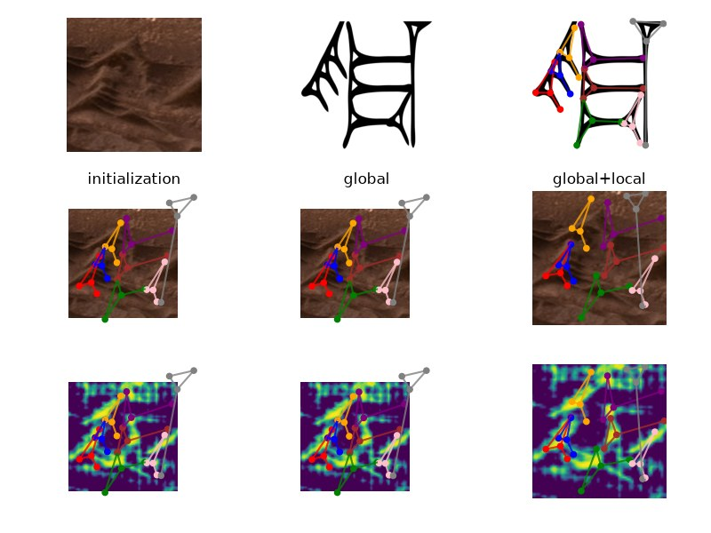
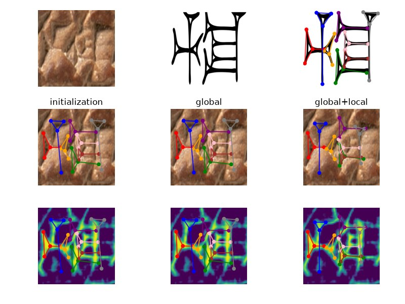
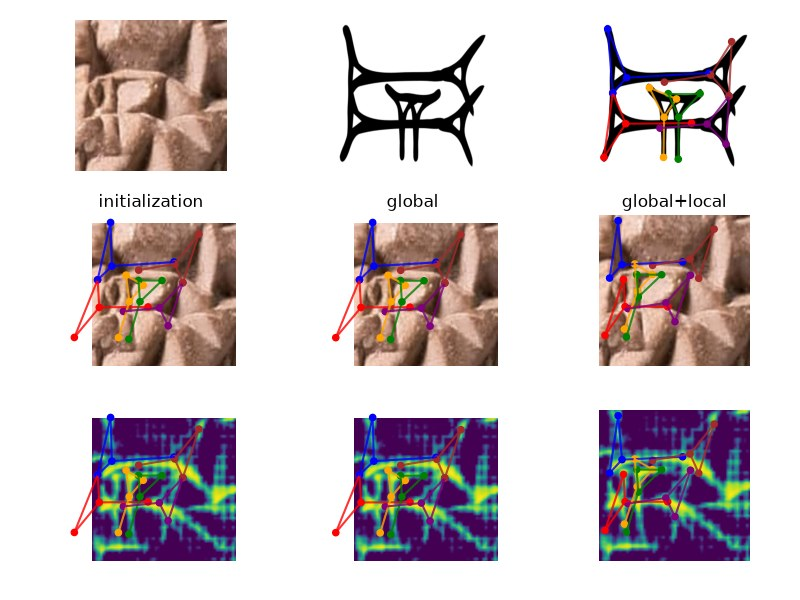
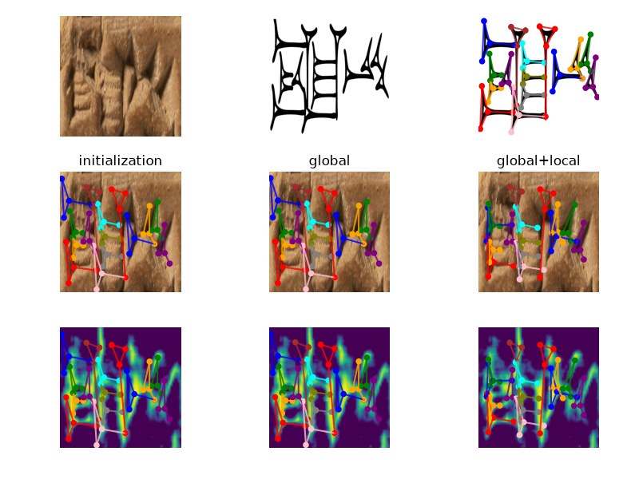
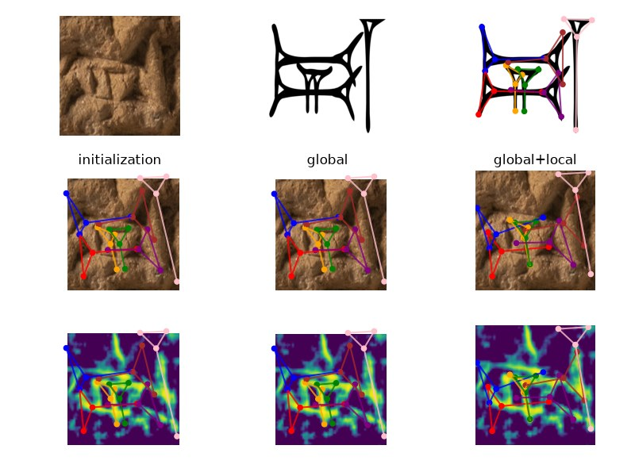
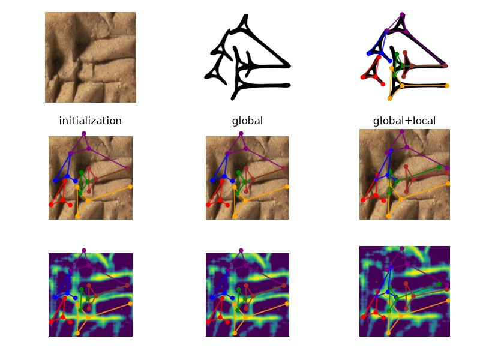
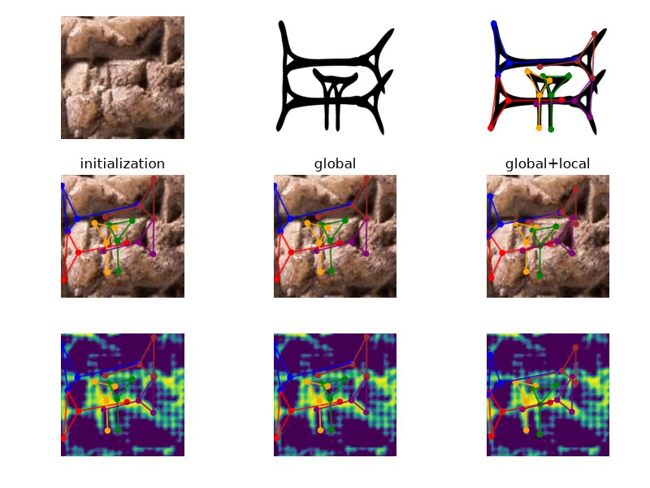
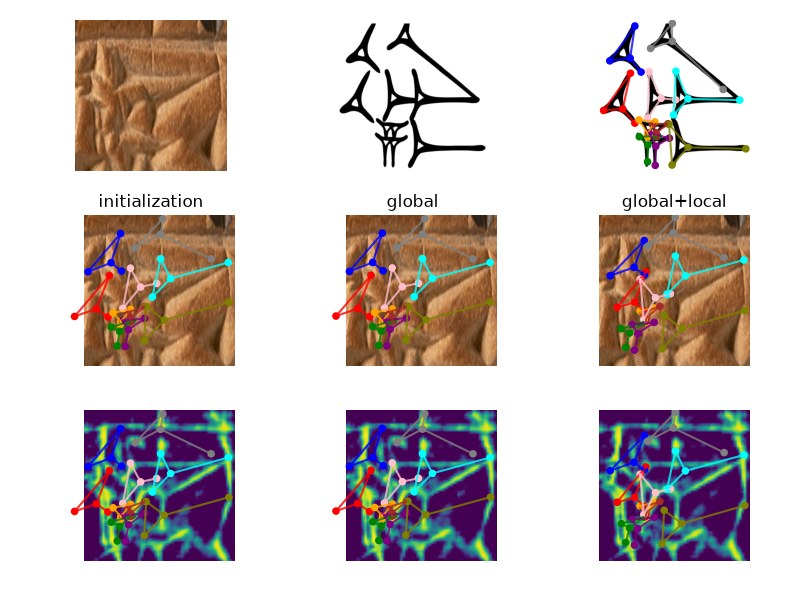
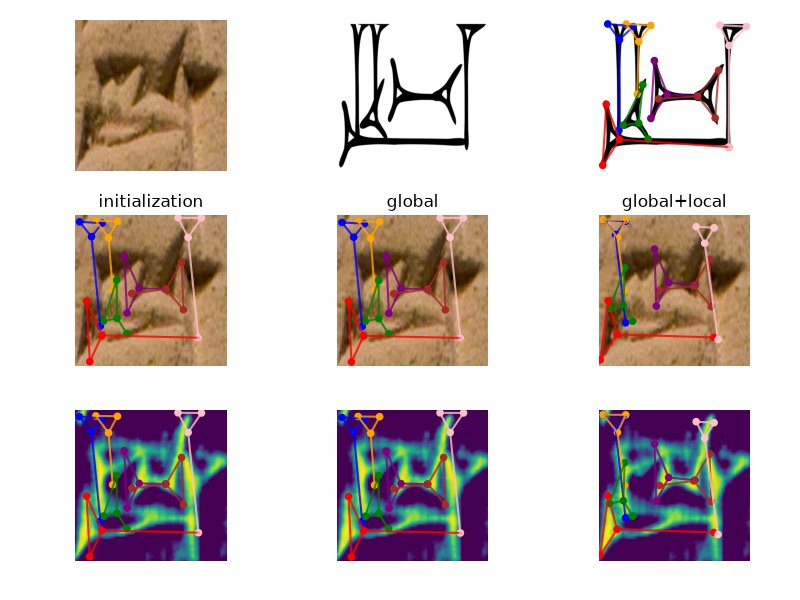
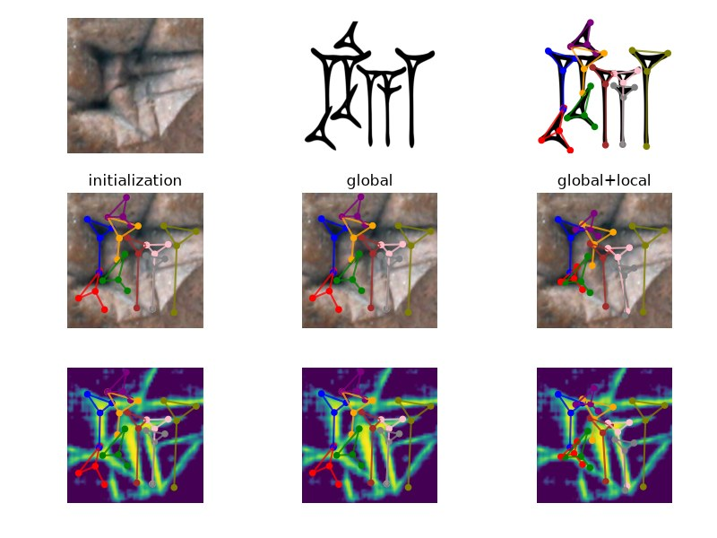

# ProtoSnap on Esagil (Neo-Babylonian): a random sample of results

This page shows 10 results drawn at random (seed 7) from the Esagil run in `output/singleSigns_Esagil_New/`. They are not selected for quality.

## What this is

ProtoSnap aligns a font-derived **prototype** of a cuneiform sign, with a **skeleton** recording each wedge as a small stroke graph, to a photograph of that sign. Until recently the repository had skeletons only for the Santakku (Old Babylonian) and Assurbanipal (Neo-Assyrian) fonts, so Neo-Babylonian signs could not be processed. The 48 skeletons now in `skeletons/Esagil/` were generated with **ProtoSnapVectorMapper** [1], which predicts ProtoSnap-format skeletons (`*_adf.csv` points, `*_con.csv` connectivity) directly from rendered font glyphs and provides a browser editor for reviewing them, instead of annotating every sign by hand.

The run uses the Neo-Babylonian sign photographs of the eBL sign-crop dataset (`singleSignImages/`, listed in `test_set/singleSigns_Esagil.csv`) whose sign has an Esagil prototype and skeleton:

```
python run_test.py --samples_df_path test_set/singleSigns_Esagil.csv --font_dir prototypes/Esagil --con_dir skeletons/Esagil --output_folder singleSigns_Esagil_New --ignore_errors
```

At the time of writing 73 of 1227 listed signs had finished. The **initialisation score** quoted below is ProtoSnap's own agreement measure for the initial placement (0 to 1, higher is better); over the finished results its median is 0.70 (range 0.38 to 0.98). It is not an accuracy: there is no ground truth for these alignments, so the panels have to be judged by eye.

## How to read a panel

Each panel is ProtoSnap's `itr99_viz.png`. Top row: the photographed sign, the font prototype, and the prototype with its skeleton (one colour per wedge). Middle row: the skeleton drawn on the photograph at initialisation, after the global transform, and after the per-stroke refinement. Bottom row: the same three stages over the diffusion-feature similarity map that drives the alignment. A good result has every coloured stroke lying along a wedge in the right-hand column.

## The sample

| # | result | sign | Unicode | tablet | init score |
|---|---|---|---|---|---|
| 1 | `HS.445_162` | HI TIMES ASH2 | 𒄯 `0x1212f` | HS.445 | 0.71 |
| 2 | `BM.38537_82` | DAR | 𒁯 `0x1206f` | BM.38537 | 0.68 |
| 3 | `HS.452_309` | GA | 𒂵 `0x120b5` | HS.452 | 0.64 |
| 4 | `BM.33393_8` | DARA3 | 𒁰 `0x12070` | BM.33393 | 0.75 |
| 5 | `BM.35034_4` | TA | 𒋫 `0x122eb` | BM.35034 | 0.71 |
| 6 | `BM.36456_25` | PIRIG | 𒊊 `0x1228a` | BM.36456 | 0.77 |
| 7 | `HS.452_131` | GA | 𒂵 `0x120b5` | HS.452 | 0.84 |
| 8 | `BM.34110_144` | PIRIG TIMES ZA | 𒊍 `0x1228d` | BM.34110 | 0.75 |
| 9 | `K.2162_10` | HUB2 | 𒄸 `0x12138` | K.2162 | 0.81 |
| 10 | `BM.42333_56` | SHA3 TIMES A | 𒊯 `0x122af` | BM.42333 | 0.91 |

### 1. HI TIMES ASH2 𒄯 on HS.445



*`HS.445_162`: sign HI TIMES ASH2 (`0x1212f`), initialisation score 0.71.*

### 2. DAR 𒁯 on BM.38537



*`BM.38537_82`: sign DAR (`0x1206f`), initialisation score 0.68.*

### 3. GA 𒂵 on HS.452



*`HS.452_309`: sign GA (`0x120b5`), initialisation score 0.64.*

### 4. DARA3 𒁰 on BM.33393



*`BM.33393_8`: sign DARA3 (`0x12070`), initialisation score 0.75.*

### 5. TA 𒋫 on BM.35034



*`BM.35034_4`: sign TA (`0x122eb`), initialisation score 0.71.*

### 6. PIRIG 𒊊 on BM.36456



*`BM.36456_25`: sign PIRIG (`0x1228a`), initialisation score 0.77.*

### 7. GA 𒂵 on HS.452



*`HS.452_131`: sign GA (`0x120b5`), initialisation score 0.84.*

### 8. PIRIG TIMES ZA 𒊍 on BM.34110



*`BM.34110_144`: sign PIRIG TIMES ZA (`0x1228d`), initialisation score 0.75.*

### 9. HUB2 𒄸 on K.2162



*`K.2162_10`: sign HUB2 (`0x12138`), initialisation score 0.81.*

### 10. SHA3 TIMES A 𒊯 on BM.42333



*`BM.42333_56`: sign SHA3 TIMES A (`0x122af`), initialisation score 0.91.*

## Sources

1. onetwothreefourfivesixe, *ProtoSnapVectorMapper*: automatic generation of ProtoSnap prototype skeletons from cuneiform font glyphs, with a review editor. https://github.com/onetwothreefourfivesixe/ProtoSnapVectorMapper
2. Rachel Mikulinsky, Morris Alper, Shai Gordin, Enrique Jiménez, Yoram Cohen, Hadar Averbuch-Elor, *ProtoSnap: Prototype Alignment for Cuneiform Signs*, ICLR 2025. https://arxiv.org/abs/2502.00129
3. Or Lewenstein et al., *A Large-Scale Dataset of Annotated Cuneiform Sign Images for Digital Palaeography*, Journal of Open Humanities Data, 2026 (the sign photographs). https://doi.org/10.5334/johd.503

Regenerate this page with `python add_new_font_skeletons/sampleResults.py --seed 7`.
