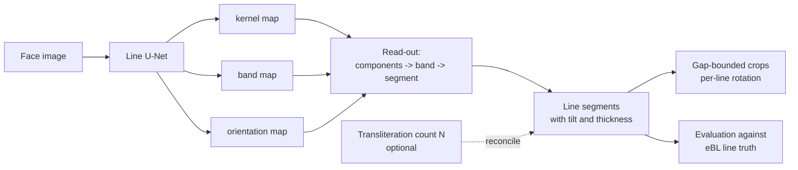
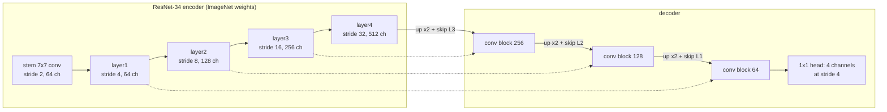
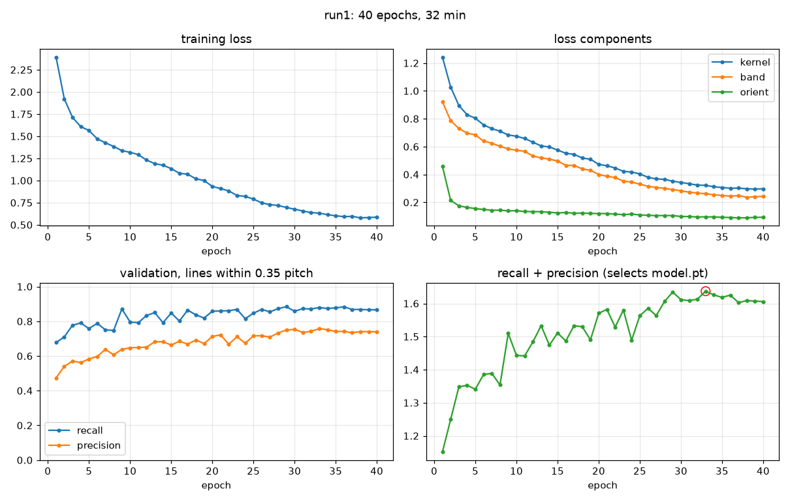
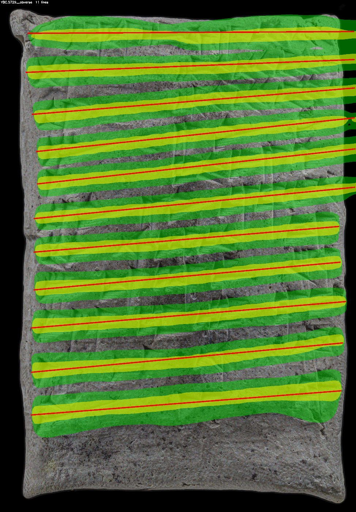
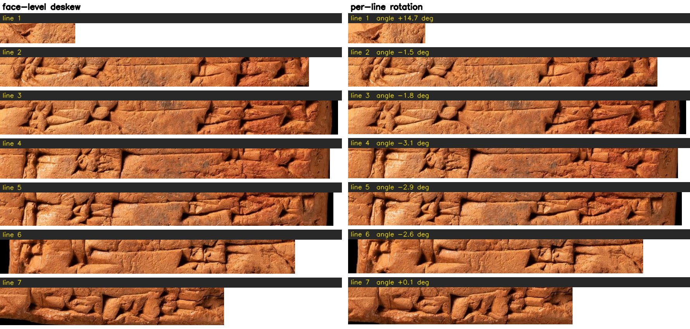
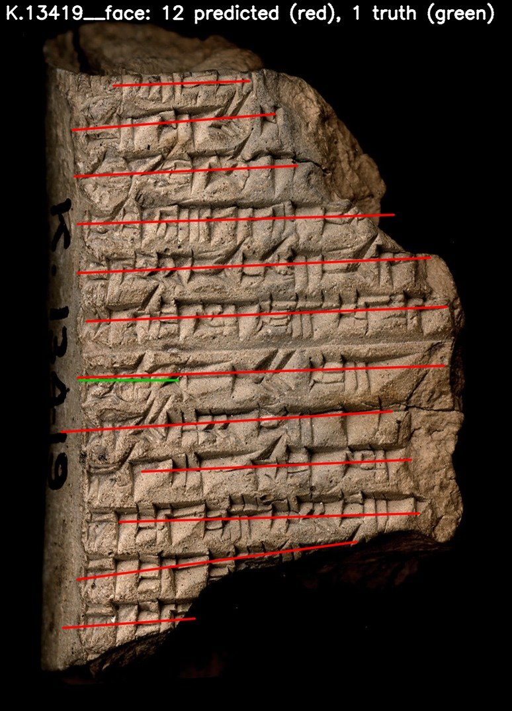

# The line model: architecture, process, planning and output

This document describes the learned line segmenter added to the line-cropping pipeline as its Phase 7: why it was built, how it is trained, what it produces, and how it performs against the detector route it is meant to replace. It is written for a reader who knows OCR and object detection; terms specific to this project are defined where they first appear, and the rest of the pipeline is described in `docs/pipeline_overview.md`. The planning text is section 14 of `docs/line_cropping_plan.md`; commands and per-step outputs are in the Phase 7 section of `line_cropping/README.md`. Code lives in `line_cropping/linemodel/`.

## 1. Why a line model

The pipeline's first line finder infers lines from detected signs: the eBL Deformable DETR detector [1] finds sign boxes, the boxes are clustered by height into lines, and the transliteration's line count **N** reconciles the result. On eBL-quality photographs with a transliteration it reaches 0.91 line recall. Its two dependencies are exactly what a new tablet lacks: without N, recall stays at 0.87 but count agreement drops to 25 percent, and where the detector finds too few signs, as on the low-resolution Old Assyrian photographs, the route fails. Both dependencies come from inferring lines through signs. The line model predicts lines from the face image directly, so neither a transliteration nor a sign detector is needed at line-finding time; both remain available as optional refinements.



## 2. Planning summary

The plan (section 14) fixed the design before any code: input a face image at 1,024 pixels on the long side, not deskewed; three output maps painted from the existing oriented-segment ground truth; a U-Net with a pretrained ResNet-34 encoder; training on the tune half of the Phase 5 split only; evaluation with the unchanged Phase 5 harness against the detector route's numbers on the same test faces; a transfer test from eBL to Old Assyrian faces; and an order of work that starts with rendering and inspecting the targets. The implementation followed that order, and two of the plan's stated risks materialised and were handled: partial annotation (section 3) and the small Neo-Assyrian training share (section 7).

## 3. Training data

**Ground truth.** A **truth line** is an oriented segment, the least-squares centre line through the eBL sign boxes of one text line, with a thickness. Phase 1 produced 9,296 such lines on eBL faces. The 785 hand-marked Old Assyrian lines from the Line Marker page are line centres in a deskewed frame; `targets.oa_segments()` converts them to segments in the unrotated face with a thickness of 0.6 pitch. **Pitch** is the median centre-to-centre distance between consecutive lines on a face and is the unit for all tolerances.

**Split.** Training uses only eBL faces in the Phase 5 **tune** split, plus the labelled Old Assyrian faces; 10 percent of training tablets are held back as validation. Test faces never enter training, so the numbers in section 8 are uncontaminated.

**Coverage rule.** eBL annotation is partial (a median of 86 percent of a face's lines), and an unannotated line painted as background would teach the model to miss lines. Only faces with coverage of at least 0.9 are used. That gave 302 training faces with 2,897 lines and 38 validation faces, but only 16 Neo-Assyrian faces, a shortfall visible in the results.

**Targets.** Five maps at one quarter of the input resolution, painted from the segments:

| channel | content | purpose |
|---|---|---|
| kernel | each line's band shrunk to 40 percent of its width | one connected region per line, so neighbours never merge |
| band | the line's band, width = min(truth thickness, 0.7 pitch) | the line's vertical extent for cropping |
| orientation, two channels | sin 2θ and cos 2θ of the line direction, inside the band | tilt and curvature without a global deskew |
| ignore | gaps between consecutive lines wider than 1.5 pitches, and one pitch beyond the first and last line of a block | pixels where a line may be missing carry no loss |

The band width is capped by the pitch because eBL sign boxes are as tall as the pitch itself; painted from the raw thickness, adjacent bands merged into one mass (the first render showed exactly that).


*Figure 1. Targets on HS.2027 reverse: green band, yellow kernel, red hatching where the loss is ignored above the first and below the last annotated line.*


*Figure 2. The same targets on an Old Assyrian face, P358252 obverse, built from hand-marked line centres.*

## 4. Architecture



A **convolution** slides a small learned filter over the image and responds where the local pattern matches; stacked layers respond to progressively larger structures, from wedge edges to whole lines. **ResNet-34** is 16 residual blocks in four stages, each halving resolution and doubling channels; the residual addition around each block keeps a 34-layer stack trainable and the ImageNet weights give it edge and texture detectors from the start, which matters with a few hundred training faces. A **U-Net** attaches a decoder that upsamples back towards input resolution and, at each step, concatenates the encoder's map of the same resolution through a **skip connection**, so wide context (which row is a line) and fine position (where its edges are) are combined. The decoder stops at stride 4, one quarter resolution, since a line's position needs only pixel-level accuracy at that scale and it makes the network four times cheaper. The head is a 1 by 1 convolution to four channels: kernel logit, band logit, sin 2θ, cos 2θ. 24.4 million weights in total.

**Loss.** Binary cross-entropy plus Dice on the kernel and band maps, and an L1 error on the two orientation channels inside bands, weighted one half; ignore pixels are excluded from every term. Dice measures region overlap as a whole and prevents the trivial "no line anywhere" solution that per-pixel cross-entropy alone would tolerate when lines are a small minority of pixels.

## 5. Training process

Training windows are random 768-pixel squares from the face resized to 1,024 pixels on its long side, centred near a randomly chosen line, with scale augmentation between 0.5 and 2, rotation of up to 4 degrees, brightness and contrast jitter, a 15 percent chance of polarity inversion for light-background museum photographs, greyscale conversion, and JPEG re-encoding. No horizontal flips, which would mirror the script. AdamW with a one-cycle learning-rate schedule, mixed precision, batch size 6, gradient clipping at 2.

After each epoch the model runs on the validation faces through the real read-out of section 6, and line recall and precision at 0.35 pitch are computed against the validation truth. The checkpoint with the best recall plus precision is kept as `model.pt`. This means the selection criterion is the line-level measure the project cares about, not the pixel loss.

The first run, `weights/linemodel/run1`, trained 40 epochs in 32 minutes on an RTX 4060. The loss falls smoothly, orientation converges within a few epochs, kernel and band keep improving to the end, and validation recall rises from 0.68 to about 0.88 with precision from 0.47 to about 0.76; epoch 33 was selected.



*Figure 3. run1: training loss and its components, validation recall and precision per epoch, and the selection score with the saved epoch circled. Produced by `visualize.py`.*

## 6. Read-out: from maps to lines

The face goes through the network once at 1,024 pixels. Kernel probabilities above 0.5 are thresholded and split into connected components; components under 12 pixels (at stride 4) are dropped. Every band pixel above 0.4 joins its nearest kernel component, but only within 1.5 kernel heights of it, a limit added after a stray speck of band far from any kernel was assigned to one and stretched a segment across a whole face. A principal-component line through each component's band pixels gives the segment's endpoints, and twice the mean perpendicular spread gives its thickness. Because text lines on one face share a direction, segments more than 45 degrees off the face's median angle are dropped; this removed the near-vertical false detections seen on worn faces. Finally, segments that are fragments of one line, at the same height and side by side, are merged into a single segment (see section 9).

Segments are written both raw (`unet_segments/<face>.csv`) and in the pipeline's line format (`unet/<face>.csv`: centre height in a frame rotated by the face's median line angle), so every downstream tool and evaluator accepts them unchanged.



*Figure 4. Model output on YBC.5729 obverse: predicted band in green, kernel in lime, read-out segments in red.*

**Optional count reconciliation.** `infer.py --use-n` applies the detector route's rules where a transliteration exists: lines are interpolated into gaps wider than 1.5 pitches or appended at the median pitch when too few were found, and the closest pair is merged when too many. Written as method `unet_n`. Without it the model's own count stands.

## 7. Crops from the model's lines

The gap-bounded crop of Phase 4 gained a `segments` mode: each line's vertical extent is its predicted band, and the boundary to a neighbour is the midpoint of the gap between the two bands, or of the two centres where bands overlap. A `--rotate-per-line` option cuts each line in its own frame, rotated about the line's centre by its predicted angle, instead of the single face-wide deskew; it is applied only when the line's angle lies within 20 degrees of the face skew, so a spurious segment cannot turn a crop sideways. On the test split the per-line crops place 95 percent of truth line centres in exactly one crop against 97 percent for the face-frame crops; the evaluator measures containment in the face frame, which slightly understates rotated crops, so the two are best treated as equivalent on these mostly flat faces.



*Figure 5. All seven lines of HS.2450 obverse, cut in the face-wide deskewed frame (left) and each in its own frame (right), drawn at one common scale; each bar gives the line number and, on the right, the line's own angle. On this face the lines differ from the face skew by only a few degrees, so the two columns are close; the per-line frame matters on warped faces where line angles diverge more. Line 1 is a short surviving fragment at the broken top edge.*

## 8. Output and results

Everything below is on the Phase 5 **test** split, which the model never saw. A line counts as found within 0.35 pitch of a truth centre; precision is reported only on faces with coverage of at least 0.9.

| method | recall | precision | first line within 0.5 pitch | count = N | crops: truth centre in exactly one crop | crops with an ATF label | ATF signs matched to a box / box confirmed by truth (OB) |
|---|---|---|---|---|---|---|---|
| line model, no transliteration (`unet`) | 0.85 | 0.88 | 81% | 29% | 97% | 20% | too few labelled lines |
| line model, count reconciled (`unet_n`) | 0.83 | 0.85 | 81% | 85% | 97% | 72% | 54% / 67% |
| detector route with count (`det_n`) | 0.91 | 0.91 | 90% | 85% | 99% | 73% | 53% / 66% |

By script, `unet` reaches 0.87 recall at 0.87 precision on Old Babylonian, three points behind the detector route, and 0.81 recall at 0.91 precision on Neo-Assyrian, where the first line is placed within half a pitch on only 45 percent of faces; those are the 16-face training script. Downstream the two routes are at parity: the crops are equally clean, and the transliteration-to-box alignment through the line model's crops matches the detector route's figures.


*Figure 6. The model's twelve lines (red) and the truth (green) on the original composite photograph of YBC.5729; no transliteration was used.*



*Figure 7. K.13419: the model finds twelve lines on a face whose eBL annotation covers one, which is why every score here is conditioned on coverage.*

**Files.** Per run: `weights/linemodel/<run>/{model.pt, last.pt, history.csv, config.json, plots/}`. Per inference: `ebl_tablets/predictions/{unet, unet_n}/<face>.csv`, `unet_segments/<face>.csv`, and rows in `faces_run.csv`; optional overlays in `unet_viz/`. Crops: `ebl_tablets/line_crops_unet*/` with `crops.csv` (rectangle, skew, per-line angle, ATF label). Whole-tablet overlays: `ebl_tablets/linemodel/prediction_overlays/`.

## 9. Known failure modes and next steps

- **Neo-Assyrian recall and first line.** Sixteen training faces is too few. The first lever is `--min-cov 0.8`, which admits more Neo-Assyrian faces at some label noise; the second is downloading the Neo-Babylonian eBL tablets, which adds a third script to training and evaluation.
- **Read-out precision.** The network outputs probabilities; the read-out of section 6 turns them into discrete lines with three hand-set numbers that have never been tuned. The **kernel threshold** (0.5) decides which pixels count as a line's core: set too low, faint texture and cracks form spurious kernels, each of which becomes a false line; set too high, weak lines on worn surfaces lose their kernel and are missed. The **band threshold** (0.4) decides how far each line's band extends; it barely affects which lines are found, but it sets the band thickness used for crop boundaries. The **minimum area** (12 pixels at stride 4) discards kernel components too small to be a line; set too low, specks survive as lines, too high, short lines at the edge of a fragment are dropped. These trade recall against precision, and precision is where the model trails the detector route most. The fix is a grid sweep: run the model once on the 38 validation faces, keep the raw maps, re-run only the read-out for each combination (for example kernel threshold 0.3 to 0.7 in steps of 0.05, minimum area 4 to 40), score line recall and precision against the validation truth, and keep the combination with the best sum, the same criterion that selects the checkpoint. Because the read-out is separate from the network, this needs no retraining and takes minutes. It must use the validation faces, not the test faces, or the test numbers stop being an honest measure.

  One read-out defect has already been fixed this way, by inspection rather than a sweep: the kernel map sometimes splits one text line into two or three side-by-side pieces at the same height, and each piece became a separate predicted line. `merge_fragments` now joins segments whose centres lie within half a band thickness of each other vertically and whose horizontal ranges barely overlap. On the test split this raised precision from 0.84 to 0.88 for one point of recall (0.86 to 0.85), and it is why section 8 quotes the post-merge figures.
- **Worn faces.** On heavily eroded faces the model can report cracks and edge texture as lines (Figure 8). The 45-degree angle guard removes the near-vertical ones; the horizontal ones remain and are the case for a per-face confidence score.
- **Straight-segment truth.** Curved lines are represented as straight segments in the truth, so the model may learn straight bands on warped faces; the Old Assyrian labels, which are centres, are the check.


*Figure 8. HS.2050 obverse before the angle guard: near-vertical false segments on a worn face with a single annotated line.*

## 10. How to run

```
python -m line_cropping.linemodel.targets --preview 12
MPLBACKEND=Agg .venv/bin/python -m line_cropping.linemodel.train --epochs 40 --out weights/linemodel/run1
.venv/bin/python -m line_cropping.linemodel.infer --weights weights/linemodel/run1/model.pt --faces ebl_tablets/faces/faces.csv --out ebl_tablets/predictions --split test [--use-n] [--viz 8]
.venv/bin/python -m line_cropping.eval.evaluate_lines --faces ebl_tablets/faces/faces.csv --pred ebl_tablets/predictions
.venv/bin/python -m line_cropping.crops.make_crops --faces ebl_tablets/faces/faces.csv --pred ebl_tablets/predictions --method unet --bounds segments --rotate-per-line --split test --out ebl_tablets/line_crops_unet
.venv/bin/python -m line_cropping.linemodel.render_predictions --n 10
```

## 11. Sources

1. Wentao Che et al., *Automated sign detection across the Electronic Babylonian Library*, 2026. https://arxiv.org/abs/2606.22608 (the detector the line model is compared against)
2. Olaf Ronneberger, Philipp Fischer, Thomas Brox, *U-Net: Convolutional Networks for Biomedical Image Segmentation*, MICCAI 2015. https://arxiv.org/abs/1505.04597
3. Kaiming He, Xiangyu Zhang, Shaoqing Ren, Jian Sun, *Deep Residual Learning for Image Recognition*, CVPR 2016. https://arxiv.org/abs/1512.03385
4. Wenhai Wang et al., *Shape Robust Text Detection with Progressive Scale Expansion Network* (PSENet), CVPR 2019, and Minghui Liao et al., *Real-time Scene Text Detection with Differentiable Binarization* (DBNet), AAAI 2020: the kernel-and-band recipe the targets follow. https://arxiv.org/abs/1903.12473, https://arxiv.org/abs/1911.08947
5. Rachel Mikulinsky et al., *ProtoSnap: Prototype Alignment for Cuneiform Signs*, ICLR 2025. https://arxiv.org/abs/2502.00129
