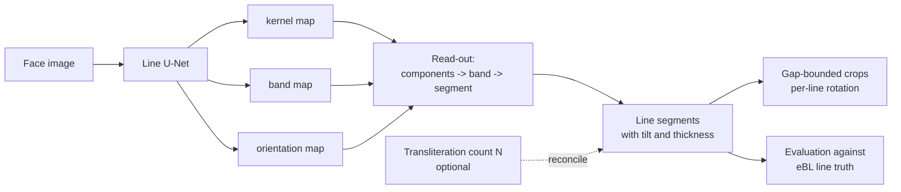
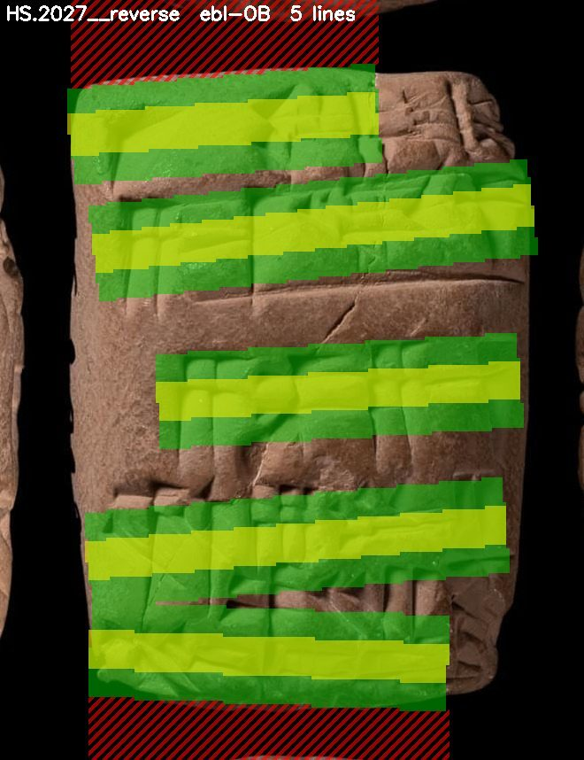
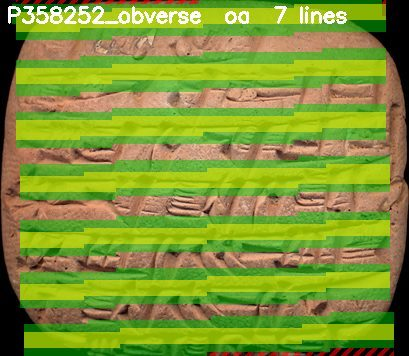
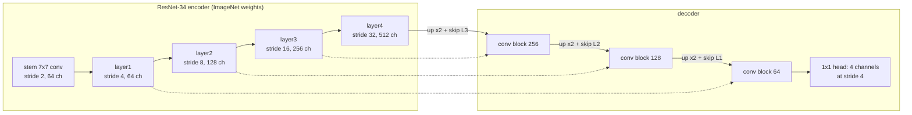
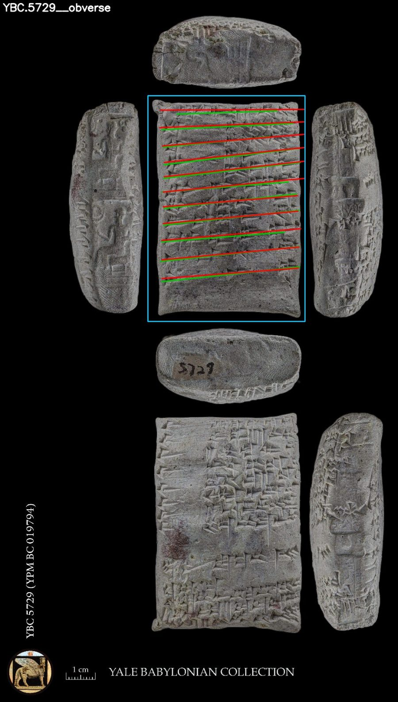
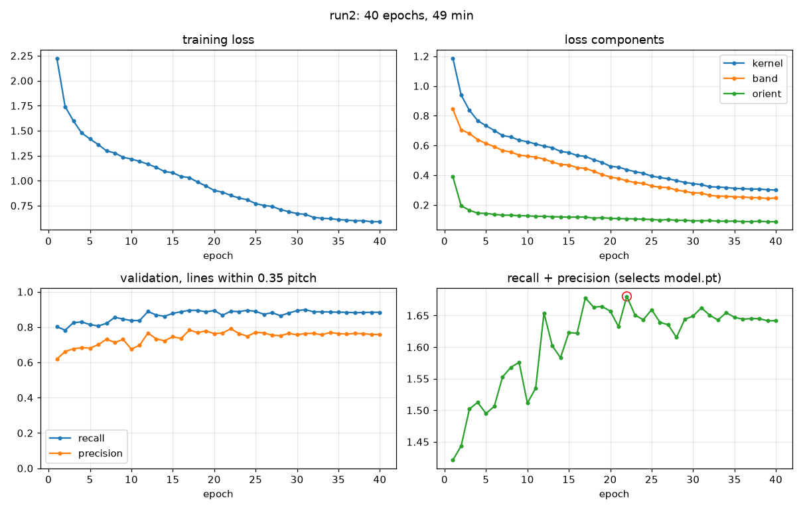
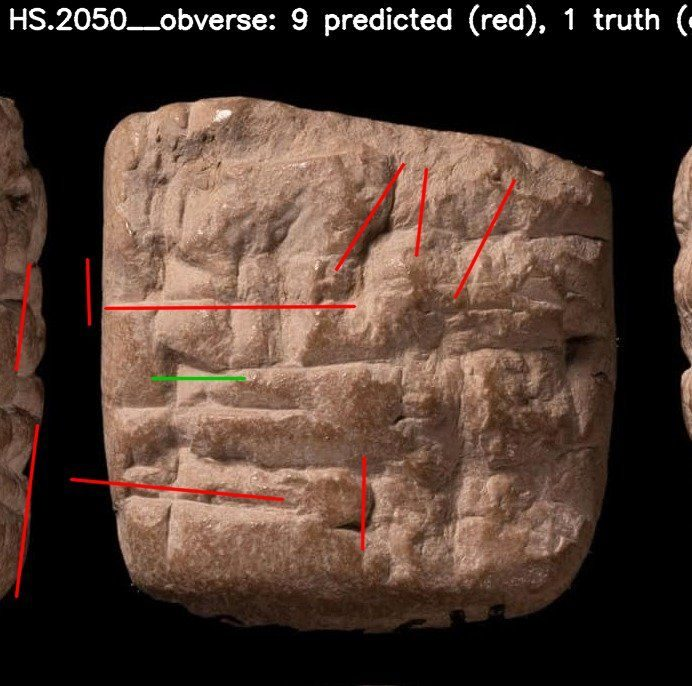
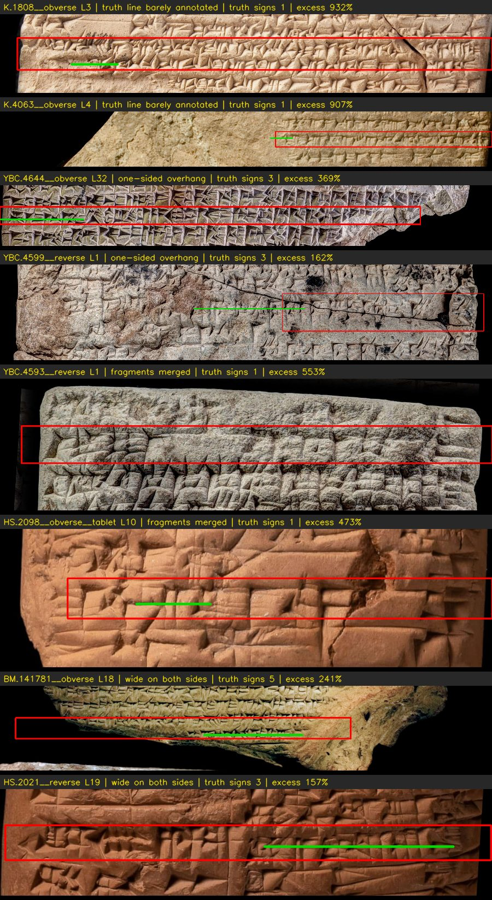
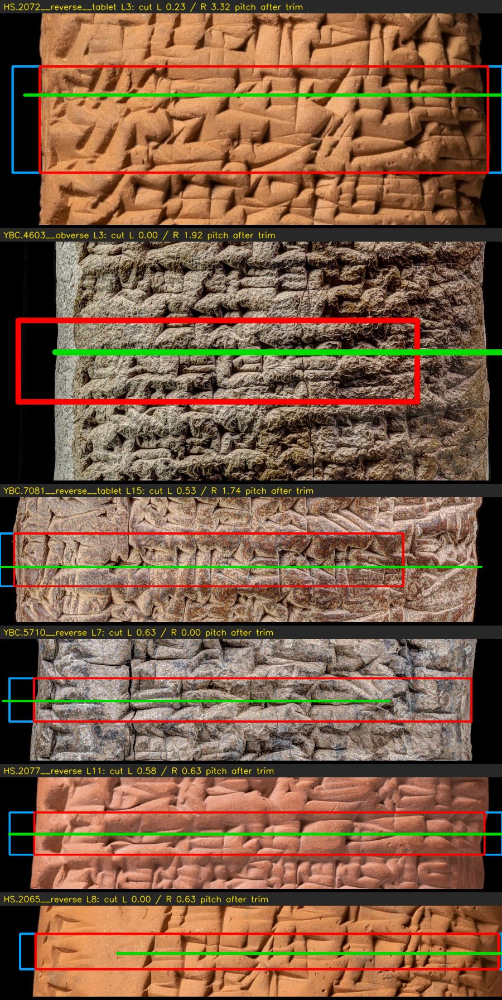

# The line model: architecture, process, planning and output

This document describes the learned line segmenter added to the line-cropping pipeline as its Phase 7: why it was built, how it is trained, what it produces, and how it performs against the detector route it is meant to replace. It is written for a reader who knows OCR and object detection; terms specific to this project are defined where they first appear, and the rest of the pipeline is described in `docs/line_cropping/pipeline_overview.md`. The planning text is section 14 of `docs/line_cropping/line_cropping_plan.md`; commands and per-step outputs are in the Phase 7 section of `line_cropping/README.md`. Code lives in `line_cropping/linemodel/`.

## 1. Why a line model

The pipeline's first line finder infers lines from detected signs: the eBL Deformable DETR detector [1] finds sign boxes, the boxes are clustered by height into lines, and the transliteration's line count **N** reconciles the result. On eBL-quality photographs with a transliteration it reaches 0.91 line recall. Its two dependencies are exactly what a new tablet lacks: without N, recall stays at 0.87 but count agreement drops to 25 percent, and where the detector finds too few signs, as on the low-resolution Old Assyrian photographs, the route fails. Both dependencies come from inferring lines through signs. The line model predicts lines from the face image directly, so neither a transliteration nor a sign detector is needed at line-finding time; both remain available as optional refinements.



## 2. Planning summary

The plan (section 14) fixed the design before any code: input a face image at 1,024 pixels on the long side, not deskewed; three output maps painted from the existing oriented-segment ground truth; a U-Net with a pretrained ResNet-34 encoder; training on the tune half of the Phase 5 split only; evaluation with the unchanged Phase 5 harness against the detector route's numbers on the same test faces; a transfer test from eBL to Old Assyrian faces; and an order of work that starts with rendering and inspecting the targets. The implementation followed that order, and two of the plan's stated risks materialised and were handled: partial annotation (section 3) and the small Neo-Assyrian training share (section 7).

## 3. Training data

**Ground truth.** A **truth line** is an oriented segment, the least-squares centre line through the eBL sign boxes of one text line, with a thickness. Phase 1 produced 9,296 such lines on eBL faces. The 785 hand-marked Old Assyrian lines from the Line Marker page are line centres in a deskewed frame; `targets.oa_segments()` converts them to segments in the unrotated face with a thickness of 0.6 pitch. **Pitch** is the median centre-to-centre distance between consecutive lines on a face and is the unit for all tolerances.

**Split.** Training uses only eBL faces in the Phase 5 **tune** split, plus the labelled Old Assyrian faces; 10 percent of training tablets are held back as validation. Test faces never enter training, so the numbers in section 8 are uncontaminated.

**Coverage rule.** eBL annotation is partial (a median of 86 percent of a face's lines), and an unannotated line painted as background would teach the model to miss lines. Only faces with coverage of at least 0.9 are used. That gave 302 training faces with 2,897 lines and 38 validation faces, but only 16 Neo-Assyrian faces, a shortfall visible in the results.

**Targets.** Five maps at one quarter of the input resolution, painted from the segments:

| channel | content | purpose |
|---|---|---|
| kernel | each line's band shrunk to 40 percent of its width | one connected region per line, so neighbours never merge |
| band | the line's band, width = min(truth thickness, 0.7 pitch) | the line's vertical extent for cropping |
| orientation, two channels | sin 2θ and cos 2θ of the line direction, inside the band | tilt and curvature without a global deskew |
| ignore | gaps between consecutive lines wider than 1.5 pitches, and one pitch beyond the first and last line of a block | pixels where a line may be missing carry no loss |

The band width is capped by the pitch because eBL sign boxes are as tall as the pitch itself; painted from the raw thickness, adjacent bands merged into one mass (the first render showed exactly that).



*Figure 1. Targets on HS.2027 reverse: green band, yellow kernel, red hatching where the loss is ignored above the first and below the last annotated line.*



*Figure 2. The same targets on an Old Assyrian face, P358252 obverse, built from hand-marked line centres.*

## 4. Architecture



A **convolution** slides a small learned filter over the image and responds where the local pattern matches; stacked layers respond to progressively larger structures, from wedge edges to whole lines. **ResNet-34** is 16 residual blocks in four stages, each halving resolution and doubling channels; the residual addition around each block keeps a 34-layer stack trainable and the ImageNet weights give it edge and texture detectors from the start, which matters with a few hundred training faces. A **U-Net** attaches a decoder that upsamples back towards input resolution and, at each step, concatenates the encoder's map of the same resolution through a **skip connection**, so wide context (which row is a line) and fine position (where its edges are) are combined. The decoder stops at stride 4, one quarter resolution, since a line's position needs only pixel-level accuracy at that scale and it makes the network four times cheaper. The head is a 1 by 1 convolution to four channels: kernel logit, band logit, sin 2θ, cos 2θ. 24.4 million weights in total.

**Loss.** Binary cross-entropy plus Dice on the kernel and band maps, and an L1 error on the two orientation channels inside bands, weighted one half; ignore pixels are excluded from every term. Dice measures region overlap as a whole and prevents the trivial "no line anywhere" solution that per-pixel cross-entropy alone would tolerate when lines are a small minority of pixels.

## 5. Training process

Training windows are random 768-pixel squares from the face resized to 1,024 pixels on its long side, centred near a randomly chosen line, with scale augmentation between 0.5 and 2, rotation of up to 4 degrees, brightness and contrast jitter, a 15 percent chance of polarity inversion for light-background museum photographs, greyscale conversion, and JPEG re-encoding. No horizontal flips, which would mirror the script. AdamW with a one-cycle learning-rate schedule, mixed precision, batch size 6, gradient clipping at 2.

After each epoch the model runs on the validation faces through the real read-out of section 6, and line recall and precision at 0.35 pitch are computed against the validation truth. The checkpoint with the best recall plus precision is kept as `model.pt`. This means the selection criterion is the line-level measure the project cares about, not the pixel loss.

The first run, `weights/linemodel/run1`, trained 40 epochs in 32 minutes on an RTX 4060. The loss falls smoothly, orientation converges within a few epochs, kernel and band keep improving to the end, and validation recall rises from 0.68 to about 0.88 with precision from 0.47 to about 0.76; epoch 33 was selected.


*Figure 3. run1: training loss and its components, validation recall and precision per epoch, and the selection score with the saved epoch circled. Produced by `visualize.py`.*

## 6. Read-out: from maps to lines

The face goes through the network once at 1,024 pixels. Kernel probabilities above 0.5 are thresholded and split into connected components; components under 12 pixels (at stride 4) are dropped. Every band pixel above 0.4 joins its nearest kernel component, but only within 1.5 kernel heights of it, a limit added after a stray speck of band far from any kernel was assigned to one and stretched a segment across a whole face. A principal-component line through each component's band pixels gives the segment's endpoints, and twice the mean perpendicular spread gives its thickness. Because text lines on one face share a direction, segments more than 45 degrees off the face's median angle are dropped; this removed the near-vertical false detections seen on worn faces. Finally, segments that are fragments of one line, at the same height and side by side, are merged into a single segment (see section 9). Last, each line's ends are refined: they are pushed outward along the line while the band probability stays above 0.2 (at most three kernel heights per end), then pulled back off any stretch where the line lies over the studio background rather than clay. This runs after the merge, because extended fragments overlap and would no longer be recognised as pieces of one line. Both settings were chosen in crop width Test 2 (section 10) and can be turned off with `--end-thr 0 --clip-tablet 0`.

Segments are written both raw (`unet_segments/<face>.csv`) and in the pipeline's line format (`unet/<face>.csv`: centre height in a frame rotated by the face's median line angle), so every downstream tool and evaluator accepts them unchanged.


*Figure 4. Model output on YBC.5729 obverse: predicted band in green, kernel in lime, read-out segments in red.*

**Optional count reconciliation.** `infer.py --use-n` applies the detector route's rules where a transliteration exists: lines are interpolated into gaps wider than 1.5 pitches or appended at the median pitch when too few were found, and the closest pair is merged when too many. Written as method `unet_n`. Without it the model's own count stands.

## 7. Crops from the model's lines

The gap-bounded crop of Phase 4 gained a `segments` mode: each line's vertical extent is its predicted band, and the boundary to a neighbour is the midpoint of the gap between the two bands, or of the two centres where bands overlap. A `--rotate-per-line` option cuts each line in its own frame, rotated about the line's centre by its predicted angle, instead of the single face-wide deskew; it is applied only when the line's angle lies within 20 degrees of the face skew, so a spurious segment cannot turn a crop sideways. On the test split the per-line crops place 95 percent of truth line centres in exactly one crop against 97 percent for the face-frame crops; the evaluator measures containment in the face frame, which slightly understates rotated crops, so the two are best treated as equivalent on these mostly flat faces.


*Figure 5. All seven lines of HS.2450 obverse, cut in the face-wide deskewed frame (left) and each in its own frame (right), drawn at one common scale; each bar gives the line number and, on the right, the line's own angle. On this face the lines differ from the face skew by only a few degrees, so the two columns are close; the per-line frame matters on warped faces where line angles diverge more. Line 1 is a short surviving fragment at the broken top edge.*

## 8. Output and results

Everything below is on the Phase 5 **test** split, which the model never saw. A line counts as found within 0.35 pitch of a truth centre; precision is reported only on faces with coverage of at least 0.9.

| method | recall | precision | first line within 0.5 pitch | count = N | crops: truth centre in exactly one crop | crops with an ATF label | ATF signs matched to a box / box confirmed by truth (OB) |
|---|---|---|---|---|---|---|---|
| line model, no transliteration (`unet`) | 0.85 | 0.88 | 81% | 29% | 97% | 20% | too few labelled lines |
| line model, count reconciled (`unet_n`) | 0.83 | 0.85 | 81% | 85% | 97% | 72% | 54% / 67% |
| detector route with count (`det_n`) | 0.91 | 0.91 | 90% | 85% | 99% | 73% | 53% / 66% |

By script, `unet` reaches 0.87 recall at 0.87 precision on Old Babylonian, three points behind the detector route, and 0.81 recall at 0.91 precision on Neo-Assyrian, where the first line is placed within half a pitch on only 45 percent of faces; those are the 16-face training script. Downstream the two routes are at parity: the crops are equally clean, and the transliteration-to-box alignment through the line model's crops matches the detector route's figures.



*Figure 6. The model's twelve lines (red) and the truth (green) on the original composite photograph of YBC.5729; no transliteration was used.*


*Figure 7. K.13419: the model finds twelve lines on a face whose eBL annotation covers one, which is why every score here is conditioned on coverage.*

**Files.** Per run: `weights/linemodel/<run>/{model.pt, last.pt, history.csv, config.json, plots/}`. Per inference: `tablet_data/ebl_tablets/predictions/{unet, unet_n}/<face>.csv`, `unet_segments/<face>.csv`, and rows in `faces_run.csv`; optional overlays in `unet_viz/`. Crops: `tablet_data/ebl_tablets/line_crops_unet*/` with `crops.csv` (rectangle, skew, per-line angle, ATF label). Whole-tablet overlays: `tablet_data/ebl_tablets/linemodel/prediction_overlays/`.

### Run 2: Old Assyrian and Neo-Babylonian training data (3 Oct 2026)

**Why.** Section 9 named training data as the main lever, above all for scripts with few faces. The sign-snippet
metadata turned out to hold no new usable Neo-Assyrian or Old Babylonian tablets (every NA/OB tablet with line-labelled
snippets was already downloaded), but it and the eBL annotation export of 11 Sep 2026 (`annotations_11.09.2026.json`,
10,196 fragments, 236,000 boxes; identical to the API's boxes on the 200 downloaded tablets checked) list well-annotated
tablets in other scripts. Old Assyrian (OA) was the priority, because the CDLI Old Assyrian set has no automatic truth,
and Neo-Babylonian (NB), whose script is close to Neo-Assyrian.

**Data.** `download_ebl.py --scripts OA NB --annotations-dump annotations_11.09.2026/annotations_11.09.2026.json`
fetched the 311 tablets with at least 50 boxes carrying a line path (83 OA, 228 NB; the NB group includes tablets eBL
dates to the Persian period), reading the boxes from the export and only the photo and transliteration from the API.
The truth builder and face cutter then ran unchanged; every pre-existing row of their tables came out identical. Of
602 new faces, 377 are single-column with coverage of at least 0.9 (OA 202 from 81 tablets, median 208 px per line;
NB 175 from 96 tablets, 153 px per line). `eval/extend_split.py` appended them to the Phase 5 split without moving any
existing face, splitting by tablet so that a tablet's obverse and reverse share a side (OA 118 tune / 108 test faces,
NB 174 / 192). The NA and OB test faces are untouched, so run 1 and run 2 are directly comparable on them.

| training set | eBL OB | eBL NA | eBL OA | eBL NB | OA hand labels | total |
|---|---|---|---|---|---|---|
| run 1 (train / val) | 205 / 24 | 16 / 7 | - | - | 81 / 7 | 302 / 38 |
| run 2 (train / val) | 202 / 27 | 20 / 3 | 93 / 17 | 70 / 4 | 79 / 9 | 464 / 60 |

**Training.** Same settings as run 1 (40 epochs, batch 6, learning rate 3e-4, seed 0), 49 minutes. Validation
recall and precision level off from about epoch 17 while the training loss keeps falling; the selected checkpoint is
epoch 22 (validation recall 0.89, precision 0.79; the validation slice was redrawn over the larger set, so these are
not comparable with run 1's).



*Figure 11. run2: training loss and components, validation recall and precision per epoch, and the selection score
with the saved epoch circled.*

**Test split** (both models with the Test 2 read-out; 759 faces with at least two truth lines):

| script (faces) | run 1 recall / precision | run 2 recall / precision | first line within 0.5 pitch, run 1 → run 2 | count match, run 1 → run 2 |
|---|---|---|---|---|
| all (759) | 0.81 / 0.81 | **0.87 / 0.88** | 76% → 84% | 27% → 31% |
| OA, new (90) | 0.61 / 0.60 | **0.92 / 0.91** | 73% → 89% | 37% → 49% |
| NB, new (183) | 0.79 / 0.83 | **0.85 / 0.85** | 65% → 82% | 17% → 25% |
| OB (327) | 0.87 / 0.87 | 0.89 / 0.88 | 88% → 91% | 38% → 42% |
| NA (159) | 0.82 / 0.91 | 0.81 / 0.92 | 49% → 50% | 11% → 8% |
| fewer than 60 px per line (89) | 0.71 / 0.70 | 0.76 / 0.70 | 42% → 66% | 9% → 13% |

**What this means.**
- **Old Assyrian** goes from the worst script to one of the best: run 1 found three lines in five, run 2 more
  than nine in ten. Run 1's hand-labelled CDLI Old Assyrian faces did not carry over to eBL's Old Assyrian
  photographs; the eBL truth did.
- **Neo-Babylonian** gains six points of recall from 70 training faces, and first-line placement improves most of
  all (65 to 82 percent).
- **Old Babylonian**, the script with the most training data, did not get worse; it gained two points of recall.
  So the extra scripts help rather than compete.
- **Neo-Assyrian** is unchanged. Its training set barely changed (16 to 20 faces), and Neo-Babylonian, despite the
  related script, did not transfer. NA remains the weakest script, above all at placing the first line, where the
  model is within half a pitch on only half the faces.
- **Small faces** (under 60 px per line) gain on recall and first-line placement, but precision stays at 0.70.

Run 2 is better than run 1 on every script except NA, where it is equal, so it replaces run 1 as the line model.
The hand-labelled CDLI Old Assyrian faces cannot measure this gain: all of them are in training in both runs, so
they are not a hold-out. The section 8 figures and the stored `predictions/unet` and `line_crops_unet*` still
describe run 1.

**Moving the stored outputs to run 2**, one set at a time; run 1's versions are kept in
`tablet_data/ebl_tablets/linemodel/archive/`.

| stored set | status | check |
|---|---|---|
| `predictions/unet`, `unet_segments` (test split) | run 2, 3 Oct 2026; run 1 in `archive/run1_predictions/` | identical to the comparison above; on the same 486 NA and OB faces recall 0.853 → 0.865, precision 0.877 → 0.881 (the run 1 files predate the Test 2 read-out); 966 test faces now, against 666, because the OA and NB test faces are included |
| `line_crops_unet` (segment bounds, face frame, margin 0.5, test split) | run 2, 3 Oct 2026; run 1 in `archive/run1_line_crops_unet/` (rebuilding it from the archived run 1 predictions with these settings reproduces all 7,449 rectangles) | 10,137 crops from 963 faces. On the same NA and OB test faces: line centres in exactly one crop 96% → 98%, crops holding two line centres 2% → 2%, half a neighbour 0% → 0%; kept whole on clay 78% → **95%**, median cut at the right end 0.20 → 0.00 pitch; past the clay median 0.34 → 0.48 pitch, at least 1 pitch on 3% → 4%. Run 2's lines reach further, so the margin overhangs more (with run 1 and the Test 2 read-out the figures were 83% kept whole and 1.5% at 1 pitch or more). A third of the large overhangs come from three faces; on K.7853 reverse a diagonal broken edge makes any rectangle take in background, and K.3118 obverse is a face cut spanning obverse, edge and reverse, on which both runs fail (recall 0.00 and 0.12). `--trim-background` remains the remedy where overhang matters |
| `predictions/unet_n`, `line_crops_unet_n` | run 1 | |
| `line_crops_unet_rot` | run 1 | |
| Line Splitter app | run 1 | |

**Next.** Neo-Assyrian needs its own data. The NA tablets in the snippet metadata that have not been downloaded have
no line labels and a median of three boxes each, so that source is used up. The open options are lowering the training
coverage bar for NA only (`--min-cov 0.8` admits more NA faces at some label noise), building truth for NA tablets
from boxes without line paths by clustering them into lines (`lines/lines_from_boxes.py`), or hand-labelling NA faces
with the Line Marker page as was done for Old Assyrian.

## 9. Known failure modes and next steps

- **Neo-Assyrian recall and first line.** Sixteen training faces is too few (twenty in run 2, which added Old Assyrian and Neo-Babylonian data without changing NA; see section 8, Run 2). The first lever is `--min-cov 0.8`, which admits more Neo-Assyrian faces at some label noise; the second is downloading the Neo-Babylonian eBL tablets, which adds a third script to training and evaluation.
- **Read-out precision.** The network outputs probabilities; the read-out of section 6 turns them into discrete lines with three hand-set numbers that have never been tuned. The **kernel threshold** (0.5) decides which pixels count as a line's core: set too low, faint texture and cracks form spurious kernels, each of which becomes a false line; set too high, weak lines on worn surfaces lose their kernel and are missed. The **band threshold** (0.4) decides how far each line's band extends; it barely affects which lines are found, but it sets the band thickness used for crop boundaries. The **minimum area** (12 pixels at stride 4) discards kernel components too small to be a line; set too low, specks survive as lines, too high, short lines at the edge of a fragment are dropped. These trade recall against precision, and precision is where the model trails the detector route most. The fix is a grid sweep: run the model once on the 38 validation faces, keep the raw maps, re-run only the read-out for each combination (for example kernel threshold 0.3 to 0.7 in steps of 0.05, minimum area 4 to 40), score line recall and precision against the validation truth, and keep the combination with the best sum, the same criterion that selects the checkpoint. Because the read-out is separate from the network, this needs no retraining and takes minutes. It must use the validation faces, not the test faces, or the test numbers stop being an honest measure.

  One read-out defect has already been fixed this way, by inspection rather than a sweep: the kernel map sometimes splits one text line into two or three side-by-side pieces at the same height, and each piece became a separate predicted line. `merge_fragments` now joins segments whose centres lie within half a band thickness of each other vertically and whose horizontal ranges barely overlap. On the test split this raised precision from 0.84 to 0.88 for one point of recall (0.86 to 0.85), and it is why section 8 quotes the post-merge figures.
- **Worn faces.** On heavily eroded faces the model can report cracks and edge texture as lines (Figure 8). The 45-degree angle guard removes the near-vertical ones; the horizontal ones remain and are the case for a per-face confidence score.
- **Straight-segment truth.** Curved lines are represented as straight segments in the truth, so the model may learn straight bands on warped faces; the Old Assyrian labels, which are centres, are the check.



*Figure 8. HS.2050 obverse before the angle guard: near-vertical false segments on a worn face with a single annotated line.*

## 10. Crop width tests

Crops looked too wide by eye, so their horizontal fit is being examined one step at a time: first find what the
over-wide crops are, then change how line ends are set, then keep the resulting measures as standing metrics. Each
test below records the question, the method, the numbers and what they mean for the next step. The diagnostic is
`line_cropping/eval/crop_width.py`; its outputs are in `tablet_data/ebl_tablets/linemodel/crop_width/<test>/`.

**Measures.** For every truth line on a test face with annotation coverage of at least 0.9 whose centre falls inside
exactly one crop, the crop and the line are compared in the crop's frame. The line's true extent runs between its
outermost annotated sign centres, widened by half a sign on each side to reach the sign edges. **Inside** is the
share of that extent within the crop (1.0 means nothing is cut off); **excess** is the crop width outside the
extent, as a share of the line's width. Because annotators sometimes box only part of a line, both are also given
for **fully annotated lines**, those with at least five annotated signs. **Background overhang** needs no truth at
all: it is how far the crop runs past the edge of the clay into the studio background, in pitches.

### Test 1: what are the over-wide crops? (29 Sep 2026)

Crops from the `unet` read-out on the test split (face-frame crops, `line_crops_unet`), 2,282 lines on 245 faces.

| measure | all lines | fully annotated lines (1,348) |
|---|---|---|
| true width inside the crop, median | 96% | 94% |
| lines keeping at least 95% of their width | 52% | 47% |
| extra width, median | 3% | 1% |
| extra width, 90th percentile | 65% | 16% |
| lines more than 50% too wide | 10% | 1% |

| background overhang, no truth needed | value |
|---|---|
| median | 0.33 pitch |
| 90th percentile | 0.75 pitch |
| lines overhanging by at least 1 pitch | 3% |

The worst tenth by extra width (229 lines, at least 65% too wide) was sorted into causes, first match wins:

| cause | lines | what it is |
|---|---|---|
| truth line barely annotated (two signs or fewer) | 116 | on inspection the crop covers the whole written line and the truth only the few signs that were boxed: the crop is right |
| runs into the background | 52 | the crop extends at least half a pitch past the clay: a real error |
| one-sided overhang | 27 | mostly partial annotation again, with some real overhang at broken edges |
| fragments merged | 23 | a line built by joining side-by-side pieces; usually right, occasionally two separate lines joined |
| wide on both sides | 11 | mixed |



*Figure 9. The two worst lines of each cause: crop in red, annotated extent of the line in green. K.1808 line 3 and
K.4063 line 4 have one annotated sign each on a fully written line, so the crop is right and the truth short.
BM.141781 line 18 runs off the tablet into the background, and YBC.4599 line 1 misses the left half of its line
along a crack: those are genuine errors.*

**What this means.** On fully annotated lines the crops are not too wide: extra width has a median of 1 percent and
exceeds half the line's width on only 1 percent of lines. Most of the apparent over-width came from comparing against
lines the annotators boxed only in part. Two genuine problems remain. The larger is the opposite of the original
concern: fewer than half of fully annotated lines keep 95 percent of their width, with the right end cut most often
(median cut 0.15 pitch against 0.03 on the left), so crops are more often slightly too narrow at one end. The smaller
is overhang into the background, at least one pitch on 3 percent of lines, part of which is simply the fixed half-pitch
margin added where a line meets the tablet edge. Step 2, setting line ends from where the predicted band actually fades
instead of the segment ends plus a fixed margin, therefore has to be judged on both counts: it should raise the share
of lines kept whole, especially at the right end, while trimming the background overhang, and not by narrowing crops
in general.

### Test 2: line ends from the predicted band (2 Oct 2026)

**Question.** Can the crop ends be set from where the model's band actually fades, rather than from the segment's
ends plus a fixed half-pitch margin, so that fewer lines lose their right end without more crops running into the
background?

**Changes tried.** Three levers, all in the read-out or the crop step, none needing retraining:

- *Extend* (`infer.py --end-thr`): walk each end outward along the line while the mean band probability across the
  line's thickness stays above the threshold, up to three kernel heights per end. The segment's own ends come from
  the band pixels above 0.4 nearest its kernel, so a faint end of a line is often left out.
- *Clip* (`infer.py --clip-tablet 1`): pull each end back while it lies over the studio background (less than 30
  percent of the line's thickness is clay), using the same background polarity test as the face cutter.
- *Margin and trim* (`make_crops.py --margin`, `--trim-background`): the margin added beyond each end (0.5 pitch so
  far), and an option that, after adding it, trims each crop's left and right edges back to the edge of the clay.

**Measure, revised.** The first runs showed trimming apparently cutting many lines. Inspection showed a measurement
artefact: the truth extent is widened by half a sign beyond the outermost sign centres, and where writing runs onto
the tablet's rounded edge that widening lands on background (Figure 10, HS.2072 and YBC.5710). A crop that stops at
the clay was scored as cut. `crop_width.py` therefore also reports **kept whole on clay**: the share of fully
annotated lines whose part on clay lies at least 95 percent inside the crop. It is the headline measure from here on;
the old one is kept beside it.



*Figure 10. Lines that lost width after trimming to clay: crop before trimming in blue, after in red, annotated
extent in green. In HS.2072, YBC.7081, YBC.5710 and HS.2077 the green line runs past the clay, so part of the "cut"
is background that no crop should include. YBC.4603 line 3 is a genuine short read-out, not a trimming effect.*

**Method.** Sweep on the 292 tune-split faces with annotation coverage below 0.9, which the model never trained on
(612 fully annotated lines), then one run of the chosen settings on the test split. One bug surfaced on the way: the
first implementation refined ends before merging side-by-side fragments, so extended fragments overlapped and stayed
separate lines, and test precision fell from 0.88 to 0.86. Refinement now runs after the merge; the numbers below
are all from the corrected code.

| variant (tune faces) | extend | clip | margin | trim to clay | kept whole on clay | past clay >= 1 pitch | past clay, median |
|---|---|---|---|---|---|---|---|
| A, as before | - | - | 0.5 | - | 83% | 3.5% | 0.29 pitch |
| B | 0.2 | - | 0.5 | - | 88% | 5.9% | 0.36 |
| C | - | yes | 0.5 | - | 83% | 1.2% | 0.29 |
| **D, chosen** | 0.2 | yes | 0.5 | - | **88%** | **2.9%** | 0.36 |
| E | 0.2 | yes | 0.25 | - | 80% | 1.3% | 0.13 |
| F | 0.1 | yes | 0.25 | - | 85% | 1.4% | 0.17 |
| G | - | - | 0.25 | - | 72% | 1.4% | 0.07 |
| H, option | 0.2 | yes | 0.5 | yes | 82% | 0.1% | 0.00 |
| I | - | - | 0.5 | yes | 77% | 0.5% | 0.00 |

Extending alone (B) keeps five more lines in a hundred whole but doubles the large overhangs; clipping alone (C)
cuts those overhangs by two thirds and costs nothing; together (D) they keep the gain and the overhang stays at the
old level. Shrinking the margin (E, F, G) trades whole lines for overhang one for one, which is the general narrowing
Test 1 warned against. Trimming to clay (H, I) removes the overhang almost entirely, at six points of kept-whole
lines: on worn or dark faces the clay test misjudges the tablet edge and trims written clay.

**Test split** (245 faces, 1,179 fully annotated lines; the model never saw these faces):

| | before (Test 1 crops) | D: extend + clip | H: D + trim to clay |
|---|---|---|---|
| kept whole on clay | 78% | **83%** | 75% |
| kept whole, old measure | 45% | 51% | 31% |
| median cut, left / right end | 0.05 / 0.20 pitch | 0.02 / 0.11 | 0.23 / 0.31 |
| more than 50% too wide | 1.4% | 1.5% | 1.4% |
| past the clay by >= 1 pitch | 2.7% | **1.5%** | 0.2% |
| past the clay, median | 0.34 pitch | 0.39 | 0.00 |
| line recall / precision | 0.85 / 0.88 | 0.86 / 0.87 | (same lines as D) |

**What this means.** D does both things Step 2 had to do: five more lines in a hundred keep their full width, the
right-end cut nearly halves, and large overhangs into the background halve as well. It did not make crops narrower
in general; the median overhang grows slightly, because extended ends now reach the real end of the writing and the
half-pitch margin then sits beyond it. Line finding is essentially unchanged: one point of recall for one point of
precision, because extending one end of a tilted line moves its centre height, which is what line matching uses.
D is now the default in `infer.py` and in the Line Splitter app (`--end-thr 0.2 --clip-tablet 1`). H is kept as the
`make_crops.py --trim-background` option for uses where any background in a crop is worse than a slightly cut line.
The stored `predictions/unet` and `line_crops_unet*` were made before this change and are left as they are, so the
section 8 figures still describe them; rerunning inference regenerates them with the new ends.

### Test 3: width as standing metrics (2 Oct 2026)

The width measures are now part of the regular evaluation instead of a one-off diagnostic. `crop_width.py` exposes
`measure()` (per-line rows and summary) and `headline()` (the numbers below); rerunning the refactored script on the
Test 1 crops reproduces its summary exactly.

- `evaluate_crops.py` prints a width line after its vertical metrics (`--split test` to restrict to the test faces,
  `--no-width` to skip it; it reads the face images, about 40 seconds on the test split).
- `report/compile_sample.py` adds a **Crop width** table to `samples/metrics/METRICS.md` for every crop set present,
  on the test split, and copies each summary to `metrics/crop_width_<set>.json`.
- `report/aggregate_metrics.py` records the same measures for the main crop set as `width_*` rows.

The headline measures are kept whole on clay, more than 50 percent too wide, the median cut at each end, and how far
crops run past the clay (median, and the share at one pitch or more). The current table, on the stored crop sets:

| crops (test faces, coverage >= 0.9) | lines (fully annotated) | kept whole on clay | > 50% too wide | median cut left / right | past clay, median | past clay >= 1 pitch |
|---|---|---|---|---|---|---|
| detector route (`det_n`), gap-bounded | 1,925 (1,206) | 60% | 1% | 0.20 / 0.38 pitch | 0.11 pitch | 2% |
| line model (`unet`), before Test 2 | 1,859 (1,179) | 78% | 1% | 0.05 / 0.20 | 0.34 | 3% |
| line model, per-line rotation | 1,823 (1,153) | 75% | 1% | 0.00 / 0.21 | 0.44 | 6% |
| line model, count reconciled (`unet_n`) | 1,859 (1,177) | 79% | 1% | 0.03 / 0.17 | 0.35 | 4% |
| line model with Test 2 ends (D) | 1,858 (1,179) | 83% | 2% | 0.02 / 0.11 | 0.39 | 1.5% |

The first row is new information: the detector route, whose crops end at its outermost sign boxes, keeps only 60
percent of lines whole, against 83 percent for the line model with the new ends. On horizontal fit the line model is
now clearly ahead, while it still trails the detector route on line recall and precision (section 8). Per-line
rotation overhangs more because it is measured in the face frame (see the measures above), which overstates width
for rotated crops.

### Test 4: letting neighbouring crops overlap (3 Oct 2026)

**Question.** Each crop stops at the midpoint between its line's band and the next, so neighbouring crops share no
rows. Tall signs that reach into the gap, interlocking lines and slight residual slant are clipped at that boundary.
Can crops share a thin strip of rows without breaking the rule that no crop may hold half of a neighbouring line?

**Change.** `make_crops.py --overlap f` moves every boundary between two lines outward by f pitch in both crops (the
outer edges of the first and last line are unchanged). The move is capped at the near edge of the neighbour's
predicted band; `--overlap-into g` lets the crop reach a further g of that band's height, clamped below one half.
With g = 0 a crop takes in the gap and its own tall signs but none of the neighbour's band, so where two bands
already touch nothing moves. Works with segment, gap and midpoint bounds and with per-line rotation.

**New measure.** `evaluate_crops.py` now reports **neighbour intrusion**: for every crop, the largest share of
another line's truth band (a line whose centre lies outside the crop) that falls inside the crop's rows. At least 50
percent is the "half of the neighbouring line" failure and must stay at zero. It also gained `--max-cov`, so the
sweep can be scored on tune faces the model never trained on.

**Method.** Sweep on the 292 untrained tune faces (coverage below 0.9; 1,924 truth lines), crops from the Test 2
read-out, then one run of the chosen setting on the test split. The vertical measures to watch: the share of truth
lines whose whole band lies inside one crop (should rise), the share of line centres that fall inside two crops and
of crops holding two line centres (should stay low), and neighbour intrusion.

| overlap | into | band fully inside one crop | line centre in two crops | crops with >= 25% of a neighbour's band | half a neighbour |
|---|---|---|---|---|---|
| 0 | - | 9% | 0% | 10% | 0% |
| 0.05 | 0 | 10% | 1% | 13% | 0% |
| 0.1 | 0 | 12% | 1% | 17% | 0% |
| **0.15** | **0** | **13%** | **2%** | **18%** | **0%** |
| 0.2 | 0 | 14% | 2% | 18% | 0% |
| 0.05 | 0.25 | 11% | 1% | 15% | 0% |
| 0.1 | 0.25 | 14% | 3% | 21% | 0% |
| 0.15 | 0.25 | 20% | 4% | 27% | 0% |
| 0.2 | 0.25 | 26% | 6% | 31% | 0% |

Crops holding two line centres stayed at 2 percent everywhere except the largest setting (3 percent), no setting
took in half a neighbour, and horizontal fit did not move (88 percent of fully annotated lines kept whole on clay).

**Reading the sweep.** With the cap at the band edge (into 0) the gain levels off at 0.15 to 0.2 pitch: by then the
gap between the predicted bands is filled, and the bands nearly touch. Reaching into the neighbour's band (into
0.25) keeps raising containment, to 26 percent, but each step also puts more line centres into two crops, about one
for every three lines gained. Why a centre can land in a second crop without the cap being broken: the cap uses the
*predicted* band, and a truth line can sit a little off it. The setting chosen is the largest gain at which no more
than 2 percent of centres fall in two crops: overlap 0.15, into 0.

**Test split** (245 faces; the 0.1 / 0.25 column is a run made before the sweep and is shown for comparison only):

| | no overlap (Test 2 crops) | overlap 0.15, into 0 | overlap 0.1, into 0.25 |
|---|---|---|---|
| band fully inside one crop (faces with coverage >= 0.9) | 4% (5%) | **10% (12%)** | 11% (12%) |
| line centre in exactly one crop / in two | 96% / 0% | 95% / 1% | 95% / 2% |
| crops holding two line centres | 2% | 2% | 2% |
| neighbour intrusion: median, >= 25%, >= 50% | 4%, 11%, 0% | 11%, 25%, 0% | 12%, 27%, 0% |
| kept whole on clay (width) | 83% | 83% | 84% |
| median crop height | 113 px | 128 px | 132 px |

**What this means.** Overlap of 0.15 pitch, capped at the neighbour's band edge, more than doubles the share of lines
whose band sits whole in one crop, at the cost of one line in a hundred also having its centre in the next crop, and
never takes in half a neighbour. It matches the pre-sweep 0.1 / 0.25 setting on containment with half its
double-counted centres. Containment stays low in absolute terms because the evaluator takes each truth band's full
vertical span from both segment ends, so any slant left after deskewing makes the band taller than any horizontal
crop; per-line rotation or masked crops are the remedy for that, not more overlap. The default stays at no overlap,
so existing crop sets are reproducible; `--overlap 0.15` is the recommended setting for line-model crops, and
`--overlap-into 0.25` is there for material whose lines interlock, where some double-counted centres are acceptable.

## 11. How to run

```
python -m line_cropping.linemodel.targets --preview 12
python -m line_cropping.ingest.download_ebl --scripts OA NB --annotations-dump annotations_11.09.2026/annotations_11.09.2026.json   # more scripts
python -m line_cropping.truth.ebl_ground_truth && python -m line_cropping.faces.prepare_faces ebl && python -m line_cropping.eval.extend_split
MPLBACKEND=Agg .venv/bin/python -m line_cropping.linemodel.train --epochs 40 --out weights/linemodel/run2
.venv/bin/python -m line_cropping.linemodel.infer --weights weights/linemodel/run2/model.pt --faces tablet_data/ebl_tablets/faces/faces.csv --out tablet_data/ebl_tablets/predictions --split test [--use-n] [--viz 8] [--end-thr 0.2 --clip-tablet 1]
.venv/bin/python -m line_cropping.eval.evaluate_lines --faces tablet_data/ebl_tablets/faces/faces.csv --pred tablet_data/ebl_tablets/predictions
.venv/bin/python -m line_cropping.crops.make_crops --faces tablet_data/ebl_tablets/faces/faces.csv --pred tablet_data/ebl_tablets/predictions --method unet --bounds segments --rotate-per-line --split test [--overlap 0.15] --out tablet_data/ebl_tablets/line_crops_unet
.venv/bin/python -m line_cropping.linemodel.render_predictions --n 10
.venv/bin/python -m line_cropping.eval.evaluate_crops --faces tablet_data/ebl_tablets/faces/faces.csv --crops tablet_data/ebl_tablets/line_crops_unet/crops.csv --split test   # includes crop width
.venv/bin/python -m line_cropping.eval.crop_width --crops tablet_data/ebl_tablets/line_crops_unet/crops.csv --pred tablet_data/ebl_tablets/predictions --split test   # per-line detail, worst-case renders
```

## 12. Sources

1. Wentao Che et al., *Automated sign detection across the Electronic Babylonian Library*, 2026. https://arxiv.org/abs/2606.22608 (the detector the line model is compared against)
2. Olaf Ronneberger, Philipp Fischer, Thomas Brox, *U-Net: Convolutional Networks for Biomedical Image Segmentation*, MICCAI 2015. https://arxiv.org/abs/1505.04597
3. Kaiming He, Xiangyu Zhang, Shaoqing Ren, Jian Sun, *Deep Residual Learning for Image Recognition*, CVPR 2016. https://arxiv.org/abs/1512.03385
4. Wenhai Wang et al., *Shape Robust Text Detection with Progressive Scale Expansion Network* (PSENet), CVPR 2019, and Minghui Liao et al., *Real-time Scene Text Detection with Differentiable Binarization* (DBNet), AAAI 2020: the kernel-and-band recipe the targets follow. https://arxiv.org/abs/1903.12473, https://arxiv.org/abs/1911.08947
5. Rachel Mikulinsky et al., *ProtoSnap: Prototype Alignment for Cuneiform Signs*, ICLR 2025. https://arxiv.org/abs/2502.00129
