# The line model: a learned text-line finder for cuneiform tablet photographs

This report covers the line model built for the line-cropping pipeline (its Phase 7). It describes the problem the
model solves, the data and ground truth behind it, the model and how its output becomes line crops, how it is
evaluated, and what it achieves against earlier runs and against other line finders. It is written for readers who
know OCR and object detection, and terms specific to the project are defined where they first appear. The work ran
from late September to early November 2026. The order of experiments is kept in Appendix A, and the main text is
organised by topic. The rest of the pipeline is described in `docs/line_cropping/pipeline_overview.md`, the published
alternatives are described in `related_work.md`, and the code is in `line_cropping/linemodel/`.

## Summary

- **What was built.** The model is a U-Net with a ResNet-34 encoder that reads a photographed tablet face and predicts
  where its text lines are, as bands with a direction, without a transliteration or a sign detector. A read-out turns
  the bands into line segments, and the crop step cuts one image per line.
- **Data.** The training set has 490 faces with seed 0 (507 with seed 1) across four scripts: Old Babylonian (OB),
  Neo-Assyrian (NA), Neo-Babylonian (NB) and Old Assyrian (OA). Line truth comes from eBL sign boxes grouped by
  transliteration line, from hand-marked Old Assyrian lines, and from hand-drawn Neo-Assyrian lines published by
  Dencker et al. (2020).
- **Results on held-out test faces.** The table gives results on about 760 eBL faces for the current model, run 6 with
  heights. The default is `run6_heights_s1`.

  | | recall | precision | first line within half a pitch |
  |---|---|---|---|
  | all scripts | 0.94 | 0.89-0.91 | 86-87% |
  | Neo-Assyrian / Neo-Babylonian / Old Assyrian / Old Babylonian | 0.90-0.92 / 0.94-0.95 / 0.89-0.93 / 0.97 | 0.89 / 0.90-0.91 / 0.90 / 0.89-0.91 | 54-60% / 82-83% / 82-86% / 96% |
  | hand-drawn Neo-Assyrian lines (9 faces never trained on) | 0.97-0.98 | 0.96-1.00 | 89% |

  Ranges cover the two training seeds, and the default is seed 1. Recall is the share of truth lines found, and
  precision is the share of predicted lines that are real (section 5). Neo-Assyrian precision rests on about 25 faces.
  The hand-drawn row rests on 9 faces from 5 tablets, where one face moves first-line placement by 11 points.
- **Progress over the runs.** Adding eBL Old Assyrian and Neo-Babylonian data (run 2) lifted all-script recall from
  0.85 to 0.91 and precision from 0.82 to 0.89, and it lifted Old Assyrian recall from 0.60 to 0.90. Adding hand-drawn
  Neo-Assyrian lines (run 3) lifted the hand-drawn test lines and Neo-Babylonian recall, at a small cost on Old
  Assyrian and Old Babylonian. Overall, it ties with run 2. Height outputs (run 4) missed their main aim, which was
  crops that follow each line's height (A.10). Their apparent gain on lines did not hold: after the validation fixes,
  models with and without them score the same within noise (run 6, A.13). Those fixes did reduce crops holding half of
  another line. These scores use the corrected line spacing and scoring (Appendix A.9, A.12).
- **Crops.** With the recommended settings (`--bounds segments --extend 0.2 --shift 0.06`, cut along each line's tilt)
  on `run6_heights_s1`, 68 percent of lines keep at least 95 percent of their sign boxes in the crop. A crop's median
  share of other lines' signs is 17 percent, and 5.5 percent of crops hold half of another line. For `run4_s0` the
  figures are 70, 18 and 7.9 (A.13). Crop height trades these against each other. Lengthwise, line ends are mostly
  solved: on run 2 crops, 95 percent of fully annotated lines were not cut short along their length (section 6.3).
- **Against other line finders.** On the same faces, the line model beats Kraken's segmenter retrained on the same data
  on precision (0.89-0.91 against 0.82), on first-line placement, and on recall and precision on the hand-drawn lines.
  It is level with Kraken on eBL recall. A rebuilt Dencker et al. line network, given each face's true line spacing,
  comes close to run 3 on eBL (0.89 / 0.86) but is well behind on the hand-drawn lines. On the 487 faces it was run on,
  the detector route with the transliteration's line count is level with `run6_heights_s1` on recall and precision
  (0.94 / 0.91 against 0.95 / 0.91) and ahead on Neo-Assyrian first lines (74 against 60 percent). However, it needs a
  transliteration, and its detector was trained on a superset of these annotations (section 6.4).
- **Open problems.** The open problems are placing the first line of Neo-Assyrian fragments (54-60 percent), false
  lines on worn faces, seed-to-seed variation of several points on the smaller scripts, line truth that is itself
  fitted from sign boxes, and what these scores leave out, such as multi-column faces (section 7).

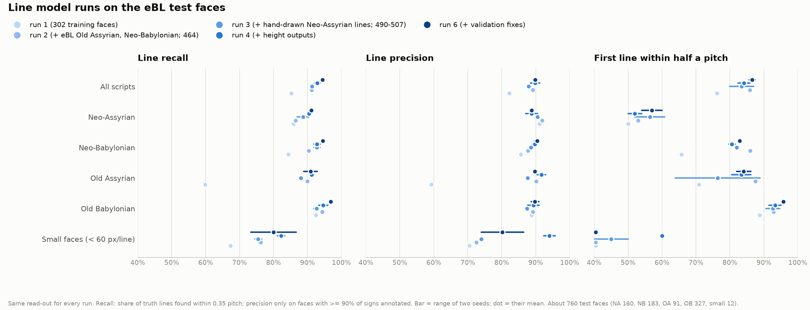

*Figure 1. The figure shows runs 1, 2, 3, 4 and 6 (with heights) on the eBL test faces, per script, with recall,
precision and first-line placement. Bars for runs 3, 4 and 6 span their two training seeds, and the dot is their mean.
Run 5 is not drawn, and its scores are in Appendix A.12.*

## 1. Problem and approach

The pipeline's first line finder infers lines from detected signs. The eBL Deformable DETR detector [1] finds sign
boxes, the boxes are clustered by height into lines, and the transliteration's line count **N** reconciles the
result. On eBL photographs with a transliteration it reaches 0.94 line recall. Its two dependencies are exactly what a
new tablet lacks. Without N, count agreement drops to 25 percent, and where the detector finds too few signs, as on
low-resolution photographs, the route fails. The line model predicts lines from the face image directly, so neither a
transliteration nor a sign detector is needed at line-finding time. Both remain available as optional refinements.

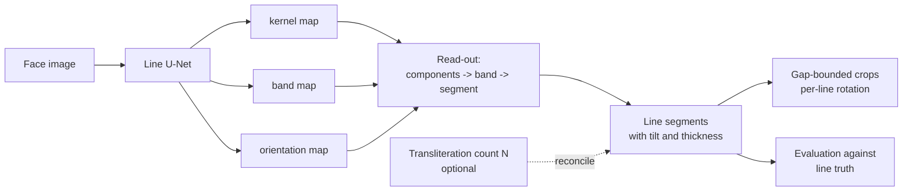

The design was fixed before any code was written (section 14 of `docs/line_cropping/line_cropping_plan.md`). It
specified a face image at 1,024 pixels on the long side, three output maps painted from the existing line truth, a
U-Net with a pretrained ResNet-34 encoder, training on the tune half of the Phase 5 split only, and evaluation with the
unchanged Phase 5 harness against the detector route on the same test faces.

## 2. Data and ground truth

### 2.1 Three kinds of line truth

A **face** is one inscribed side of a tablet (obverse, reverse, an edge), cut out of the museum's composite
photograph. A **truth line** is a text line's position on a face, stored as a centre line with a thickness. **Pitch**
is the median distance between consecutive lines on a face and is the unit for all tolerances.

| source | what an annotator drew | how a truth line is made | used for |
|---|---|---|---|
| eBL sign annotations (OB, NA, OA, NB) | a box around each sign, with the transliteration line it belongs to | least-squares straight segment through the centres of one line's boxes (`truth/ebl_ground_truth.py`) | training and the main test set |
| Old Assyrian Line Marker labels (CDLI photographs) | a mark at each line's height on 88 faces (7 or 4 of them held out for validation, depending on the seed) | horizontal segment across the face at that height, thickness 0.6 pitch | training |
| Heidelberg line annotations, Dencker et al. 2020 (NA) | each text line as a polyline from end to end, 618 lines on 50 faces | the polyline itself, as a chain of short segments | training (32 faces) and an independent test (9 faces) |

The eBL truth has two known limits. First, a line spans only the signs that were boxed, and annotation is partial on
some scripts (median coverage is 1.0 on OB, OA and NB, but 0.12 on NA). Only faces with a **coverage** of at least 0.9
are used, where coverage is the share of transliteration lines that have boxes, and precision is scored only on them.
Second, a line is always straight, and it is occasionally wrong where boxes of neighbouring lines were mislabelled
(HS.2069 in `related_work.md`, Figure 2). The Heidelberg lines have neither limit, which is why they serve as the
independent check.

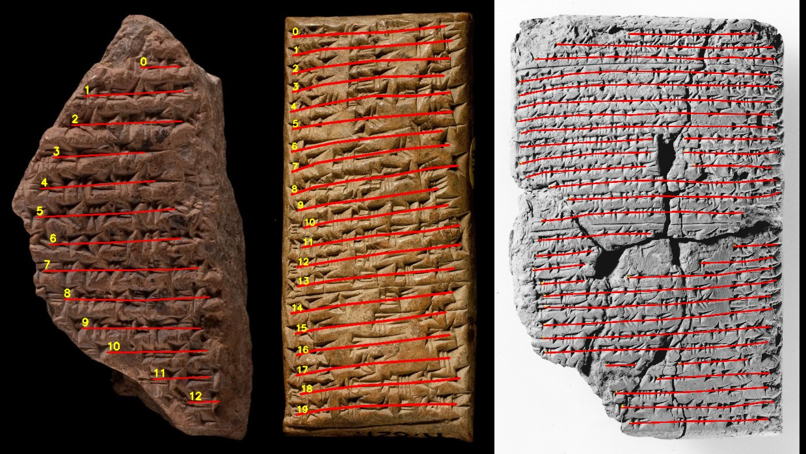

*Figure 2. Heidelberg line annotations (red, numbered) are shown on three faces. Every line is drawn end to end and
follows its slope. On the cracked tablet on the right, a line is drawn as separate pieces on either side of the crack.*

### 2.2 Training sets

Training uses only faces of the Phase 5 **tune** split, and the **test** split is never trained on. Faces added later
(the OA and NB faces) were split by tablet, so their obverse and reverse are on the same side (`eval/extend_split.py`).
The original NA and OB split was made by face, not by tablet, so a test face can share a tablet with a training face.
This applies to 158 of the 966 test faces (146 OB, 12 NA). It barely affects scores (with `run4_s0`, recall is 0.937
and precision 0.911 on the clean tablets, and 0.939 and 0.918 on the shared ones), so the split was kept. A tenth of
the training tablets are held out as a validation slice that chooses the checkpoint. The slice depends on the seed, so
seeds also differ in their training faces.

| run | eBL OB | eBL NA | eBL OA | eBL NB | OA hand labels | Heidelberg NA | training / validation faces |
|---|---|---|---|---|---|---|---|
| run 1 | 205 | 16 | - | - | 81 | - | 302 / 38 |
| run 2 | 202 | 20 | 93 | 70 | 79 | - | 464 / 60 |
| run 3 and run 4, seed 0 | 208 | 21 | 86 | 68 | 81 | 26 | 490 / 66 |
| run 3 and run 4, seed 1 | 205 | 20 | 101 | 70 | 84 | 27 | 507 / 49 |

Run 2's Old Assyrian and Neo-Babylonian faces come from 311 eBL tablets chosen from the eBL annotation export of
11 Sep 2026 (`data/ebl/annotations_11.09.2026/`) for having at least 50 sign boxes with a line position
(`ingest/download_ebl.py --scripts OA NB --annotations-dump`). The eBL sign data held no further usable Neo-Assyrian
tablets, which is why run 3 turned to the Heidelberg annotations (Appendix A.3, A.4).

### 2.3 Training targets

The targets are five maps at one quarter of the input resolution, painted from the truth lines:

| channel | content | purpose |
|---|---|---|
| kernel | each line's band shrunk to 40 percent of its width | one connected region per line, so neighbours never merge |
| band | the line's band, width = min(truth thickness, 0.7 pitch) | the line's vertical extent for cropping |
| orientation, two channels | sin 2θ and cos 2θ of the line direction, inside the band | tilt and curvature without a global deskew |
| ignore | gaps between consecutive lines wider than 1.5 pitches, and one pitch beyond the first and last line of a block | pixels where an unannotated line may be carry no loss |

The band width is capped by the pitch because eBL sign boxes are as tall as the pitch itself. When the bands were
painted from the raw thickness, adjacent bands merged into one mass. Hand-drawn polylines are painted segment by
segment, with spacing and ignore regions computed per line (`targets.polyline_segments`).

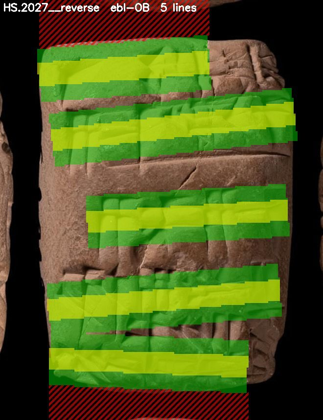

*Figure 3. The targets on HS.2027 reverse are shown with the band in green, the kernel in yellow, and red hatching
where the loss is ignored above the first and below the last annotated line.*

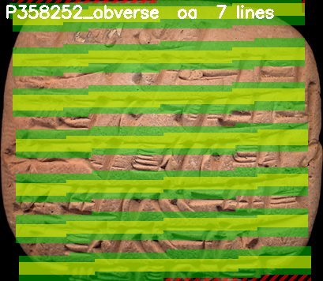

*Figure 4. The same targets are shown on an Old Assyrian face, P358252 obverse, where they are built from hand-marked
line heights.*

## 3. Model and training

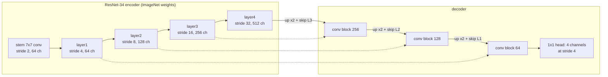

**Network.** The encoder is a **ResNet-34** (16 residual blocks in four stages, each halving resolution and doubling
channels), initialised from ImageNet. This gives edge and texture detectors from the start, which is important with a
few hundred training faces. A **U-Net** decoder upsamples back towards input resolution and at each step concatenates
the encoder's map of the same resolution through a **skip connection**, so wide context (which row is a line) and fine
position (where its edges are) are combined. The decoder stops at stride 4, which is enough for line positions and four
times cheaper than full resolution. The head is a 1 x 1 convolution to four channels: kernel, band, sin 2θ and cos 2θ.
The network has 24.4 million weights.

**Loss.** The loss is binary cross-entropy plus Dice on the kernel and band maps, and an L1 error on the orientation
channels inside bands, weighted one half. Ignore pixels are excluded. Dice measures region overlap as a whole and
prevents the "no line anywhere" solution that cross-entropy alone tolerates when lines are a small share of pixels.

**Training.** The model trains on random 768-pixel windows from the face resized to 1,024 pixels on its long side,
centred near a line. Augmentation covers scale between 0.5 and 2, rotation up to 4 degrees, brightness and contrast
jitter, polarity inversion for light-background photographs, greyscale and JPEG re-encoding. There are no horizontal
flips, which would mirror the script. Optimisation uses AdamW with a one-cycle schedule, mixed precision, batch 6, and
40 epochs (32 to 55 minutes on an RTX 4060). After every epoch the model runs on the validation faces through the real
read-out, and the checkpoint with the best line recall plus precision is kept, so selection uses the measure the
project cares about rather than the pixel loss.

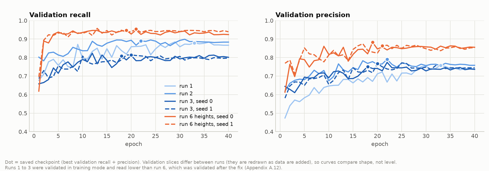

*Figure 5. Validation recall and precision per epoch are shown for runs 1 to 3 and run 6 with heights, and the dot marks
the saved checkpoint. Validation slices differ between runs, so the curves compare shape, not level. Run 6 reads higher
mainly because of the validation fixes (A.12).*

## 4. From maps to lines and crops

### 4.1 Read-out

The face goes through the network once. Kernel probabilities above 0.5 are split into connected components, and
components under 12 pixels (at stride 4) are dropped. Every band pixel above 0.4 joins its nearest kernel component
within 1.5 kernel heights. A principal-component line through each component's band pixels gives the segment, and
twice the mean perpendicular spread gives its thickness. Segments more than 45 degrees off the face's median angle are
dropped, since these are near-vertical false lines on worn faces. Segments that are side-by-side pieces of one line, at
the same height with barely overlapping horizontal ranges, are joined (`merge_fragments`). On run 1 this joining
raised precision from 0.84 to 0.88 at the cost of one point of recall. Last, each line's ends are pushed outward while
the band probability stays above 0.2 (at most three kernel heights per end), and they are pulled back off stretches
that lie over the studio background (Appendix A.2, Test 2).

Segments are written raw (`unet_segments/<face>.csv`) and in the pipeline's line format (`unet/<face>.csv`), so every
downstream tool and evaluator accepts them. An optional `--use-n` reconciles the line count with a transliteration as
the detector route does (method `unet_n`).

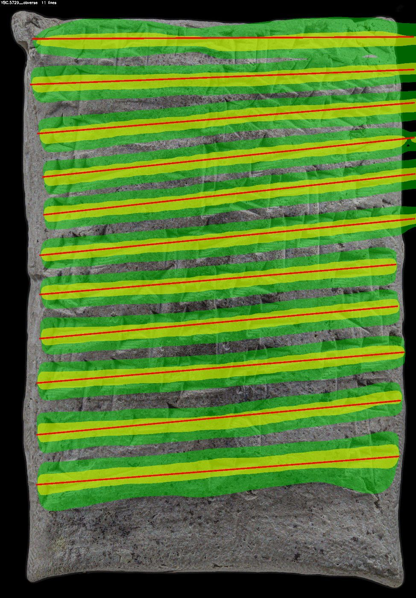

*Figure 6. The model output on YBC.5729 obverse shows the predicted band in green, the kernel in lime and the read-out
segments in red.*

### 4.2 Crops

Each line becomes one image, cut from the face rotated so that its lines run horizontally (`crops/make_crops.py
--bounds segments`). A crop runs from the middle of the gap to the line above to the middle of the gap to the line
below, with half a pitch of margin beyond the line's ends. Each of the options below was tested in Appendix A.2:

| option | effect | default |
|---|---|---|
| line ends from the fading band (`infer.py --end-thr 0.2 --clip-tablet 1`) | fewer lines cut short at the right end, fewer crops running into the background | on |
| `--rotate-per-line` | each line cut along its own tilt, rotated by its own angle (within 20 degrees of the face's); about 2 points more whole lines at the same crop size (A.11) | on with segment or height bounds; `--no-rotate-per-line` for the deskewed face |
| `--extend 0.2` | every crop boundary moves out by 0.2 pitch, uncapped: 98% of a line's signs inside instead of 81%, two thirds of lines whole, for a strip of the neighbours' signs (Appendix A.8) | off (recommended where neighbour content is tolerated) |
| `--shift 0.06` | every crop boundary moves down by 0.06 pitch, because the model's lines sit slightly above the middle of the signs: with `--extend 0.2`, 70% of lines whole instead of 67%, 60% instead of 52% on Neo-Assyrian, at no cost (Appendix A.9) | off |
| `--overlap 0.15` | neighbouring crops share 0.15 pitch of rows, never past the neighbour's band, so tall signs are not clipped | off |
| `--trim-background` | crop ends trimmed back to the edge of the clay | off (for uses where any background is worse than a slightly cut line) |

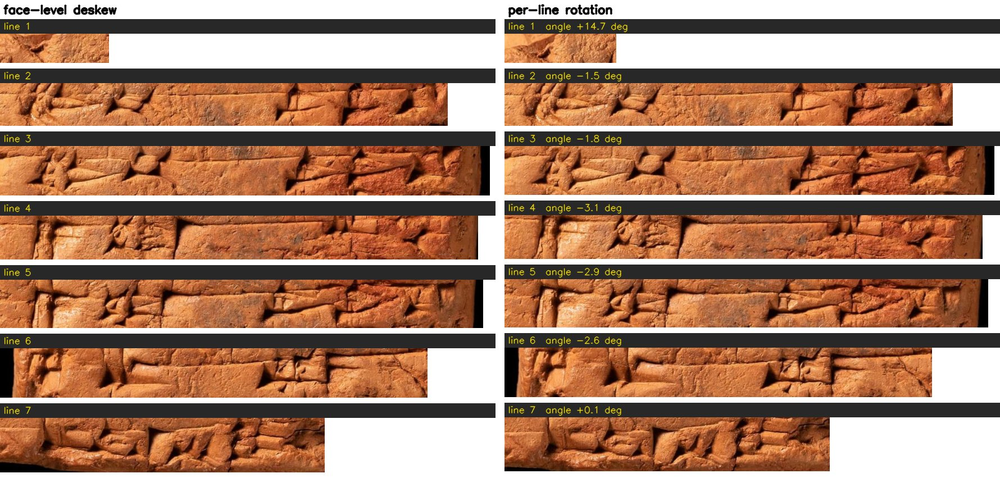

*Figure 7. HS.2450 obverse is cut in the face-wide deskewed frame (left) and with each line in its own frame (right),
at one scale. The right-hand labels give each line's own angle.*

## 5. How it is evaluated

**Test sets.** (1) The eBL test split has about 760 faces with at least two truth lines, and none of them were trained
on (NA 160, NB 183, OA 90, OB 327). Results are also given for **small faces**, which are those with fewer than 60
pixels between lines (12 test faces). (2) The 9 Heidelberg test faces have hand-drawn lines (99 lines) and were never
trained on by any run. Every line on them is drawn, so precision is valid on every face, and line ends can be checked.

**Line measures** (`eval/evaluate_lines.py`, `eval/evaluate_heidelberg.py`). A predicted line matches a truth line
when their centre heights differ by less than 0.35 pitch, with one prediction per truth line. Pitch is the median gap
between the face's annotated lines. On faces with fewer than five annotated lines, the sign height is used where those
gaps are too wide for the signs (Appendix A.9). **Recall** is the share of truth lines matched. **Precision** is the
share of predicted lines matched, on faces with coverage of at least 0.9 only. **First line** is the share of faces
whose top predicted line is within half a pitch of truth line 1. **Count match** is the share of faces where the
number of lines equals the transliteration's.

**Crop measures** (`eval/evaluate_crops.py`, `eval/crop_width.py`). **Kept whole on clay** is the share of fully
annotated lines (at least five signs) whose part on the clay lies at least 95 percent inside their crop. **Past the
clay** is how far a crop runs beyond the tablet into the background. **Neighbour intrusion** is the share of another
line's band inside a crop. Half or more counts as the "half of the neighbouring line" failure.

**Variation.** Retraining with a different seed moves per-script recall or precision by up to four points and
first-line placement by up to nine (on Old Assyrian, first-line placement moves by 24 with run 3, and by 5 with run 4).
Seeds also differ in their training and validation faces, so this slightly overstates pure training randomness.
Differences smaller than that are not treated as real.

## 6. Results

### 6.1 The runs compared

| eBL test faces | run 1 | run 2 | run 3, seed 0 | run 3, seed 1 | run 4, seed 0 | run 4, seed 1 | run 6 heights, seed 0 | run 6 heights, seed 1 (default) |
|---|---|---|---|---|---|---|---|---|
| all: recall / precision | 0.85 / 0.82 | 0.91 / 0.89 | 0.92 / 0.88 | 0.91 / 0.88 | 0.94 / 0.91 | 0.92 / 0.89 | 0.94 / 0.89 | 0.94 / 0.91 |
| all: first line within 0.5 pitch | 76% | 86% | 87% | 80% | 86% | 82% | 86% | 87% |
| Neo-Assyrian: recall / precision, first line | 0.86 / 0.91, 50% | 0.87 / 0.92, 53% | 0.90 / 0.90, 61% | 0.87 / 0.91, 52% | 0.91 / 0.91, 54% | 0.90 / 0.87, 50% | 0.92 / 0.89, 54% | 0.90 / 0.89, 60% |
| Neo-Babylonian: recall / precision, first line | 0.84 / 0.86, 66% | 0.90 / 0.88, 86% | 0.94 / 0.89, 82% | 0.92 / 0.89, 81% | 0.94 / 0.90, 81% | 0.92 / 0.89, 80% | 0.95 / 0.90, 82% | 0.94 / 0.91, 83% |
| Old Assyrian: recall / precision, first line | 0.60 / 0.59, 71% | 0.90 / 0.90, 88% | 0.89 / 0.88, 89% | 0.87 / 0.87, 64% | 0.91 / 0.93, 86% | 0.91 / 0.90, 81% | 0.89 / 0.90, 82% | 0.93 / 0.90, 86% |
| Old Babylonian: recall / precision, first line | 0.93 / 0.89, 89% | 0.94 / 0.89, 93% | 0.92 / 0.87, 95% | 0.94 / 0.88, 91% | 0.96 / 0.91, 95% | 0.93 / 0.88, 92% | 0.97 / 0.89, 96% | 0.97 / 0.91, 96% |
| small faces (12): recall / precision | 0.67 / 0.71 | 0.76 / 0.73 | 0.77 / 0.74 | 0.75 / 0.74 | 0.81 / 0.96 | 0.83 / 0.92 | 0.87 / 0.87 | 0.73 / 0.74 |
| Heidelberg test: recall / precision | | 0.95 / 0.90 | 0.98 / 0.94 | 0.96 / 0.93 | 0.99 / 0.93 | 0.99 / 0.91 | 0.98 / 0.96 | 0.97 / 1.00 |
| Heidelberg test: line count right, overshoot past the drawn ends | | 11%, 0.6 pitch | 56%, 0.5 | 44%, 0.5 | 33%, 0.6 | 44%, 0.6 | 44%, 0.6 | 78%, 0.6 |

All rows use the same read-out, the same 761 test faces and the scoring of A.12. The prose below this table and the
figures for run 1 to run 3 may round differently. Run 1 was not scored on Heidelberg. Neo-Assyrian precision rests on
about 25 faces, small-face precision on 4 and small-face first line on 5 or 6, so those differences are
worth one or two faces. On Heidelberg, run 4's first line falls to 67 percent from run 3's 89, which is 2 of the 9
faces.

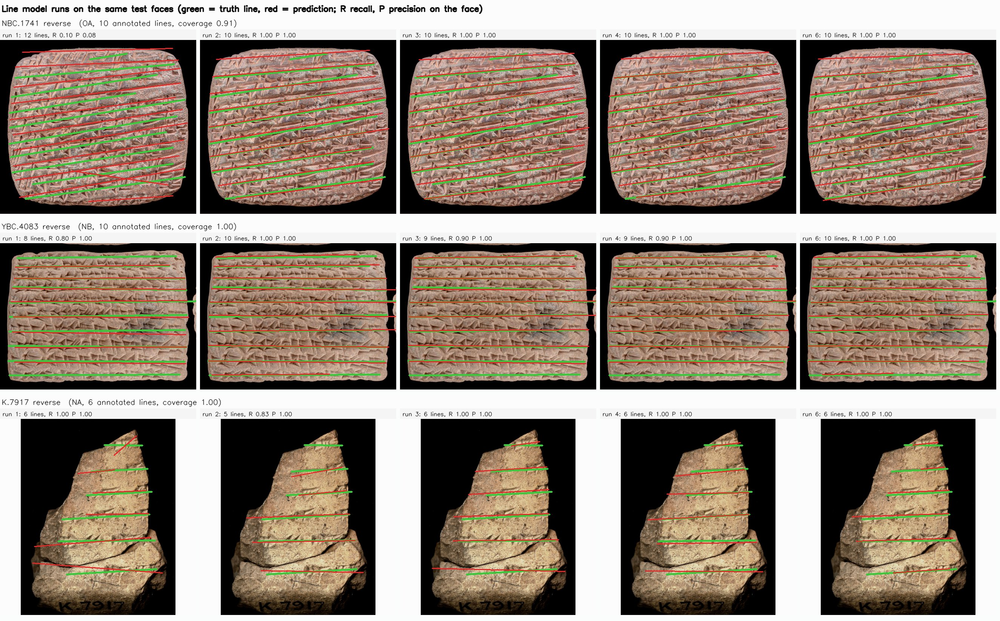

*Figure 8. Three test faces drawn at random are read by each run. Green marks a truth line and red a prediction, and
run 6 is the default, `run6_heights_s1`. NBC.1741 shows the Old Assyrian jump from run 1 (recall 0.10) to every later
run (1.00). On YBC.4083, runs 3 and 4 miss one of ten lines that runs 2 and 6 find, and on the fragment K.7917 only
run 2 misses one. Differences of this size between runs are common on single faces.*

- **Run 2 is the large step.** Old Assyrian goes from the worst script to one of the best. Run 1's hand-labelled CDLI
  Old Assyrian faces did not carry over to eBL's Old Assyrian photographs, but the eBL truth did. Neo-Babylonian gains
  six points of recall, and Old Babylonian, the script with most data, gains rather than losing.
- **Run 3 moves accuracy between scripts rather than adding to it.** It gains on Neo-Babylonian recall (from 0.88 to
  0.90-0.92) and on the hand-drawn lines, where the share with the line count right rises from 11 to 44-56 percent and
  lines stop closer to their real ends. Neo-Assyrian recall rises in one seed only (from 0.86 to 0.86-0.89). It
  loses two to three points of Old Assyrian recall and one to two of Old Babylonian recall and precision. Overall it
  ties with run 2.
- **Run 6 changes the crops more than the lines.** Lines score about the same as with `run4_s0`, but fewer crops hold
  half of another line (A.13). The default's one clear weak spot is the 12 small faces (0.73 / 0.74 against
  `run4_s0`'s 0.81 / 0.96), though precision there rests on 4 faces.
- **First-line placement on Neo-Assyrian stays the weakest result** (50 to 61 percent across runs). The eBL
  Neo-Assyrian test faces are mostly broken British Museum fragments whose first surviving line is often damaged.

### 6.2 Against hand-drawn lines

On the Heidelberg faces the model does better than against the eBL truth for the same script. Run 2, which never saw
a Heidelberg face, finds 95 lines in 100 at 0.90 precision, against 0.86 / 0.92 on eBL Neo-Assyrian. The sets differ
(State Archives letters photographed for CDLI, against mostly K. fragments), so this does not prove the eBL truth is at
fault. It does show that the Neo-Assyrian weakness is not an inability to see Neo-Assyrian lines. Predicted lines
cover the whole drawn line on 92 to 95 percent of lines (runs 2 and 3) and are never short at either end. They run on
past the drawn ends by about half a pitch with run 3 and by 0.6 with run 2. The annotators stopped at about the centre
of the first and last sign, which accounts for roughly half a sign. The rest is the model carrying lines onto the edge
of the clay. Details are in Appendix A.4.

### 6.3 Crop quality

| crops on the eBL test faces (NA and OB, the faces all crop sets cover) | detector route (`det_n`) | line model run 1 | run 1 + line ends from the band | line model run 2 |
|---|---|---|---|---|
| fully annotated lines kept whole on clay | 60% | 78% | 83% | **95%** |
| median cut at the right end | 0.38 pitch | 0.20 | 0.11 | 0.00 |
| crops at least 1 pitch past the clay | 2% | 3% | 1.5% | 4% |
| line centre in exactly one crop | 99% | 96% | 96% | 98% |
| crops holding half of a neighbouring line | | 0% | 0% | 0% |

The crops were first thought too wide, but measured against fully annotated lines they were not (the median extra
width was 1 percent). The real problems were the opposite: lines cut short at the right end, and a few crops running
into the background. Setting line ends from where the band fades fixed the first and halved the second (Appendix A.2,
Tests 1 and 2). Run 2's lines reach further, so almost every line is now whole, at a little more overhang, which
`--trim-background` removes where it matters. Letting neighbouring crops share 0.15 pitch of rows more than doubles
the share of lines whose whole band lies inside one crop, from 4 to 10 percent, without any crop taking half a
neighbour (Test 4). That measure counts residual slant as height, so it stays low.

These measures concern length, along with the band-based neighbour measure. They do not mean that a line's signs are
whole. By their sign boxes, only 12 percent of lines on these same crops keep at least 95 percent of their signs, and
9.1 percent of crops hold half of another line (A.9). Crop height is what decides that (A.8). The current settings are
in A.11, and the current scores are in A.13.

### 6.4 Compared with other line finders

| line finder (eBL test faces) | needs a transliteration | recall | precision | first line within 0.5 pitch | Heidelberg test recall / precision |
|---|---|---|---|---|---|
| detector route with the line count (`det_n`), on 487 NA and OB faces only, see below | yes | 0.94 | 0.91 | 90% | |
| **line model, run 6 with heights** | no | 0.94 | 0.89-0.91 | 86-87% | 0.97-0.98 / 0.96-1.00 |
| line model, run 4 | no | 0.92-0.94 | 0.89-0.91 | 82-86% | 0.99 / 0.91-0.93 |
| line model, run 3 | no | 0.91-0.92 | 0.88 | 80-87% | 0.96-0.98 / 0.93-0.94 |
| Kraken segmenter, retrained on run 3 seed 0's 490 faces, pieces joined | no | 0.93 | 0.82 | 81% | 0.88 / 0.86 |
| Dencker et al. line network, rebuilt and retrained, given each face's true line spacing | no | 0.89 | 0.86 | 73% | 0.83 / 0.72 |

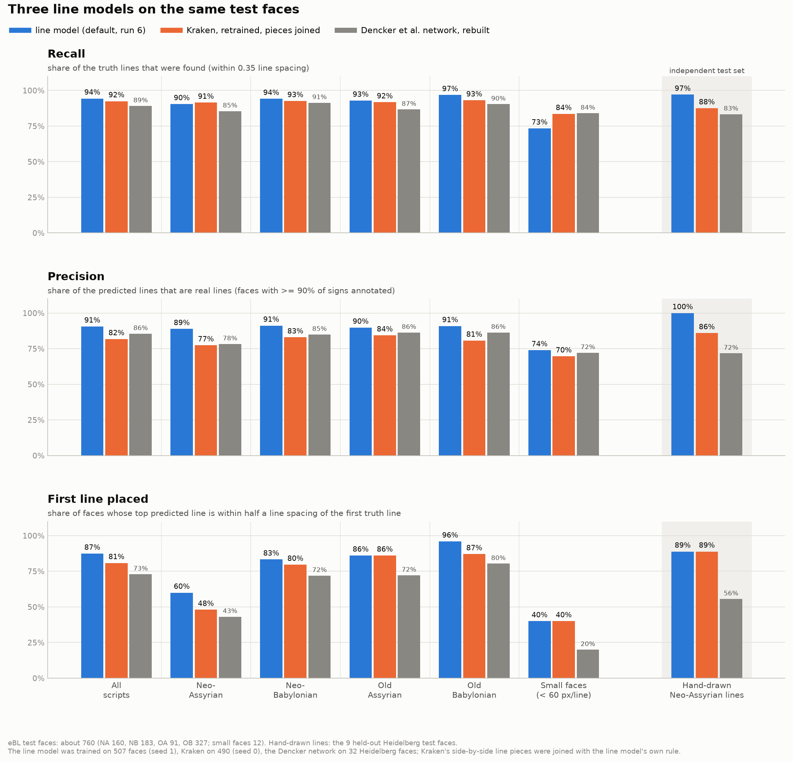

*Figure 9. The line model, Kraken and the Dencker network are compared on the same test faces, per script and on the
hand-drawn Heidelberg lines.*

Among models that need no transliteration, the default `run6_heights_s1` has the best first-line placement on eBL,
precision level with `run4_s0`, recall level with Kraken's on eBL, and the best precision on the hand-drawn lines. On
the hand-drawn lines its recall is behind run 4's, and its first-line placement is level with Kraken's (89 percent, on
9 faces). It is also much faster. Stored timings give 0.07 to 0.09 seconds per face for prediction and read-out.
Kraken's 6.8 seconds was noted at the time and is not stored, so no exact factor is claimed. The Dencker network is
close on eBL recall and precision only because it is told each face's line spacing, which a new tablet does not come
with.

The `det_n` row is not like-for-like with those above it, because it was only run on the NA and OB test faces. The
results on those 487 faces are as follows:

| same 487 faces | recall | precision | first line within 0.5 pitch | Neo-Assyrian first line |
|---|---|---|---|---|
| detector route with the line count (`det_n`) | 0.94 | 0.91 | 90% | 74% |
| line model, run 6 heights seed 1 (default) | 0.95 | 0.91 | 89% | 60% |
| line model, run 6 heights seed 0 | 0.95 | 0.89 | 88% | 54% |
| line model, run 4 seed 0 | 0.94 | 0.91 | 88% | 54% |
| line model, run 4 seed 1 | 0.92 | 0.88 | 84% | 50% |
| line model, run 3 seed 0 | 0.91 | 0.88 | 88% | 61% |
| Kraken, pieces joined | 0.93 | 0.80 | 80% | 48% |

So `run6_heights_s1` is level with the detector route on recall and precision, without needing a transliteration or a
sign detector. The detector route stays ahead on Neo-Assyrian first lines, and on precision against the other seed.
Its detector was also trained on a superset of these annotations (`line_cropping/README.md`), and the overlap with
these test faces is not known, so its scores may be flattered. It also needs a sign detector that works on the
photograph. The comparison, the side-by-side examples and the literature search are in `related_work.md`.

## 7. Limitations and next steps

- **First line of Neo-Assyrian fragments.** First-line placement on these is 54-60 percent with run 6. More intact
  Neo-Assyrian lines (run 3) did not fix it. The next step is a per-face check of the top line against the tablet edge,
  or hand-labelled Neo-Assyrian fragments.
- **Worn faces.** Cracks and edge texture can be read as lines (Figure 10). The angle guard removes near-vertical
  ones, but slanted ones remain. A per-face confidence score would flag such faces.
- **Seed variation.** Scores vary by several points on the smaller scripts, partly because the checkpoint is chosen on
  49 to 66 validation faces. The next step is to average the predictions of several runs (run 2 is stronger on Old
  Assyrian and Old Babylonian, and run 3 is stronger on Neo-Babylonian), which needs no training.
- **What these scores leave out.** The test faces are all single-column, so multi-column tablets are untested. A line
  counts as found on its height alone, so a short fragment can match a whole line. Crop settings (`--extend`,
  `--shift`) and the spacing guard (A.9) were chosen after seeing test scores, so those results are somewhat
  optimistic. The test set has been used across all runs, and `run6_heights_s1` was picked partly on it.
- **Read-out thresholds** (kernel 0.5, band 0.4, minimum area 12) were set by hand. A grid sweep on the validation
  faces, re-running only the read-out on stored maps, would tune them in minutes.
- **Truth fitted from sign boxes.** eBL lines are straight and occasionally wrong (HS.2069 in `related_work.md`,
  Figure 2). The hand-drawn lines are the only truth without this limit, and they cover one script.
- **Crop height.** The signs of a line, by their eBL boxes, reach past the top and bottom of its crop on most lines
  (84 and 93 percent of 944 export crops), because neighbouring lines interlock. Ends are rarely cut. A pilot that
  fitted ProtoSnap skeletons to every sign of 40 lines confirmed the direction but proved too unreliable on signs in
  context to measure it (Appendix A.6). Line-shaped crops that bend around signs keep no more of a line than
  rectangles at the same leakage of the neighbours' signs (Appendix A.7), so the real choice is crop height.
  Calibration on the eBL boxes shows that extending crops 0.15-0.2 line spacings past the midpoint keeps 98-99 percent
  of a line's signs in every script (`make_crops --extend 0.2`, Appendix A.8). Moving them down by 0.06 spacings makes
  three more lines in a hundred whole (`--shift 0.06`, Appendix A.9).

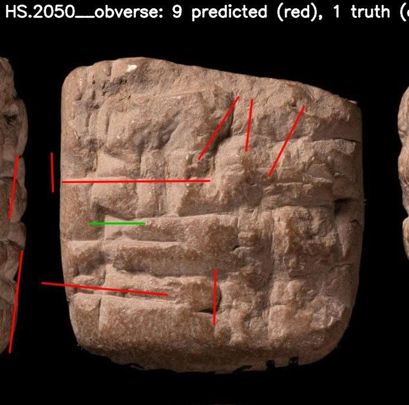

*Figure 10. HS.2050 obverse is shown before the angle guard, with near-vertical false segments on a worn face with a
single annotated line.*

## 8. Status and how to run

**Models.** `weights/linemodel/run6_heights_s1/` is the default (`paths.LINE_WEIGHTS`), and it is used by `infer.py`
and the Line Splitter app. Also kept are the other run 6 models (A.13), `run4_s0/`, `run4_s1/`, `run5_s0/` (A.11),
`run2/`, `run3_full_s0/` and `run3_full_s1/`. Each holds `model.pt`, `history.csv`, `config.json` and `plots/`.
**Stored outputs.** `tablet_data/ebl_tablets/predictions/unet` and `line_crops_unet` come from the default model. They
cover the test split (966 faces, 10,739 crops) and were cut with `--bounds segments --extend 0.2 --shift 0.06` along
each line's tilt. `predictions/unet_n`, `line_crops_unet_n` and `line_crops_unet_rot` still come from run 1
(Appendix A.3). Scripts that compare crops with face coordinates read each crop in its own frame
(`crops/crop_frame.py`). `tablet_data/exports/line_crops_60_run6` holds the default's tilted crops (60 tablets, 114
faces, 1,116 crops, 8,106 signs). `tablet_data/exports/line_crops_60` and the ProtoSnap results made from it are older
and hold level crops, and they are still the default of the `protosnap/line_envelope_*` scripts.
`tablet_data/exports/line_signs` holds every eBL truth line with its signs in reading order
(`report/export_line_signs.py`). `tablet_data/exports/line_signs_std` holds the same lines with one geometry for all,
1.4 line spacings tall and along each line's angle (`--half-height 0.7 --end-margin 0.5`), and a check against the
default model. `tablet_data/exports/line_signs_run6` holds the default model's crops on the test faces with the signs
inside them (`report/export_model_line_signs.py`). `ground_truth/full_line_annotations.csv` lists which tablets have
every line annotated (`truth/full_line_annotations.py`). Run 2's outputs and earlier versions are in
`tablet_data/ebl_tablets/linemodel/archive/`. **Report figures** are regenerated with
`MPLBACKEND=Agg .venv/bin/python -m line_cropping.report.report_figures`.

```
python -m line_cropping.linemodel.targets --preview 12
python -m line_cropping.ingest.download_ebl --scripts OA NB --annotations-dump data/ebl/annotations_11.09.2026/annotations_11.09.2026.json
python -m line_cropping.truth.ebl_ground_truth && python -m line_cropping.faces.prepare_faces ebl && python -m line_cropping.eval.extend_split
MPLBACKEND=Agg .venv/bin/python -m line_cropping.linemodel.train --epochs 40 --seed 1 --heidelberg --heights --out weights/linemodel/run6_heights_s1
.venv/bin/python -m line_cropping.linemodel.infer --faces tablet_data/ebl_tablets/faces/faces.csv --out tablet_data/ebl_tablets/predictions --split test [--use-n]
.venv/bin/python -m line_cropping.eval.evaluate_lines --faces tablet_data/ebl_tablets/faces/faces.csv --pred tablet_data/ebl_tablets/predictions
.venv/bin/python -m line_cropping.eval.evaluate_heidelberg --weights weights/linemodel/run6_heights_s1/model.pt
.venv/bin/python -m line_cropping.crops.make_crops --faces tablet_data/ebl_tablets/faces/faces.csv --pred tablet_data/ebl_tablets/predictions --method unet --bounds segments --extend 0.2 --shift 0.06 --split test [--overlap 0.15] [--rotate-per-line] --out tablet_data/ebl_tablets/line_crops_unet
.venv/bin/python -m line_cropping.eval.evaluate_crops --faces tablet_data/ebl_tablets/faces/faces.csv --crops tablet_data/ebl_tablets/line_crops_unet/crops.csv --split test
.venv/bin/python -m line_cropping.report.export_tablets --zip     # 60 tablets with line crops and sign boxes, for other pipelines
```

## Appendix A. Experiment log

This appendix lists the experiments in the order they were run, with their full tables. Later sections supersede
earlier numbers where they differ. For example, run 1's first results below use the read-out of the time and only the
NA and OB test faces that existed then, while section 6.1 scores every run with the same read-out on the full test set.
Line scores in A.1 to A.8 are as recorded at the time, before the line spacing was corrected (A.9). Sections 1 to 8 use
the corrected scores.

### A.1 Run 1: first results (29 Sep 2026)

Everything below is on the Phase 5 **test** split, which the model never saw. A line counts as found when it lies within 0.35 pitch of a truth centre. Precision is reported only on faces with coverage of at least 0.9.

| method | recall | precision | first line within 0.5 pitch | count = N | crops: truth centre in exactly one crop | crops with an ATF label | ATF signs matched to a box / box confirmed by truth (OB) |
|---|---|---|---|---|---|---|---|
| line model, no transliteration (`unet`) | 0.85 | 0.88 | 81% | 29% | 97% | 20% | too few labelled lines |
| line model, count reconciled (`unet_n`) | 0.83 | 0.85 | 81% | 85% | 97% | 72% | 54% / 67% |
| detector route with count (`det_n`) | 0.91 | 0.91 | 90% | 85% | 99% | 73% | 53% / 66% |

By script, `unet` reaches 0.87 recall at 0.87 precision on Old Babylonian, three points behind the detector route. On Neo-Assyrian it reaches 0.81 recall at 0.91 precision, and the first line is placed within half a pitch on only 45 percent of faces. Neo-Assyrian is the script with 16 training faces. Downstream, the two routes are at parity. The crops are equally clean, and the transliteration-to-box alignment through the line model's crops matches the detector route's figures.

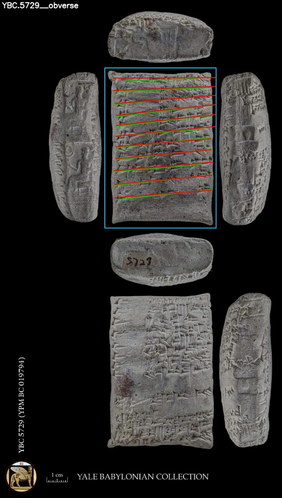

*Figure A1. The model's twelve lines (red) and the truth (green) are shown on the original composite photograph of YBC.5729. No transliteration was used.*

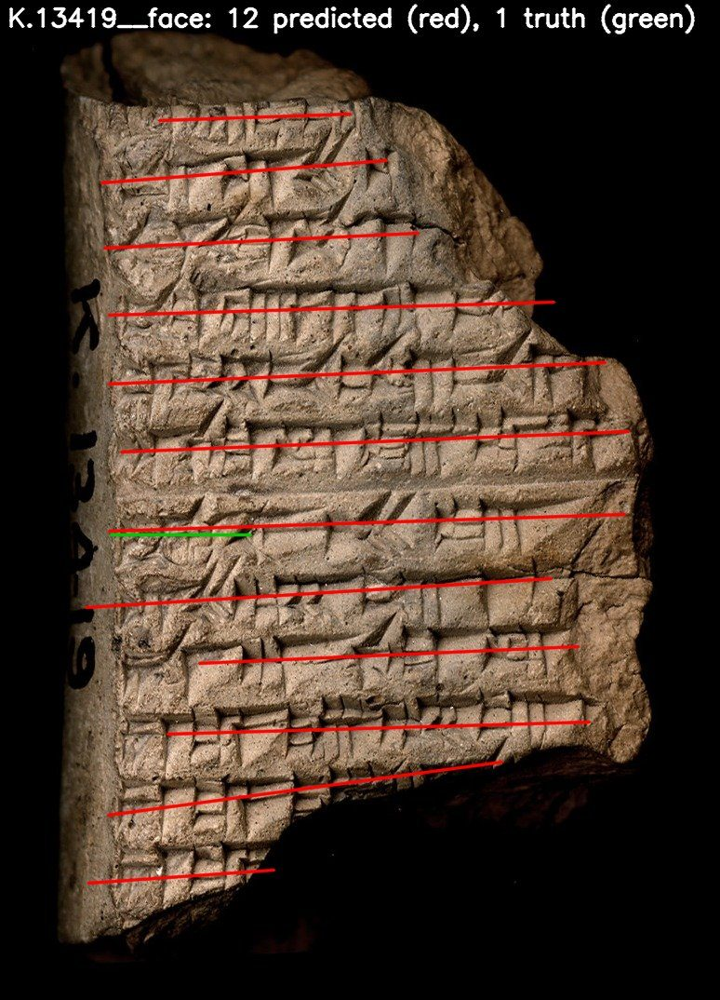

*Figure A2. The model finds twelve lines on K.13419, a face whose eBL annotation covers one. This is why every score here is conditioned on coverage.*

**Files.** The files for each run are `weights/linemodel/<run>/{model.pt, last.pt, history.csv, config.json, plots/}`. Each inference writes `tablet_data/ebl_tablets/predictions/{unet, unet_n}/<face>.csv`, `unet_segments/<face>.csv`, and rows in `faces_run.csv`, with optional overlays in `unet_viz/`. Crops are in `tablet_data/ebl_tablets/line_crops_unet*/`, where `crops.csv` holds the rectangle, skew, per-line angle and ATF label. Whole-tablet overlays are in `tablet_data/ebl_tablets/linemodel/prediction_overlays/`.

### A.2 Crop width and overlap tests (29 Sep - 3 Oct 2026)

Crops looked too wide by eye, so their horizontal fit is being examined one step at a time. The first step is to find
what the over-wide crops are, the second is to change how line ends are set, and the third is to keep the resulting
measures as standing metrics. Each test below records the question, the method, the numbers and what they mean for the
next step. The diagnostic is `line_cropping/eval/crop_width.py`, and its outputs are in `tablet_data/ebl_tablets/linemodel/crop_width/<test>/`.

**Measures.** For every truth line on a test face with annotation coverage of at least 0.9 whose centre falls inside
exactly one crop, the crop and the line are compared in the crop's frame. The line's true extent runs between its
outermost annotated sign centres, widened by half a sign on each side to reach the sign edges. **Inside** is the
share of that extent within the crop (1.0 means nothing is cut off). **Excess** is the crop width outside the
extent, as a share of the line's width. Because annotators sometimes box only part of a line, both are also given
for **fully annotated lines**, which are those with at least five annotated signs. **Background overhang** needs no
truth at all. It is how far the crop runs past the edge of the clay into the studio background, in pitches.

#### Test 1: what are the over-wide crops? (29 Sep 2026)

This test uses crops from the `unet` read-out on the test split (face-frame crops, `line_crops_unet`), covering 2,282 lines on 245 faces.

| measure | all lines | fully annotated lines (1,348) |
|---|---|---|
| true width inside the crop, median | 96% | 94% |
| lines keeping at least 95% of their width | 52% | 47% |
| extra width, median | 3% | 1% |
| extra width, 90th percentile | 65% | 16% |
| lines more than 50% too wide | 10% | 1% |

| background overhang, no truth needed | value |
|---|---|
| median | 0.33 pitch |
| 90th percentile | 0.75 pitch |
| lines overhanging by at least 1 pitch | 3% |

The worst tenth by extra width (229 lines, at least 65% too wide) was sorted into causes, with the first matching cause winning:

| cause | lines | what it is |
|---|---|---|
| truth line barely annotated (two signs or fewer) | 116 | on inspection the crop covers the whole written line and the truth only the few signs that were boxed: the crop is right |
| runs into the background | 52 | the crop extends at least half a pitch past the clay: a real error |
| one-sided overhang | 27 | mostly partial annotation again, with some real overhang at broken edges |
| fragments merged | 23 | a line built by joining side-by-side pieces; usually right, occasionally two separate lines joined |
| wide on both sides | 11 | mixed |

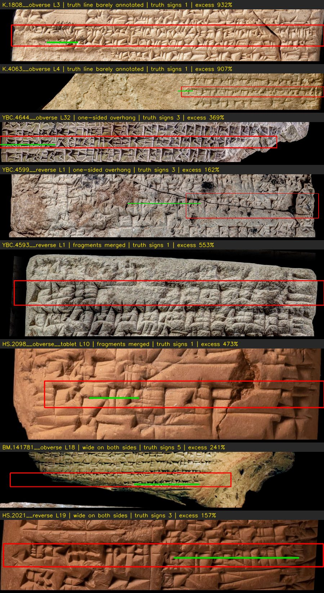

*Figure A3. The two worst lines of each cause are shown, with the crop in red and the annotated extent of the line in
green. K.1808 line 3 and K.4063 line 4 have one annotated sign each on a fully written line, so the crop is right and
the truth is short. BM.141781 line 18 runs off the tablet into the background, and YBC.4599 line 1 misses the left half
of its line along a crack. Those are genuine errors.*

**What this means.** On fully annotated lines the crops are not too wide. Extra width has a median of 1 percent and
exceeds half the line's width on only 1 percent of lines. Most of the apparent over-width came from comparing against
lines the annotators boxed only in part. Two genuine problems remain. The larger is the opposite of the original
concern. Fewer than half of fully annotated lines keep 95 percent of their width, and the right end is cut most often
(median cut 0.15 pitch against 0.03 on the left), so crops are more often slightly too narrow at one end. The smaller
is overhang into the background, which reaches at least one pitch on 3 percent of lines. Part of it is simply the fixed
half-pitch margin added where a line meets the tablet edge. Step 2, which sets line ends from where the predicted band
actually fades instead of from the segment ends plus a fixed margin, therefore has to be judged on both counts. It should raise the
share of lines kept whole, especially at the right end, while trimming the background overhang, and it should not do
so by narrowing crops in general.

#### Test 2: line ends from the predicted band (2 Oct 2026)

**Question.** Can the crop ends be set from where the model's band actually fades, rather than from the segment's
ends plus a fixed half-pitch margin, so that fewer lines lose their right end without more crops running into the
background?

**Changes tried.** Three levers were tried, all in the read-out or the crop step and none needing retraining:

- *Extend* (`infer.py --end-thr`) walks each end outward along the line while the mean band probability across the
  line's thickness stays above the threshold, up to three kernel heights per end. The segment's own ends come from
  the band pixels above 0.4 nearest its kernel, so a faint end of a line is often left out.
- *Clip* (`infer.py --clip-tablet 1`) pulls each end back while it lies over the studio background (less than 30
  percent of the line's thickness is clay). It uses the same background polarity test as the face cutter.
- *Margin and trim* (`make_crops.py --margin`, `--trim-background`) are two settings. The margin is added beyond each
  end (0.5 pitch so far), and the trim option, after the margin is added, trims each crop's left and right edges back
  to the edge of the clay.

**Measure, revised.** The first runs showed trimming apparently cutting many lines. Inspection showed that this was a
measurement artefact. The truth extent is widened by half a sign beyond the outermost sign centres, and where writing
runs onto the tablet's rounded edge, that widening lands on background (Figure A4, HS.2072 and YBC.5710). A crop that stops at
the clay was scored as cut. `crop_width.py` therefore also reports **kept whole on clay**, which is the share of
fully annotated lines whose part on clay lies at least 95 percent inside the crop. It is the headline measure from here
on, and the old one is kept beside it.

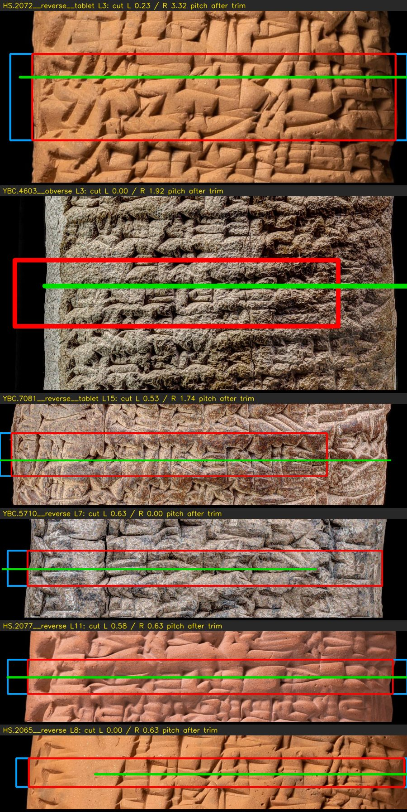

*Figure A4. These are lines that lost width after trimming to clay, with the crop before trimming in blue, the crop
after trimming in red and the annotated extent in green. In HS.2072, YBC.7081, YBC.5710 and HS.2077 the green line runs past the clay, so part of the "cut"
is background that no crop should include. YBC.4603 line 3 is a genuine short read-out, not a trimming effect.*

**Method.** The settings were swept on the 292 tune-split faces with annotation coverage below 0.9, which the model
never trained on (612 fully annotated lines). The chosen settings were then run once on the test split. One bug
surfaced on the way. The first implementation refined ends before merging side-by-side fragments, so extended fragments overlapped and stayed
separate lines, and test precision fell from 0.88 to 0.86. Refinement now runs after the merge, and the numbers
below are all from the corrected code.

| variant (tune faces) | extend | clip | margin | trim to clay | kept whole on clay | past clay >= 1 pitch | past clay, median |
|---|---|---|---|---|---|---|---|
| A, as before | - | - | 0.5 | - | 83% | 3.5% | 0.29 pitch |
| B | 0.2 | - | 0.5 | - | 88% | 5.9% | 0.36 |
| C | - | yes | 0.5 | - | 83% | 1.2% | 0.29 |
| **D, chosen** | 0.2 | yes | 0.5 | - | **88%** | **2.9%** | 0.36 |
| E | 0.2 | yes | 0.25 | - | 80% | 1.3% | 0.13 |
| F | 0.1 | yes | 0.25 | - | 85% | 1.4% | 0.17 |
| G | - | - | 0.25 | - | 72% | 1.4% | 0.07 |
| H, option | 0.2 | yes | 0.5 | yes | 82% | 0.1% | 0.00 |
| I | - | - | 0.5 | yes | 77% | 0.5% | 0.00 |

Extending alone (B) keeps five more lines in a hundred whole but doubles the large overhangs. Clipping alone (C)
cuts those overhangs by two thirds and costs nothing. Together (D), they keep the gain, and the overhang stays at the
old level. Shrinking the margin (E, F, G) trades whole lines for overhang one for one, which is the general narrowing
that Test 1 warned against. Trimming to clay (H, I) removes the overhang almost entirely, at a cost of six points of
kept-whole lines, because on worn or dark faces the clay test misjudges the tablet edge and trims written clay.

**Test split.** The results on the test split (245 faces, 1,179 fully annotated lines, none of which the model ever saw) are:

| | before (Test 1 crops) | D: extend + clip | H: D + trim to clay |
|---|---|---|---|
| kept whole on clay | 78% | **83%** | 75% |
| kept whole, old measure | 45% | 51% | 31% |
| median cut, left / right end | 0.05 / 0.20 pitch | 0.02 / 0.11 | 0.23 / 0.31 |
| more than 50% too wide | 1.4% | 1.5% | 1.4% |
| past the clay by >= 1 pitch | 2.7% | **1.5%** | 0.2% |
| past the clay, median | 0.34 pitch | 0.39 | 0.00 |
| line recall / precision | 0.85 / 0.88 | 0.86 / 0.87 | (same lines as D) |

**What this means.** D does both things Step 2 had to do. Five more lines in a hundred keep their full width, the
right-end cut nearly halves, and large overhangs into the background halve as well. It did not make crops narrower
in general. The median overhang grows slightly, because extended ends now reach the real end of the writing and the
half-pitch margin then sits beyond it. Line finding is essentially unchanged, trading one point of recall for one point
of precision, because extending one end of a tilted line moves its centre height, which is what line matching uses.
D is now the default in `infer.py` and in the Line Splitter app (`--end-thr 0.2 --clip-tablet 1`). H is kept as the
`make_crops.py --trim-background` option for uses where any background in a crop is worse than a slightly cut line.
The stored `predictions/unet` and `line_crops_unet*` were made before this change and are left as they are, so the
A.1 figures still describe them. Rerunning inference regenerates them with the new ends.

#### Test 3: width as standing metrics (2 Oct 2026)

The width measures are now part of the regular evaluation instead of a one-off diagnostic. `crop_width.py` exposes
`measure()` (per-line rows and summary) and `headline()` (the numbers below). Rerunning the refactored script on the
Test 1 crops reproduces its summary exactly.

- `evaluate_crops.py` prints a width line after its vertical metrics. The option `--split test` restricts it to the
  test faces, and `--no-width` skips it. It reads the face images, which takes about 40 seconds on the test split.
- `report/compile_sample.py` adds a **Crop width** table to `samples/metrics/METRICS.md` for every crop set present,
  on the test split, and copies each summary to `metrics/crop_width_<set>.json`.
- `report/aggregate_metrics.py` records the same measures for the main crop set as `width_*` rows.

The headline measures are kept whole on clay, more than 50 percent too wide, the median cut at each end, and how far
crops run past the clay (median, and the share at one pitch or more). The current table below covers the stored crop sets.

| crops (test faces, coverage >= 0.9) | lines (fully annotated) | kept whole on clay | > 50% too wide | median cut left / right | past clay, median | past clay >= 1 pitch |
|---|---|---|---|---|---|---|
| detector route (`det_n`), gap-bounded | 1,925 (1,206) | 60% | 1% | 0.20 / 0.38 pitch | 0.11 pitch | 2% |
| line model (`unet`), before Test 2 | 1,859 (1,179) | 78% | 1% | 0.05 / 0.20 | 0.34 | 3% |
| line model, per-line rotation | 1,823 (1,153) | 75% | 1% | 0.00 / 0.21 | 0.44 | 6% |
| line model, count reconciled (`unet_n`) | 1,859 (1,177) | 79% | 1% | 0.03 / 0.17 | 0.35 | 4% |
| line model with Test 2 ends (D) | 1,858 (1,179) | 83% | 2% | 0.02 / 0.11 | 0.39 | 1.5% |

The first row is new information. The detector route, whose crops end at its outermost sign boxes, keeps only 60
percent of lines whole, against 83 percent for the line model with the new ends. On horizontal fit the line model is
now clearly ahead, while it still trails the detector route on line recall and precision (A.1). Per-line
rotation overhangs more because it is measured in the face frame (see the measures above), which overstates width
for rotated crops.

#### Test 4: letting neighbouring crops overlap (3 Oct 2026)

**Question.** Each crop stops at the midpoint between its line's band and the next, so neighbouring crops share no
rows. Tall signs that reach into the gap, interlocking lines and slight residual slant are clipped at that boundary.
Can crops share a thin strip of rows without breaking the rule that no crop may hold half of a neighbouring line?

**Change.** `make_crops.py --overlap f` moves every boundary between two lines outward by f pitch in both crops (the
outer edges of the first and last line are unchanged). The move is capped at the near edge of the neighbour's
predicted band. The option `--overlap-into g` lets the crop reach a further g of that band's height, clamped below one half.
With g = 0 a crop takes in the gap and its own tall signs but none of the neighbour's band, so where two bands
already touch, nothing moves. The option works with segment, gap and midpoint bounds and with per-line rotation.

**New measure.** `evaluate_crops.py` now reports **neighbour intrusion**. For every crop, this is the largest share
of another line's truth band (a line whose centre lies outside the crop) that falls inside the crop's rows. A share of
at least 50 percent is the "half of the neighbouring line" failure and must stay at zero. The script also gained `--max-cov`, so the
sweep can be scored on tune faces the model never trained on.

**Method.** The setting was swept on the 292 untrained tune faces (coverage below 0.9, with 1,924 truth lines),
using crops from the Test 2 read-out, and the chosen setting was then run once on the test split. Several vertical
measures are watched. The share of truth lines whose whole band lies inside one crop should rise. The share of line
centres that fall inside two crops and the share of crops holding two line centres should stay low. Neighbour
intrusion is watched as well.

| overlap | into | band fully inside one crop | line centre in two crops | crops with >= 25% of a neighbour's band | half a neighbour |
|---|---|---|---|---|---|
| 0 | - | 9% | 0% | 10% | 0% |
| 0.05 | 0 | 10% | 1% | 13% | 0% |
| 0.1 | 0 | 12% | 1% | 17% | 0% |
| **0.15** | **0** | **13%** | **2%** | **18%** | **0%** |
| 0.2 | 0 | 14% | 2% | 18% | 0% |
| 0.05 | 0.25 | 11% | 1% | 15% | 0% |
| 0.1 | 0.25 | 14% | 3% | 21% | 0% |
| 0.15 | 0.25 | 20% | 4% | 27% | 0% |
| 0.2 | 0.25 | 26% | 6% | 31% | 0% |

Crops holding two line centres stayed at 2 percent everywhere except at the largest setting (3 percent). No
setting took in half a neighbour, and horizontal fit did not move (88 percent of fully annotated lines kept whole on clay).

**Reading the sweep.** With the cap at the band edge (into 0), the gain levels off at 0.15 to 0.2 pitch. By then the
gap between the predicted bands is filled, and the bands nearly touch. Reaching into the neighbour's band (into
0.25) keeps raising containment, to 26 percent, but each step also puts more line centres into two crops, about one
for every three lines gained. A centre can land in a second crop without the cap being broken because the cap uses
the *predicted* band, and a truth line can sit a little off it. The setting chosen is the one with the largest gain at
which no more than 2 percent of centres fall in two crops. It is overlap 0.15, into 0.

**Test split.** The test split has 245 faces. The 0.1 / 0.25 column is a run made before the sweep and is shown for comparison only.

| | no overlap (Test 2 crops) | overlap 0.15, into 0 | overlap 0.1, into 0.25 |
|---|---|---|---|
| band fully inside one crop (faces with coverage >= 0.9) | 4% (5%) | **10% (12%)** | 11% (12%) |
| line centre in exactly one crop / in two | 96% / 0% | 95% / 1% | 95% / 2% |
| crops holding two line centres | 2% | 2% | 2% |
| neighbour intrusion: median, >= 25%, >= 50% | 4%, 11%, 0% | 11%, 25%, 0% | 12%, 27%, 0% |
| kept whole on clay (width) | 83% | 83% | 84% |
| median crop height | 113 px | 128 px | 132 px |

**What this means.** Overlap of 0.15 pitch, capped at the neighbour's band edge, more than doubles the share of lines
whose band sits whole in one crop. The cost is one line in a hundred also having its centre in the next crop, and the
setting never takes in half a neighbour. It matches the pre-sweep 0.1 / 0.25 setting on containment with half its
double-counted centres. Containment stays low in absolute terms because the evaluator takes each truth band's full
vertical span from both segment ends, so any slant left after deskewing makes the band taller than any horizontal
crop. Per-line rotation or masked crops are the remedy for that, not more overlap. The default stays at no overlap,
so existing crop sets are reproducible. The recommended setting for line-model crops is `--overlap 0.15`, and
`--overlap-into 0.25` is there for material whose lines interlock, where some double-counted centres are acceptable.


### A.3 Run 2: Old Assyrian and Neo-Babylonian training data (3 Oct 2026)

**Why.** The first results named training data as the main lever, above all for scripts with few faces. The sign-snippet
metadata turned out to hold no new usable Neo-Assyrian or Old Babylonian tablets, because every NA/OB tablet with
line-labelled snippets was already downloaded. However, the metadata and the eBL annotation export of 11 Sep 2026
(`annotations_11.09.2026.json`, 10,196 fragments, 236,000 boxes) list well-annotated tablets in other scripts. The
export's boxes are identical to the API's boxes on the 200 downloaded tablets checked. The priorities were Old Assyrian
(OA), because the CDLI Old Assyrian set has no automatic truth, and Neo-Babylonian (NB), whose script is close to
Neo-Assyrian.

**Data.** `download_ebl.py --scripts OA NB --annotations-dump annotations_11.09.2026/annotations_11.09.2026.json`
fetched the 311 tablets with at least 50 boxes carrying a line path (83 OA and 228 NB, where the NB group includes
tablets that eBL dates to the Persian period). It read the boxes from the export and only the photo and transliteration
from the API. The truth builder and face cutter then ran unchanged, and every pre-existing row of their tables came out
identical. Of 602 new faces, 377 are single-column with coverage of at least 0.9. Of these, 202 are OA faces from 81
tablets, with a median of 208 px per line, and 175 are NB faces from 96 tablets, with 153 px per line.
`eval/extend_split.py` appended them to the Phase 5 split without moving any existing face. It split by tablet so that
a tablet's obverse and reverse share a side. OA has 118 tune and 108 test faces, and NB has 174 and 192. The NA and OB test faces are untouched, so run 1 and run 2 are directly comparable on them.

| training set | eBL OB | eBL NA | eBL OA | eBL NB | OA hand labels | total |
|---|---|---|---|---|---|---|
| run 1 (train / val) | 205 / 24 | 16 / 7 | - | - | 81 / 7 | 302 / 38 |
| run 2 (train / val) | 202 / 27 | 20 / 3 | 93 / 17 | 70 / 4 | 79 / 9 | 464 / 60 |

**Training.** Training used the same settings as run 1 (40 epochs, batch 6, learning rate 3e-4, seed 0) and took 49
minutes. Validation recall and precision level off from about epoch 17 while the training loss keeps falling. The
selected checkpoint is epoch 22 (validation recall 0.89, precision 0.79). The validation slice was redrawn over the
larger set, so these figures are not comparable with run 1's.

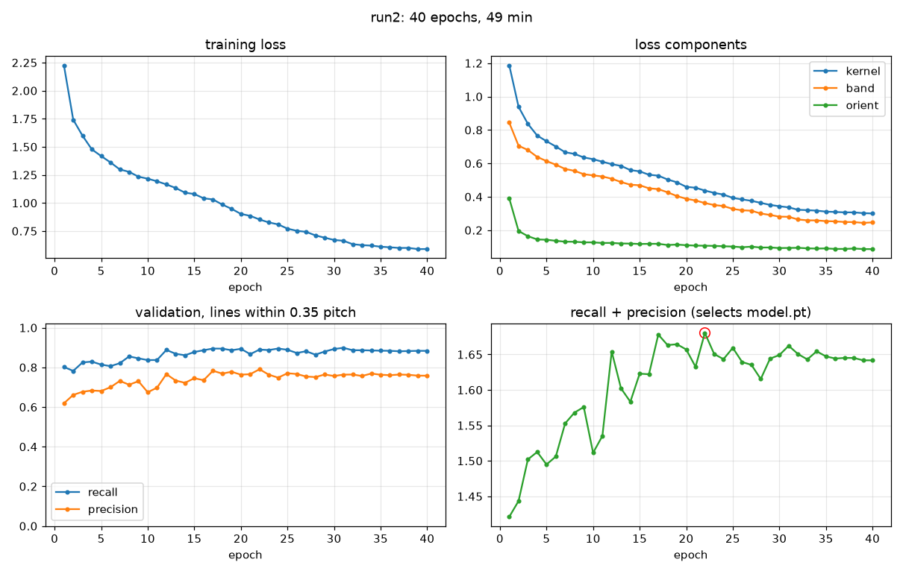

*Figure A5. The run2 dashboard shows training loss and components, validation recall and precision per epoch, and the selection score
with the saved epoch circled.*

**Test split.** Both models use the Test 2 read-out and are scored on 759 faces with at least two truth lines.

| script (faces) | run 1 recall / precision | run 2 recall / precision | first line within 0.5 pitch, run 1 → run 2 | count match, run 1 → run 2 |
|---|---|---|---|---|
| all (759) | 0.81 / 0.81 | **0.87 / 0.88** | 76% → 84% | 27% → 31% |
| OA, new (90) | 0.61 / 0.60 | **0.92 / 0.91** | 73% → 89% | 37% → 49% |
| NB, new (183) | 0.79 / 0.83 | **0.85 / 0.85** | 65% → 82% | 17% → 25% |
| OB (327) | 0.87 / 0.87 | 0.89 / 0.88 | 88% → 91% | 38% → 42% |
| NA (159) | 0.82 / 0.91 | 0.81 / 0.92 | 49% → 50% | 11% → 8% |
| fewer than 60 px per line (89) | 0.71 / 0.70 | 0.76 / 0.70 | 42% → 66% | 9% → 13% |

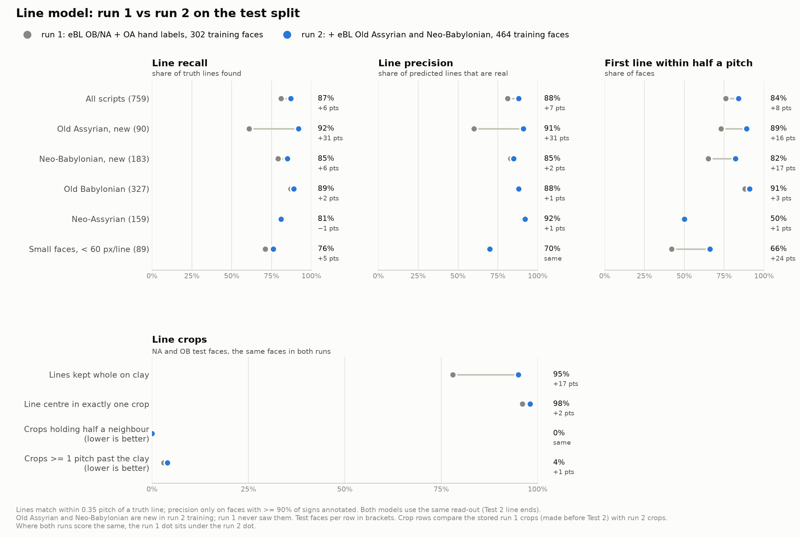

*Figure A6. Run 1 (gray) is plotted against run 2 (blue) on the test split. The figure shows line recall, precision
and first-line placement by script, and the crop measures on the NA and OB test faces both runs cover. Each line runs
from the run 1 value to the run 2 value, and the change is printed beside it.*

**What this means.**
- **Old Assyrian** goes from the worst script to one of the best. Run 1 found three lines in five, and run 2 found
  more than nine in ten. Run 1's hand-labelled CDLI Old Assyrian faces did not carry over to eBL's Old Assyrian
  photographs, but the eBL truth did.
- **Neo-Babylonian** gains six points of recall from 70 training faces, and first-line placement improves most of
  all (65 to 82 percent).
- **Old Babylonian**, the script with the most training data, did not get worse. It gained two points of recall.
  So the extra scripts help rather than compete.
- **Neo-Assyrian** is unchanged. Its training set barely changed (16 to 20 faces), and Neo-Babylonian, despite the
  related script, did not transfer. NA remains the weakest script, above all at placing the first line, where the
  model is within half a pitch on only half the faces.
- **Small faces** (under 60 px per line) gain on recall and first-line placement, but precision stays at 0.70.

Run 2 is better than run 1 on every script except NA, where it is equal, so it replaces run 1 as the line model.
The hand-labelled CDLI Old Assyrian faces cannot measure this gain. All of them are in training in both runs, so
they are not a hold-out. The A.1 figures and the stored `predictions/unet` and `line_crops_unet*` still
describe run 1.

**Moving the stored outputs to run 2.** The stored outputs are moved one set at a time, and run 1's versions are kept
in `tablet_data/ebl_tablets/linemodel/archive/`.

| stored set | status | check |
|---|---|---|
| `predictions/unet`, `unet_segments` (test split) | run 2, 3 Oct 2026; run 1 in `archive/run1_predictions/` | identical to the comparison above; on the same 486 NA and OB faces recall 0.853 → 0.865, precision 0.877 → 0.881 (the run 1 files predate the Test 2 read-out); 966 test faces now, against 666, because the OA and NB test faces are included |
| `line_crops_unet` (segment bounds, face frame, margin 0.5, test split) | run 2, 3 Oct 2026; run 1 in `archive/run1_line_crops_unet/` (rebuilding it from the archived run 1 predictions with these settings reproduces all 7,449 rectangles) | 10,137 crops from 963 faces. On the same NA and OB test faces: line centres in exactly one crop 96% → 98%, crops holding two line centres 2% → 2%, half a neighbour 0% → 0%; kept whole on clay 78% → **95%**, median cut at the right end 0.20 → 0.00 pitch; past the clay median 0.34 → 0.48 pitch, at least 1 pitch on 3% → 4%. Run 2's lines reach further, so the margin overhangs more (with run 1 and the Test 2 read-out the figures were 83% kept whole and 1.5% at 1 pitch or more). A third of the large overhangs come from three faces; on K.7853 reverse a diagonal broken edge makes any rectangle take in background, and K.3118 obverse is a face cut spanning obverse, edge and reverse, on which both runs fail (recall 0.00 and 0.12). `--trim-background` remains the remedy where overhang matters |
| `predictions/unet_n`, `line_crops_unet_n` | run 1 | |
| `line_crops_unet_rot` | run 1 | |
| Line Splitter app | run 1 | |

**Next.** Neo-Assyrian needs its own data. The NA tablets in the snippet metadata that have not been downloaded have
no line labels and a median of three boxes each, so that source is used up. The open options are lowering the training
coverage bar for NA only (`--min-cov 0.8` admits more NA faces at some label noise), building truth for NA tablets
from boxes without line paths by clustering them into lines (`lines/lines_from_boxes.py`), or hand-labelling NA faces
with the Line Marker page as was done for Old Assyrian.

### A.4 Independent check on hand-drawn Neo-Assyrian lines (10 Oct 2026)

**Why.** All line truth so far is built by us. eBL annotators boxed signs and recorded each sign's transliteration line,
and `ebl_ground_truth.py` fits a straight segment through each line's boxes, so a truth line spans only the signs that
were boxed and is always straight. The eBL sign dataset (Lewenstein et al. 2026, JOHD) has no line annotations of its
own. Its export holds only sign boxes plus a few boxes around ruled lines (150) and around whole surfaces and columns.
Dencker et al. (2020) did draw text lines by hand. They drew 618 lines on 50 faces of 36 Neo-Assyrian tablets from the
State Archives of Assyria, and each line is a polyline from end to end that follows the line's curve. The lines are in
github.com/compvis/cuneiform-sign-detection-dataset (`annotations/line_annotations_{train,test}.csv`) and were
downloaded to `data/heidelberg/`. None of the 36 tablets is in our eBL set. The photographs are the Heidelberg images
already in the eBL OCR download. There are 9 faces (6 tablets) with no photograph there, and they are skipped.

**Method.** `eval/evaluate_heidelberg.py` cuts each face out of its composite photograph, runs the model with the
standard read-out and scores it as `evaluate_lines.py` does. It matches within 0.35 pitch, allows one prediction per
truth line, and works in the frame of the truth lines' median angle. Line pieces split by a crack are merged first. Every line on these
faces is drawn, so precision is valid on every face. Because the drawn lines run end to end, it also measures how much
of each true line the matched prediction covers and how far it runs past each end. No training or tuning used these
faces.

| run 2 on hand-drawn lines | faces | lines | recall | precision | first line within 0.5 pitch | count match | line length covered: median / at least 95% | runs past the drawn ends, median left / right |
|---|---|---|---|---|---|---|---|---|
| all | 41 | 474 | 0.92 | 0.90 | 71% | 39% | 100% / 94% | 0.74 / 0.88 pitch |
| authors' test faces | 9 | 99 | 0.95 | 0.90 | 89% | 11% | 100% / 93% | 0.58 / 0.67 pitch |
| eBL Neo-Assyrian test faces, for comparison | 159 | | 0.81 | 0.92 | 50% | 8% | | |

**What this means.**
- **On Neo-Assyrian the model does better against hand-drawn lines than against our eBL truth.** Recall is 0.92
  against 0.81, and the first line is placed within half a pitch on 71 against 50 percent of faces, at the same
  precision. The two sets are different tablets and photographs (Heidelberg has CDLI composites of State Archives
  letters, and eBL has mostly British Museum K. fragments). This does not prove that the eBL truth is at fault, but it
  shows the model's Neo-Assyrian weakness is not simply an inability to see
  Neo-Assyrian lines.
- **Line ends: nothing is cut short.** Predicted lines cover the whole drawn line on 94 percent of lines, with no
  shortfall at either end, so the run 2 crops do not lose the ends of lines.
- **They run on by about 0.8 pitch at each end.** The annotators stopped at about the centre of the first and last
  sign, which accounts for roughly half a sign. The rest is real: the model's lines continue to the edge of the clay
  and onto rounded edges past the last sign. This matches the slightly larger background overhang of the run 2 crops.
- **The weak faces are dense or tiny.** They include VAT08803 obverse (36 lines, recall 0.61), P335608 (37 tightly
  packed lines, recall 0.76), and small fragments with five or six lines, where one miss costs 17 to 20 points.

**Next.** These 41 faces (32 from the authors' training set) are the first Neo-Assyrian truth not built by us. Adding
the 32 training faces to a run 3, with polylines rendered as chains of short segments and the 9 test faces held out,
would more than double Neo-Assyrian's 20 training faces. The face crops are already written to
`tablet_data/heidelberg/faces/`.

### A.5 Run 3: adding the hand-drawn Neo-Assyrian lines (10-11 Oct 2026)

**Data.** This run uses run 2's data plus the 32 Heidelberg faces from the authors' train split, which become 27
training and 5 validation faces in our tablet-level slice. Their 9 test faces stay out. Each hand-drawn polyline is painted as a chain of short segments
(`targets.polyline_segments`, thickness 0.6 pitch as for the Old Assyrian labels), with line spacing and ignore regions
computed per chain. All 513 existing training faces render the same targets as before. Note that `faces.csv` was
reduced on 7 Oct 2026 by 102 faces (99 Neo-Babylonian, 3 Old Babylonian) and kept that way. As a result, run 3 also
trains on 48 fewer Neo-Babylonian tune faces than run 2 did, and the test comparison below re-scores run 2 on the same
reduced set (705 faces, with Neo-Babylonian at 130 instead of 183). Training used `train.py --heidelberg` with otherwise
the same settings as run 2. It had 491 training and 54 validation faces, took 54 minutes, and used the checkpoint from
epoch 25.

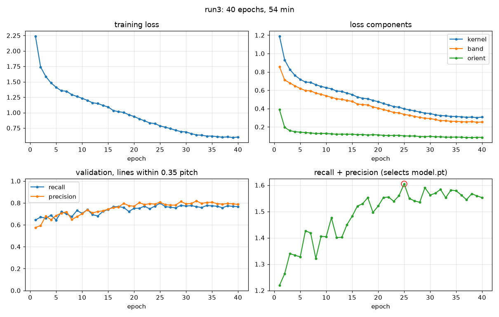

*Figure A7. The run3 dashboard shows training loss, validation recall and precision, and the selection score with the saved epoch circled.*

| eBL test faces | run 2 recall / precision | run 3 recall / precision | first line within 0.5 pitch, run 2 → run 3 | count match, run 2 → run 3 |
|---|---|---|---|---|
| all (705) | 0.87 / 0.88 | 0.89 / 0.89 | 84% → 83% | 32% → 36% |
| Neo-Assyrian (159) | 0.81 / 0.92 | **0.85** / 0.90 | 50% → 51% | 8% → 11% |
| Neo-Babylonian (130) | 0.85 / 0.87 | 0.88 / 0.87 | 82% → 79% | 28% → 35% |
| Old Assyrian (90) | 0.92 / 0.91 | 0.90 / 0.91 | 89% → 81% | 49% → 48% |
| Old Babylonian (326) | 0.89 / 0.88 | 0.90 / 0.89 | 91% → 92% | 42% → 44% |
| fewer than 60 px per line (49) | 0.70 / 0.69 | **0.82 / 0.76** | 46% → 54% | 10% → 14% |

| Heidelberg test faces (9 faces, 99 hand-drawn lines, never trained on) | run 2 | run 3 |
|---|---|---|
| recall / precision | 0.95 / 0.90 | **0.98 / 0.94** |
| line count equals the drawn count | 11% | **67%** |
| first line within 0.5 pitch | 89% | 78% (one face of nine) |
| line length covered, at least 95% | 93% | 91% |
| runs past the drawn ends, median left / right | 0.58 / 0.67 pitch | 0.44 / 0.45 pitch |

**What this means.**
- **Neo-Assyrian recall rises four points on the eBL test faces** (0.81 to 0.85) for two points of precision, from 27
  training faces of a different collection. On the held-out Heidelberg faces, both recall and precision rise, and the
  line count is right on six faces in nine instead of one.
- **Placing the first Neo-Assyrian line did not improve** (50 to 51 percent on eBL). Whatever makes the top line hard
  on the eBL Neo-Assyrian fragments, which are mostly broken K. fragments whose first surviving line is often damaged, is not
  fixed by more Neo-Assyrian lines from intact letters.
- **Lines stop closer to the real ends.** The overshoot past the drawn ends falls by about a third. The hand-drawn
  truth is the first to show the model where a line actually stops.
- **Small faces improve most** (recall 0.70 to 0.82), probably because the Heidelberg faces are small CDLI images.
- **Old Assyrian first-line placement drops eight points** (six faces of 72), and Neo-Babylonian placement drops
  three. With one training run per configuration, this is within what a different validation slice and fewer Neo-Babylonian faces
  could cause, so it needs a second run before it is read as a regression.

**Second seed.** Run 3 was repeated with `--seed 1`, which changes the starting weights, the training windows and the
validation slice, to see how much of the difference from run 2 is chance:

| eBL test faces | run 2 | run 3, seed 0 | run 3, seed 1 |
|---|---|---|---|
| all: recall / precision | 0.87 / 0.88 | 0.89 / 0.89 | 0.90 / 0.88 |
| Neo-Assyrian: recall / precision | 0.81 / 0.92 | 0.85 / 0.90 | 0.88 / 0.90 |
| Neo-Assyrian: first line within 0.5 pitch | 50% | 51% | 63% |
| Neo-Babylonian: recall / precision | 0.85 / 0.87 | 0.88 / 0.87 | 0.90 / 0.90 |
| Old Assyrian: recall / precision, first line | 0.92 / 0.91, 89% | 0.90 / 0.91, 81% | 0.91 / 0.87, 85% |
| Old Babylonian: recall / precision, first line | 0.89 / 0.88, 91% | 0.90 / 0.89, 92% | 0.91 / 0.87, 91% |
| fewer than 60 px per line: recall / precision | 0.70 / 0.69 | 0.82 / 0.76 | 0.83 / 0.83 |
| Heidelberg test: recall / precision, count match | 0.95 / 0.90, 11% | 0.98 / 0.94, 67% | 0.95 / 0.92, 33% |
| Heidelberg test: runs past the drawn ends | 0.58 / 0.67 pitch | 0.44 / 0.45 | 0.37 / 0.50 |

The two seeds differ by up to three points in per-script recall or precision and by up to twelve points in
first-line placement on the smaller groups (Neo-Assyrian 49 to 51 faces, Old Assyrian 71). Differences between run 2
and run 3 smaller than that are not reliable. Several results hold in both seeds: **Neo-Assyrian recall** rises (0.81 to 0.85
and 0.88), **overall recall** rises two to three points, **small faces** gain twelve to thirteen points of recall,
and **lines stop closer to their real ends**. The Old Assyrian first-line drop (89 to 81 percent) shrinks to four
points with seed 1 and is within the seed spread. Precision on Old Assyrian and Old Babylonian is one to four points
lower with seed 1, which is also within it. Neo-Assyrian first-line placement remains the weak point (51 and 63 percent).

**Data caveat.** The reduction of `faces.csv` on 7 Oct 2026 was not a deliberate selection. Row 47 (BM.31033__face)
ends in typed characters (`tablet_data/ bnjm.njm.`), and the 102 rows that followed it are missing. That is what
selecting a block of the file in an editor and typing over it produces. Run 3 (both seeds) therefore trained without 48
Neo-Babylonian tune faces, and all comparisons in this section use the reduced test set. On 10 Oct 2026 the file was
regenerated with `python -m line_cropping.faces.prepare_faces ebl`, and the damaged copy was kept as
`faces.csv.damaged_2026-10-07`. The regenerated file has 1,969 faces again, with 106 restored (103 Neo-Babylonian, 3 Old
Babylonian), and every undamaged row of the damaged copy is identical in the regenerated file. Runs 3 and 3 seed 1 above were trained before the
restore.

**Final comparison on the restored data (11 Oct 2026).** Both seeds were retrained on the restored face list
(`run3_full_s0` and `run3_full_s1`, with checkpoints from epochs 18 and 20 of 40) and scored with run 2 on the full test set.
These figures supersede the two tables above, which used the damaged face list.

| eBL test faces (full set) | run 2 | run 3, seed 0 | run 3, seed 1 |
|---|---|---|---|
| all (760): recall / precision | 0.87 / 0.88 | 0.87 / 0.87 | 0.88 / 0.87 |
| all: first line within 0.5 pitch | 84% | 86% | 79% |
| Neo-Assyrian (160): recall / precision | 0.81 / 0.92 | 0.85 / 0.89 | 0.84 / 0.90 |
| Neo-Assyrian: first line within 0.5 pitch | 50% | 59% | 52% |
| Neo-Babylonian (183): recall / precision | 0.85 / 0.85 | 0.88 / 0.87 | 0.88 / 0.88 |
| Old Assyrian (90): recall / precision | 0.92 / 0.91 | 0.89 / 0.89 | 0.89 / 0.87 |
| Old Assyrian: first line within 0.5 pitch | 89% | 89% | 66% |
| Old Babylonian (327): recall / precision | 0.89 / 0.88 | 0.87 / 0.86 | 0.89 / 0.86 |
| fewer than 60 px per line (89): recall / precision | 0.76 / 0.70 | 0.81 / 0.76 | 0.81 / 0.72 |
| Heidelberg test (9 faces): recall / precision | 0.95 / 0.90 | 0.98 / 0.94 | 0.96 / 0.93 |
| Heidelberg test: count match, runs past the drawn ends | 11%, 0.58 / 0.67 pitch | 56%, 0.50 / 0.54 | 44%, 0.51 / 0.54 |

**What this means.**
- **Overall, run 3 ties with run 2** (recall 0.87 to 0.88, precision 0.87 against 0.88). The hand-drawn Neo-Assyrian
  lines move accuracy between scripts rather than adding to it.
- **Gains in both seeds:** Both seeds gain in Neo-Assyrian recall (0.81 to 0.85 and 0.84), in Neo-Babylonian recall
  and precision (three points each), and on small faces (recall 0.76 to 0.81). On the held-out hand-drawn faces, they
  have higher precision, a right line count far more often and line ends closer to the real ones.
- **Costs in both seeds:** Old Assyrian recall falls three points (0.92 to 0.89), and Old Babylonian precision falls
  two (0.88 to 0.86). Neo-Assyrian precision falls two to three points.
- **First-line placement is too noisy to call:** the two seeds differ by 7 points on Neo-Assyrian (59 and 52 percent)
  and by 23 points on Old Assyrian (89 and 66 percent). The checkpoint is chosen on a validation slice of about 54
  faces that changes with the seed, which adds to this spread.

Run 3 is the better model for Neo-Assyrian, Neo-Babylonian and small faces, and run 2 is better for Old Assyrian and
Old Babylonian, with no overall winner. The stored outputs (A.3, "Moving the stored outputs") stay on run 2.

### A.6 Pilot: rebuilding lines from ProtoSnap sign fits (19-20 Oct 2026)

**Question.** If each annotated sign's font skeleton is fitted to the photograph with ProtoSnap, and a line's fitted
skeletons are joined into its **wedge envelope**, does the envelope show where the crops cut writing off or waste space,
and so show how to improve the crops?

**Method.** The pilot used 40 lines from the 60-tablet export (test split): 20 Old Babylonian lines (Santakku font) and
20 Neo-Assyrian lines (Assurbanipal font). Each line had at least 6 annotated signs, of which at least 80 percent had a
skeleton, and at most two lines were taken per tablet. Neo-Babylonian, which has skeletons for 4 percent of signs, and
Old Assyrian, which has no font, could not be included. Each of the 357 signs was cut from the deskewed face around its
eBL box with 30 percent padding, so that a skeleton could reach past the box and past the crop. Each sign was then fitted
with the unchanged ProtoSnap (`run_test.py`), which took about 58 seconds per sign and 6.5 hours in all. Fits with a
ProtoSnap score below 0.5 were left out. The envelope is the 2.5th-97.5th percentile of the kept wedge points. The code
is in `line_cropping/protosnap/line_envelope_prep.py` and `line_envelope_analyze.py`, and the results are in
`tablet_data/protosnap_inputs/envelope_pilot/analysis/`.

| result | value |
|---|---|
| fits with score >= 0.5 | 162 of 357 (45%); median score 0.49 |
| lines with at least one kept fit | 36 of 40 |
| kept skeleton extent / eBL box, width and height (median) | 1.07 / 0.96 |
| lines whose wedges reach past the crop's top / bottom | 75% / 78%, by a median 0.18 / 0.17 pitch |
| lines whose wedges reach past the crop's left / right end | 6% / 0% |
| crop height / wedge envelope height (median) | 1.11 / 1.45 pitch |
| slant of the line through the sign centres in the crop, bend from straight (median) | 1.5 degrees, 0.16 pitch |
| share of other lines' eBL box area inside a crop (median) | 13% |

The same question was also asked of the eBL boxes alone, on all 944 export crops with a known line spacing. The boxes of
a line reach past its crop's top on 84 percent of lines and past the bottom on 93 percent (median 0.19 and 0.31 pitch),
in every script. The boxes are a median 1.19 pitch tall, against crops of 1.03 pitch.

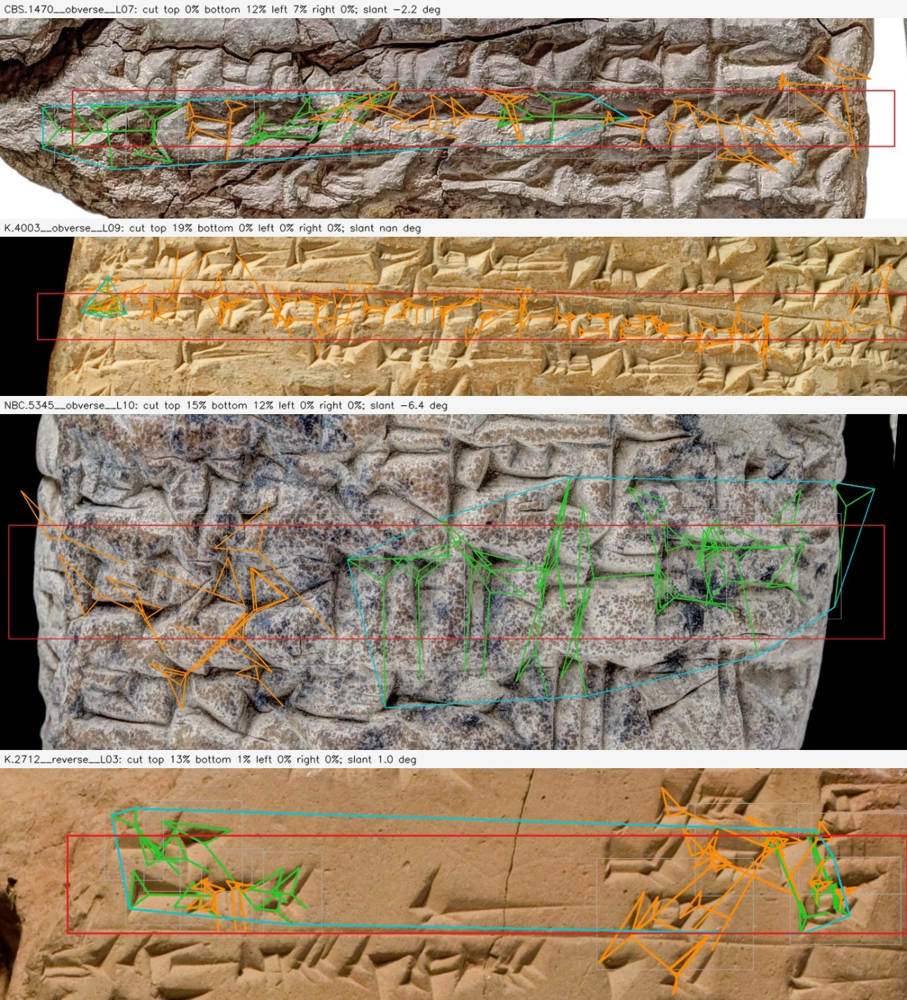

*Figure A8. Four pilot lines are shown, with the crop in red, eBL boxes in grey, kept fits in green, fits below the score
threshold in orange, and the envelope of the kept wedges in cyan. On K.4003 almost every fit failed. On NBC.5345 the kept
fits follow the signs, and their tall vertical wedges run below the crop.*

**What this means.**
- **ProtoSnap is not a reliable wedge locator for signs in their line.** More than half of the fits failed the score
  threshold, and the failures are visible: skeletons sprawl over neighbouring signs (orange in Figure A8). ProtoSnap
  was built for a single, centred sign. A padded box on a tablet always holds parts of the neighbours.
- **The kept fits largely reproduce the eBL boxes** (the extent ratio is about 1), because the target is cut around the
  box and the skeleton is fitted inside it. So the envelope is not independent evidence of where the wedges are. At this
  quality it says little that the boxes do not.
- **The boxes themselves give the useful answer, at no cost:** writing reaches past the top and bottom of the crops on
  most lines in every script, and hardly ever past the ends. Gap-bounded crops of about one line spacing are shorter
  than the signs, which are about 1.2 spacings tall, because signs of neighbouring lines interlock vertically. The crops'
  weak point is height, not width. Slant (1.5 degrees) and bend (0.16 pitch) are small.
- **Next steps for the crops, without ProtoSnap:** the first is to use the 150,000 eBL boxes directly to choose crop
  height and overlap, measuring for each setting how many of a line's boxes it contains against how much of the
  neighbouring lines' boxes it takes in. Test 4 did this with the predicted bands, but the boxes are the closer measure
  of the writing. The second is to consider line-shaped crops that follow the line's band and mask the neighbours,
  instead of rectangles. If ProtoSnap is used again, tighter targets (smaller padding) or fitting a whole line's signs
  jointly would be needed before its envelopes can be trusted.

### A.7 Line-shaped crops (20-21 Oct 2026)

**Question.** A.6 found that the signs of a line reach past the top and bottom of its rectangular crop on most lines,
because signs of neighbouring lines interlock. Can crops shaped to the line, bending around tall signs, hold more of
their own line without taking in more of the neighbours?

**Method.** `crops/seam_crops.py` replaces the straight boundary between two lines with a **seam**. The seam is the
left-to-right path through the deskewed face that crosses the least writing, as measured by the smoothed image gradient.
It is found by dynamic programming, kept at least 0.2 pitch from both line centres and pulled gently towards the
midpoint over blank clay. A line's crop is the region between its two seams, from its start to its end plus half a
pitch. Pixels outside the region are filled with the clay's colour, and the mask and seams are saved. The crops were
judged with `eval/box_containment.py` on the 436 test faces with coverage >= 0.9 (3,831 lines), using the eBL sign
boxes. The two measures are the share of a line's box area inside its crop and the share of the box area inside a crop
that belongs to other lines. Because eBL boxes are loose (A.6), line-shaped crops were also widened by a band shared
with the neighbours (0.1-0.2 pitch beyond each seam). This band is the counterpart of the rectangles' `--overlap`, so
the two shapes can be compared at equal leakage.

| crops (run 2 lines, test faces) | other lines' signs in crop (median) | own signs inside (median) | lines >= 90% inside | lines >= 95% inside | image per line |
|---|---|---|---|---|---|
| rectangles | 5% | 81% | 23% | 12% | 1.01 |
| line-shaped, strict | 6% | 83% | 23% | 11% | 1.06 |
| rectangles, overlap 0.15 | 10% | 90% | 48% | 29% | 1.18 |
| line-shaped + 0.1 shared band | 11% | 92% | 56% | 31% | 1.25 |
| line-shaped + 0.15 | 15% | 95% | 73% | 48% | 1.34 |
| line-shaped + 0.2 | 19% | 97% | 84% | 64% | 1.44 |

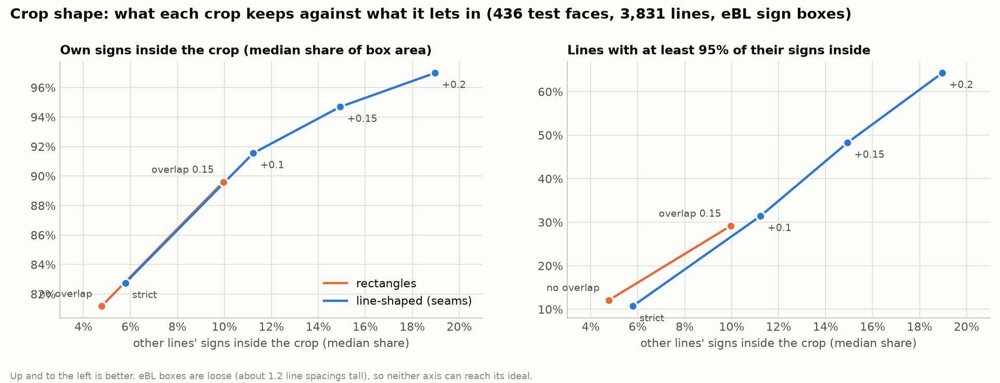

*Figure A9. The plot shows what a crop keeps of its own line against how much of the other lines it lets in, for
rectangles and line-shaped crops. The two shapes lie on one curve.*

**What this means.**
- **The shape adds almost nothing.** The seams do bend: about a sixth of each seam's length lies more than 0.15 pitch
  off a straight line. Line by line, they help 21 percent of lines by more than five points and hurt 12 percent. But at
  equal leakage of the neighbours' signs, line-shaped crops keep the same share of their own line as rectangles.
- **Height is the trade-off.** Every gain in a line's own signs is paid for in the neighbours' signs, in either shape.
  The crops range from keeping 81 percent of a line's signs at 5 percent foreign to keeping 97 percent at 19 percent
  foreign.
- **What line-shaped crops do offer** is masking and a smooth way to go beyond the rectangles' 0.15 overlap, which is
  capped at the neighbour's band edge (A.2, Test 4). With masking, the clay outside the region is blanked, so a
  downstream model does not see the neighbours' strokes outside the band.
- **The measure has a limit:** loose, overlapping eBL boxes make any strict boundary cut some boxes, so the strict
  versions of both shapes look worse than the writing itself would. A tighter measure of where the wedges are would be
  needed to see whether bending pays off where signs truly interlock.
- **Choice of setting** is a downstream question. It depends on how much of the neighbouring line a reader, such as
  ProtoSnap or an OCR model, tolerates for whole signs. The sign-box calibration proposed in A.6 would map this curve per
  script.

### A.8 Crop height calibrated on the eBL sign boxes (21 Oct 2026)

**Question.** A.6 and A.7 showed that crops are too short for the signs and that shape matters little, so the choice to
make is height. How tall should a crop be, per script, to hold its line's signs without taking in too much of the
neighbours?

**Method.** `eval/height_calibration.py` sweeps crop height and scores each setting with the eBL sign boxes, using the
share of a line's box area inside its crop and the share of a crop's box area that belongs to other lines. Overlaps are
computed exactly per box and column. There were two sweeps on single-column faces with coverage >= 0.9. The first was
around the **truth lines** (all such faces, 790, with 7,620 lines), with the crop at the line centre plus or minus h line
spacings. The second was around the **line model's lines** (run 2, 390 test faces, 3,778 lines), with the crop running
from the midpoint to each neighbour (as in today's crops) and extended by e line spacings, without the band-edge cap of
`--overlap`. The chosen setting was then built with the new `make_crops --extend` and scored with
`eval/box_containment.py`, and 30 random lines were inspected side by side (`report/crop_height_samples.py`, output in
`tablet_data/ebl_tablets/linemodel/crop_height_samples/`).

| around the model's lines: extension e beyond the midpoint | own signs inside (median) | lines >= 95% inside | other lines' signs in crop (median) | crop holds half of another line |
|---|---|---|---|---|
| 0 (today) | 85% | 16% | 14% | 8.9% |
| 0.1 | 95% | 49% | 22% | 9.6% |
| **0.15** | **98%** | **67%** | **27%** | **10.2%** |
| **0.2** | **99%** | **78%** | **31%** | **10.9%** |
| 0.25 | 100% | 85% | 34% | 12.1% |
| 0.3 | 100% | 88% | 38% | 15.3% |
| 0.4 | 100% | 90% | 44% | 35.3% |

Around the truth lines, a half-height of 0.5 line spacings (the midpoint) keeps 87 percent of a line's signs, 0.6 keeps
97 percent, and 0.65 keeps 99 percent with 77 percent of lines whole. Crops start to hold half of a neighbour beyond
about 0.75.

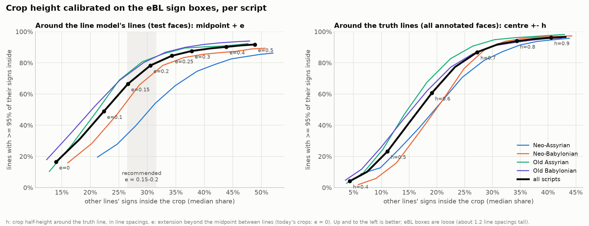

*Figure A10. The plot shows lines with at least 95 percent of their signs inside the crop against the other lines' share
of the crop, per script, around the model's lines (left) and the truth lines (right).*

**Check with real crops.** The setting was checked with real crops (`make_crops --extend 0.2`) on 436 test faces and
3,831 lines. This measure counts overlapping boxes once, so its foreign shares are lower than the calibration's.

| crops | own signs inside (median) | lines >= 95% inside | other lines' signs in crop (median) | crop holds half of another line | image per line |
|---|---|---|---|---|---|
| today (gap-bounded) | 81% | 12% | 5% | 9.1% | 1.01 |
| `--overlap 0.15` | 90% | 29% | 10% | 9.4% | 1.18 |
| **`--extend 0.2`** | **98%** | **67%** | **19%** | **10.6%** | 1.41 |

**What this means.**
- **The signs of a line occupy about +-0.6 to 0.7 line spacings around its centre**, in every script. Around the truth
  lines, the four scripts' curves nearly coincide. Today's crops stop at the midpoint (+-0.5), so they cut the tops and
  bottoms of most lines' signs.
- **Extending crops 0.15 to 0.2 line spacings beyond the midpoint** keeps 98 to 99 percent of a line's signs and makes
  two thirds to three quarters of lines whole, at the cost of a strip of the neighbours' signs along the top and bottom
  edges. Up to that point, the share of crops holding half of another line stays near the level caused by the model's
  missed or merged lines (about 9 percent, highest on Neo-Assyrian). From 0.3 it rises fast, so 0.25 is the upper limit.
- **One setting serves every script.** Neo-Assyrian trails only around the model's lines, because of the model's line
  errors on that script, not because its writing is taller.
- **The setting is now an option** (`make_crops --extend 0.2`). Whether to use it is a downstream choice. A reader that
  tolerates part of the neighbouring lines (or masks them) gains whole signs on most lines.

### A.9 Corrected line spacing, and a downward crop shift (1 Nov 2026)

**The spacing bug.** Every line score measures its tolerance in pitch, and the face table's pitch was wrong. It divided
each gap between lines by the difference of eBL's line index, which assumes that the index rises by 1 per text line. On
many tablets it rises by 2 or 3, so pitch came out at half or a third of the real value. The tolerance was then too
strict on those faces, and the Dencker network, which sizes its input from this value, ran at the wrong scale. In all,
446 of 1,551 faces (192 of 755 test faces) were at least 1.5 times too small. Of these, Neo-Babylonian had 190, Old
Babylonian 182, Neo-Assyrian 71, and Old Assyrian 3. The "small faces" group shrinks from about 90 test faces to 12, because
most of them were not small.

**The fix** (`truth/ebl_ground_truth.py`). Pitch is now measured directly as the median gap between neighbouring
annotated lines. The index is not used at all, because it is irregular (it runs 1, 1, 3, 4, 4, 6 on YBC.5710). Measured
gaps alone fail on faces with few annotated lines far apart (HS.2070 has two lines 1,460 px apart), and a first attempt
inflated pitch there and made scores too generous. So when there are fewer than five annotated lines, a gap over 1.5
sign heights is replaced by 0.93 sign heights, which is the ratio on well-annotated blocks. The checks are as follows:

| check | before | after |
|---|---|---|
| blocks with implausible spacing (under 0.6 or over 1.4 sign heights) | 22% | 3.5% |
| spacing in sign heights, median: NA / NB / OA / OB | 0.81 / 0.56 / 0.95 / 0.87 | 0.93 / 0.94 / 0.94 / 0.94 |
| face images and crop boxes | | unchanged (the old value is kept only as the face margin, `face_margin_px`; all faces.csv columns but the two pitch columns identical, 60 sampled images byte-identical) |

Stored predictions, crops and the split therefore all stay valid. Scores rise because a too-strict tolerance is gone,
not because any model changed. Only the Dencker network was re-run. The old scores are kept beside the new ones as
`evaluation_before_pitch_fix.csv`.

| eBL test faces: recall / precision, first line | before | after |
|---|---|---|
| line model run 1 | 0.81 / 0.81, 76% | 0.84 / 0.82, 76% |
| line model run 2 | 0.87 / 0.88, 84% | 0.90 / 0.89, 86% |
| line model run 3, seed 0 | 0.87 / 0.87, 86% | 0.90 / 0.88, 87% |
| line model run 3, seed 1 | 0.88 / 0.87, 79% | 0.89 / 0.88, 80% |
| Kraken retrained, pieces joined | 0.89 / 0.81, 80% | 0.91 / 0.82, 81% |
| Dencker network, no count (re-run at the right scale) | 0.85 / 0.78, 74% | **0.88 / 0.86**, 73% |
| Dencker network, with count (re-run) | 0.80 / 0.82, 72% | 0.86 / 0.88, 75% |
| detector route with count (`det_n`), 487 NA and OB faces | 0.91 / 0.91, 90% | 0.92 / 0.92, 90% |
| line model with count (`unet_n`, still run 1), 486 NA and OB faces | 0.83 / 0.85, 81% | 0.87 / 0.88, 83% |

- **The order among line models holds, but the Dencker network moves up.** Its precision rises eight points, so most of
  its earlier deficit on eBL was this bug. It is given each face's true spacing, which a new tablet does not come with.
- **Run 2 and run 3 still tie overall.**
- **Heidelberg scores do not change:** that set has its own truth and spacing.

**The shift** (`make_crops --shift`). The model's lines sit a median 0.06 line spacings above the middle of the signs, so
crops are moved down by that constant. The results on 436 test faces and 3,831 lines, measured as in A.8, are as follows:

| crops | own signs inside (median) | lines >= 95% inside | other lines' signs in crop (median) | crop holds half of another line | image per line |
|---|---|---|---|---|---|
| today (gap-bounded) | 81% | 12% | 5% | 9.1% | 1.01 |
| `--shift 0.06` | 82% | 12% | 4% | 9.1% | 1.01 |
| `--extend 0.2` | 98% | 67% | 19% | 10.6% | 1.41 |
| **`--extend 0.2 --shift 0.06`** | **98%** | **70%** | **19%** | **10.7%** | 1.41 |
| `--extend 0.15 --shift 0.06` | 96% | 55% | 14% | 10.1% | 1.31 |

| lines >= 95% inside | Neo-Assyrian | Neo-Babylonian | Old Assyrian | Old Babylonian |
|---|---|---|---|---|
| `--extend 0.2` | 52% | 68% | 66% | 69% |
| `--extend 0.2 --shift 0.06` | 60% | 73% | 66% | 72% |

- **The shift is a small free gain:** it makes three more lines in a hundred whole, eight more on Neo-Assyrian and none
  on Old Assyrian, with no added image and no added foreign signs.
- **It matters only together with the extension.** Alone it changes almost nothing.
- **It does not replace extending:** extending by 0.15 with the shift keeps fewer whole lines than 0.2 without it.
- **Why the lines sit high (found while setting up run 4, A.10):** the cause is mostly half a pixel of the stride-4
  output map. Map rows are counted from their top edge when they are turned back into face pixels, and this half pixel
  is 2 px of model input. The measured offset is a nearly constant 2 to 3 px at every line spacing (run 2, median
  -2.7 px), not a constant share of the spacing. So `--shift` in line spacings is a stand-in: small spacings are
  under-corrected and large ones over-corrected. A half-pixel fix in the read-out would be the proper correction. It is
  not applied, so that stored predictions stay as scored.
- **Caveat:** the offset was measured on these same test faces, as only they have stored run 2 lines. It is one constant,
  and the median is similar across scripts (-0.04 to -0.06 by a separate per-script check), so the optimism should be
  small. However, it is not an independent test.

### A.10 Run 4: predicting each line's height (set up 1 Nov 2026, trained 2 Nov 2026)

**Result in short.** Predicted heights did not beat a fixed height. At equal crop size they keep as many whole lines, but
no more. Line accuracy did not suffer and rose slightly on both seeds. Crops should stay on `--extend` and `--shift`.

**Goal.** One fixed crop height serves every line (A.8, A.9). Run 4 adds two output channels so the model says how far
each line's signs reach, and crop height follows the line.

**Target** (`truth/line_heights.py`, `faces/line_heights.csv`). For each line, the target is the 90th percentile, over its
sign boxes, of the distance from the line to the box's top edge (`up`) and bottom edge (`down`), capped at 1.2 line
spacings. A percentile is used rather than the maximum, so that one box assigned to the wrong line does not set the
height. 11,471 of 14,210 eBL lines have a height. Lines with fewer than 3 boxes do not. The table shows the ceiling with
perfect lines and perfect heights (390 tune faces, 3,808 lines, measured as in A.8, with the fixed height standing in for
lines without a height):

| crops around truth lines | own signs inside (median) | lines >= 95% inside | other lines' signs in crop (median) | crop holds half of another line |
|---|---|---|---|---|
| fixed +-0.65 spacings | 99% | 79% | 23% | 1.3% |
| fixed +-0.7 spacings | 100% | 88% | 27% | 2.1% |
| per line, 75th percentile | 98% | 86% | 18% | 0.7% |
| **per line, 90th percentile** | **99%** | **95%** | **21%** | **1.3%** |
| per line, maximum | 100% | 96% | 23% | 3.0% |

**Model** (`train.py --heights`). The head grows from 4 to 6 channels. Otherwise the network is run 3's, with the same
recipe and, per seed, the same faces (490 training and 66 validation faces with seed 0, and 507 and 49 with seed 1). Inside a line's band, each pixel predicts log(1 + d / 4), where d is its distance straight up or down to
the edge of the line's signs, so the target scales with the augmentation and the error is relative. The loss adds L1 on
both channels, with weight 1, only on lines with a height. These lines cover 425 of the 556 training and validation
faces. The Old Assyrian hand labels and Heidelberg lines have no sign boxes and train the line channels only. Checkpoint
selection stays on line recall plus precision.

**Read-out and crops.** Each line's `up` and `down` are medians over its band pixels (`infer.read_lines`). They are
written with the segments and used by `make_crops --bounds heights`, with `--height-scale` to trade whole signs against
other lines' signs. The heights correct for the half-pixel offset above, so crop edges are unbiased while the line
positions stay comparable with earlier runs.

**Checks before training.** Perfect target maps passed through the real read-out recover the true edges (the median error
is 0.000 of the crop height, with the IQR within 0.001). Run 3 weights run through the changed code give byte-identical
segments (20 of 20 faces). A dry run trains, infers and scores end to end.

**What to compare.** Run 4 is compared against run 3 on lines, because adding a task must not cost line accuracy (seed
variation applies). On the same run 4 lines, `--bounds heights` is compared against `--extend 0.2 --shift 0.06`
(`savio/infer.sbatch` prints both). The heights are worthwhile if whole lines rise clearly above 70% without more of
other lines' signs than the fixed 19%.

**Results: lines.** Two seeds were trained locally for 40 epochs and scored on the eBL test faces. Recall and precision
rise by 0.01 to 0.03 on both seeds, and first-line accuracy moves by -1 and +3 points. Two seeds cannot show that the
height task is the cause.

| run | recall | precision | first line within 0.5 spacing |
|---|---|---|---|
| run 3, seed 0 | 0.90 | 0.88 | 87% |
| run 3, seed 1 | 0.89 | 0.88 | 80% |
| **run 4, seed 0** | **0.92** | **0.91** | **86%** |
| **run 4, seed 1** | **0.91** | **0.89** | **83%** |

**Results: crops.** On the same run 4 lines (`eval/box_containment.py`; seed 0: 439 faces, 3,851 lines; seed 1: 438
faces, 3,834 lines), the unscaled heights give smaller crops than the fixed setting, so they miss the target of 70% (they
reach 44% and 51%). The comparison that counts is at equal crop size, where the `--height-scale` and `--extend` sweeps
meet:

| crops (all `--extend` with `--shift 0.06`) | seed | lines >= 95% inside | other lines' signs in crop (median) | crop holds half of another line | image per line (spacings) |
|---|---|---|---|---|---|
| `--extend 0.2` | 0 | 67% | 18% | 8.2% | 1.40 |
| heights x 1.1 | 0 | 65% | 17% | 8.3% | 1.38 |
| `--extend 0.25` | 0 | 78% | 22% | 9.0% | 1.50 |
| heights x 1.2 | 0 | 78% | 23% | 10.4% | 1.51 |
| `--extend 0.2` | 1 | 66% | 18% | 8.3% | 1.41 |
| heights x 1.1 | 1 | 69% | 19% | 11.0% | 1.42 |
| `--extend 0.25` | 1 | 76% | 22% | 9.4% | 1.51 |
| heights x 1.15 | 1 | 75% | 22% | 12.4% | 1.49 |

Heights also take in half of another line as often or more often, and they move whole lines between scripts rather than
adding them. Comparing `--extend 0.2` with heights x 1.1 on seed 0, Neo-Assyrian falls from 56% to 44% (other lines'
signs go from 20% to 16%) and Old Assyrian rises from 66% to 71% (other lines' signs go from 15% to 17%). The scales were
read off these test faces, which favours the heights, and they still do not win.

**Why the ceiling was not reached.** The table below scores crops that follow each line's tilt, as in A.8, on the test
faces (398 and 397 faces). This is a separate measure, so compare only within this table.

| crops following the line | lines >= 95% inside, seed 0 / seed 1 |
|---|---|
| truth lines, truth heights | 95% / 95% |
| truth lines, predicted heights | 71% / 76% |
| predicted lines, truth heights | 75% / 71% |
| predicted lines, predicted heights | 67% / 71% |

Either error alone costs about 20 points. Perfect heights on predicted lines would add only 0 to 8 points, so line
position limits this as much as height does (the position error is 0.05 spacings at the median and 0.17 to 0.18 at the
90th percentile). The heights themselves carry little per-line information: they correlate with the truth at only 0.33
to 0.52, in spacings. Their bias is small: `up` is 3 to 7% low and `down` is 5 to 8% high, which roughly offsets the
lines sitting high.

### A.11 Crops that follow each line's tilt, and run 4 as the default model (2 Nov 2026)

**Change.** `make_crops --bounds segments` (or `heights`) now cuts each line along its own predicted tilt instead of in
the deskewed face. Lines tilt a median 0.74 degrees from their face's skew, and 2.82 degrees at the 90th percentile. The
option existed but was off and could not be scored. Three things changed with it:

- `crops.csv` gains `line_cx` and `line_cy`, and `box_containment` scores such a crop in the line's own frame. Before, it
  read those rectangles as if they lay in the deskewed face.
- The 20-degree guard added the skew instead of subtracting it, so it measured the wrong angle (a median of 5.82 degrees
  rather than 0.74). The Line Splitter already subtracted it.
- `--trim-background` now also applies to tilted crops.

**Result.** The crops were scored on the run 4 lines on the eBL test faces, with `--shift 0.06` throughout (seed 0: 439
faces, 3,851 lines; seed 1: 438 faces, 3,834 lines). Tilted crops keep 2 to 3 points more whole lines at the same crop
size, with other lines' signs and half neighbours essentially unchanged. The gain is real but small. Crop size matters
far more.

| `--extend` | seed | lines >= 95% inside, level -> tilted | other lines' signs in crop, level -> tilted | crop holds half of another line, level -> tilted |
|---|---|---|---|---|
| 0.15 | 0 | 51% -> 53% | 14% -> 14% | 7.7% -> 7.8% |
| 0.15 | 1 | 51% -> 53% | 14% -> 14% | 8.0% -> 8.0% |
| **0.2** | **0** | **67% -> 69%** | **18% -> 18%** | **8.2% -> 8.2%** |
| 0.2 | 1 | 66% -> 68% | 18% -> 18% | 8.3% -> 8.4% |
| 0.25 | 0 | 78% -> 81% | 22% -> 22% | 9.0% -> 8.9% |
| 0.25 | 1 | 76% -> 78% | 22% -> 22% | 9.4% -> 9.4% |

10,607 of 10,624 seed 0 crops were cut along their tilt. A crop is still straight, so a curved line, or a segment joined
across columns, is not fully levelled (K.3993 reverse is an example).

**Default model.** `paths.LINE_WEIGHTS` is `weights/linemodel/run4_s0/model.pt`, which is the default of `infer.py` and
the Line Splitter. The stored `predictions/` and `line_crops_unet/` are still from run 2 until they are regenerated. The
Line Splitter already followed the tilt, but it does not apply `--extend` or `--shift`.

**Run 5: run 4's seed 0 without the height channels (3 Nov 2026).** It uses the same recipe, seed and faces, with
`--heights` left out, to test whether the height task caused run 4's gain. The result points that way, weakly, on
precision and line centring, and `run4_s0` stays the default model.

| run | recall | precision | first line within 0.5 spacing | lines >= 95% inside (tilted, `--extend 0.2 --shift 0.06`) | crop holds half of another line |
|---|---|---|---|---|---|
| **run 4, seed 0** | **0.92** | **0.91** | **86%** | **69%** | **8.2%** |
| run 5, seed 0 | 0.91 | 0.88 | 82% | 70% | 8.6% |

The next table gives differences on the same faces, with 95% intervals from resampling tablets. The intervals cover the
choice of test tablets, not training randomness. Different seeds also train on different faces, so the seed rows
overstate training randomness alone. The last row is the fairer yardstick, though run 3 was trained on slightly older
code.

| comparison | recall | precision | first line |
|---|---|---|---|
| run 4 seed 0 - run 5 seed 0 | +0.009 (+0.002, +0.017) | +0.032 (+0.019, +0.045) | +4.2 points (+1.3, +7.1) |
| run 4 seed 0 - run 4 seed 1 (same recipe, other faces) | +0.015 (+0.006, +0.025) | +0.027 (+0.017, +0.037) | +3.5 points (+0.4, +6.7) |
| run 3 seed 0 - run 3 seed 1 (same recipe, other faces) | +0.005 (-0.007, +0.017) | -0.000 (-0.015, +0.016) | +7.1 points (+3.9, +10.5) |
| run 5 seed 0 - run 3 seed 0 (no heights, same seed and faces) | +0.011 (+0.001, +0.022) | +0.001 (-0.013, +0.016) | -5.3 points (-8.4, -2.2) |

Run 4's precision gain is larger than the difference between the two runs without heights. Its recall and first-line
gaps are not. Lines also sit better centred on the sign boxes with heights. The table below uses eBL test faces with
coverage >= 0.9. Offset and error are in line spacings, and a negative offset means that the line sits high.

| run | heights | median offset | median absolute error |
|---|---|---|---|
| run 4, seed 0 | yes | -0.032 | 0.050 |
| run 4, seed 1 | yes | -0.034 | 0.054 |
| run 5, seed 0 | no | -0.041 | 0.059 |
| run 3, seed 1 | no | -0.045 | 0.063 |
| run 3, seed 0 | no | -0.061 | 0.072 |

The height outputs do not change the kernel target that positions a line, so any effect is indirect, through features
shared with the sign edges. Five runs cannot settle this, and `run4_s0` was picked on these test faces, so its scores are
slightly optimistic. Crops are level with run 5's. The crop sweeps in A.10 and A.11 were written to a temporary folder
and not kept. `make_crops` with the flags shown and `eval/box_containment.py` regenerate them.

### A.12 Fixes to scoring and validation (3 Nov 2026)

An audit of the benchmarks found no wrong stored numbers in the main tables, but it found four code bugs. Test faces were
never trained on through any of them. Sections A.1 to A.11 keep the scores of their time. The Summary and sections 6.1
and 6.4 use the scoring below.

**Scoring (`eval/evaluate_lines.py`).** All runs were rescored, and the old files are kept as
`evaluation_before_truth_merge.csv`.

- *Repeated truth rows.* 63 test faces listed one line more than once (194 extra rows), so a single predicted line could
  only match one of them. Rows with the same column and line index within 0.35 pitch are now one truth line. Rows
  farther apart stay separate, as they can be separate rows of writing.
- *Faces with no prediction.* These were skipped, which spared a model that found nothing. They now score recall 0 and
  fail their first line if it is scored. This concerned 0 to 2 faces per run.

| eBL test faces, recall / precision, first line | before | after |
|---|---|---|
| run 1 | 0.84 / 0.82, 76% (759 faces) | 0.85 / 0.82, 76% (761) |
| run 2 | 0.90 / 0.89, 86% (759) | 0.91 / 0.89, 86% (761) |
| run 3, seed 0 | 0.90 / 0.88, 87% (761) | 0.92 / 0.88, 87% (761) |
| run 3, seed 1 | 0.89 / 0.88, 80% (760) | 0.91 / 0.88, 80% (761) |
| run 4, seed 0 | 0.92 / 0.91, 86% (761) | 0.94 / 0.91, 86% (761) |
| run 4, seed 1 | 0.91 / 0.89, 83% (760) | 0.92 / 0.89, 82% (761) |
| run 5, seed 0 | 0.91 / 0.88, 82% (761) | 0.93 / 0.88, 82% (761) |
| Kraken, pieces joined | 0.91 / 0.82, 81% (761) | 0.93 / 0.82, 81% (761) |
| Dencker network, no count | 0.88 / 0.86, 73% (759) | 0.89 / 0.86, 73% (759) |
| `det_n`, 487 NA and OB faces | 0.92 / 0.92, 90% | 0.94 / 0.91, 90% |

Recall rises by 0.012 to 0.017 for every method, and the order does not change. `phase5_eval.py` still scores the raw
rows. Its stored Phase 5 results are historical, and it should not be re-run, as it rewrites the split. The run
comparisons in A.11 change by at most 0.002.

**Validation (`linemodel/train.py`, `infer.score_against_truth`).**

- *Training mode.* `validate()` never called `model.eval()`. Validation scores were noisy, and validation faces, with
  full-face statistics, altered the BatchNorm statistics saved in `model.pt`. This affected every run, and the saved
  statistics also shape test predictions.
- *Heidelberg lines miscounted (runs 3 to 5).* Each short segment of a drawn line counted as a truth line, so these faces
  scored about 0.29 / 0.48 instead of about 0.92 / 0.83 on `run4_s0`. They are 6 of the 66 validation faces with seed 0.
  Segments of one chain now count as one line, and eBL pieces are merged as above.

Together these explain why the stored validation scores (about 0.80 / 0.76 for `run4_s0` in `history.csv`) sit far below
the test scores. In eval mode with lines merged, `run4_s0` scores 0.90 / 0.84 on its validation slice. The
`history.csv` files of the existing runs were not rewritten.

**Not yet addressed.** Existing checkpoints were chosen with both validation bugs and keep their BatchNorm statistics, so
a fair comparison needs retraining. Runs 1 to 5 are not comparable on validation scores with any run trained after this
fix. Run 6 is that retraining (A.13).

### A.13 Run 6: retraining after the validation fixes, with and without heights (3-4 Nov 2026)

Four models were trained with the fixes of A.12: seeds 0 and 1, each with and without the height channels, otherwise with
the settings of run 4 (40 epochs, Heidelberg faces in training). They answer two questions: whether the height channels
help, and whether the fixes change the model. `LINE_WEIGHTS` now points to `run6_heights_s1` (see the end of this
section).

The table shows line finding on the 761 eBL test faces and on the 9 Heidelberg test faces (5 tablets):

| Model | Best validation sum (epoch) | eBL recall / precision | eBL first line | Heidelberg recall / precision | Heidelberg first line |
|---|---|---|---|---|---|
| run 4, seed 0 (default) | not comparable | 0.94 / 0.91 | 86% | 0.99 / 0.93 | 67% |
| run 4, seed 1 | not comparable | 0.92 / 0.89 | 82% | 0.99 / 0.91 | 67% |
| run 5, seed 0 | not comparable | 0.93 / 0.88 | 82% | not scored | not scored |
| run 6, heights, seed 0 | 1.830 (19) | 0.94 / 0.89 | 86% | 0.98 / 0.96 | 89% |
| run 6, no heights, seed 0 | 1.793 (27) | 0.94 / 0.90 | 85% | 0.99 / 1.00 | 89% |
| run 6, heights, seed 1 | 1.817 (21) | 0.94 / 0.91 | 87% | 0.97 / 1.00 | 89% |
| run 6, no heights, seed 1 | 1.825 (20) | 0.94 / 0.90 | 85% | 0.97 / 0.98 | 89% |

The next table scores crops on the 435 faces and 3,830 lines that every set covers
(`--bounds segments --extend 0.2 --shift 0.06`, cut along each line's tilt). The output is in
`linemodel/recheck/box_all`.

| Model | Whole lines | Other lines' signs | Half of another line | Image per line |
|---|---|---|---|---|
| run 4, seed 0 | 70% | 18% | 7.9% | 1.39 |
| run 4, seed 1 | 68% | 18% | 8.4% | 1.41 |
| run 5, seed 0 | 70% | 18% | 8.2% | 1.41 |
| run 6, heights, seed 0 | 68% | 17% | 4.4% | 1.39 |
| run 6, no heights, seed 0 | 69% | 17% | 5.4% | 1.39 |
| run 6, heights, seed 1 | 68% | 17% | 5.5% | 1.38 |
| run 6, no heights, seed 1 | 68% | 17% | 5.8% | 1.39 |

These counts differ slightly from A.11 (69%, 8.2%), which scored each model on its own faces. The intervals below are 95%
intervals from 2,000 paired resamples of tablets. They are not corrected for the number of comparisons.

**Heights make no measurable difference.** No gap between the height and no-height models of a seed excludes zero:

| No heights minus heights | Recall | Precision | First line | Half of another line | Whole lines |
|---|---|---|---|---|---|
| seed 0 | +0.000 (-0.008 to +0.008) | +0.002 (-0.009 to +0.014) | -0.2 (-2.9 to +2.4) pts | +1.0 (-0.1 to +2.2) pts | +1.1 (-0.3 to +2.7) pts |
| seed 1 | -0.001 (-0.006 to +0.004) | -0.008 (-0.018 to +0.001) | -2.2 (-4.6 to +0.2) pts | +0.3 (-0.7 to +1.3) pts | +0.9 (-0.5 to +2.2) pts |

Height channels did not clearly centre lines better either. The median offset of the line from its signs' box centres,
in pitch, with the median absolute offset, is -0.019 / 0.075 with heights and -0.030 / 0.079 without on seed 0, but
-0.034 / 0.083 with heights and -0.030 / 0.081 without on seed 1. This measure uses box centres on matched lines with at
least 3 boxes, so it is not comparable with the offsets quoted in earlier sections.

**All four run 6 models hold half of another line less often than `run4_s0`.** The gap is 2.0 to 3.5 points, and its
interval excludes zero for each of them. For example, it is -2.3 (-3.7 to -1.1) points for heights, seed 1.
Neo-Assyrian and Neo-Babylonian gain most (for that model, from 19% to 15% and from 14% to 12%). The costs are as
follows:

- Whole lines go down by 0.8 to 2.3 points, and only the intervals of the two height models exclude zero (seed 1: -2.3,
  -3.6 to -1.0).
- Recall goes up by about 0.006, and for three of the four models the interval includes zero.
- Precision goes down by 0.006 to 0.021, and only the interval for heights with seed 1 includes zero (-0.006, -0.018 to
  +0.005). First line is unchanged for all four.
- There are slightly more predicted lines (8,508 to 8,719 against 8,477).

Older models rerun with the current inference and crop code gave identical crop scores, so this is not a side effect of
those changes. Run configurations match apart from heights, seed and output folder. The likely cause is the A.12
validation fix, either through checkpoint choice or through BatchNorm statistics no longer altered by validation faces.
This was not tested separately.

On the 12 small faces, the default scores below `run4_s0` (0.73 / 0.74 against 0.81 / 0.96; the precision figures rest on 4 faces)
and below `run6_heights_s0` (0.87 / 0.87).

**Which model.** The four differ by no more than seed noise, so the height channels can be dropped or kept on other
grounds. Against `run4_s0`, `run6_heights_s1` is the only one with no measurable loss of precision, and it has the highest
first-line score. However, it was picked using these test scores, so they slightly favour it. Validation would pick
`run6_heights_s0`, by 0.005 over the next model. Heidelberg differences come from 9 faces and are weak evidence.
`run6_heights_s1` became the default on 4 Nov 2026.

## Sources

1. Wentao Che et al., *Automated sign detection across the Electronic Babylonian Library*, 2026. https://arxiv.org/abs/2606.22608 (the detector the line model is compared against)
2. Olaf Ronneberger, Philipp Fischer, Thomas Brox, *U-Net: Convolutional Networks for Biomedical Image Segmentation*, MICCAI 2015. https://arxiv.org/abs/1505.04597
3. Kaiming He, Xiangyu Zhang, Shaoqing Ren, Jian Sun, *Deep Residual Learning for Image Recognition*, CVPR 2016. https://arxiv.org/abs/1512.03385
4. Wenhai Wang et al., *Shape Robust Text Detection with Progressive Scale Expansion Network* (PSENet), CVPR 2019, and Minghui Liao et al., *Real-time Scene Text Detection with Differentiable Binarization* (DBNet), AAAI 2020: the kernel-and-band recipe the targets follow. https://arxiv.org/abs/1903.12473, https://arxiv.org/abs/1911.08947
5. Rachel Mikulinsky et al., *ProtoSnap: Prototype Alignment for Cuneiform Signs*, ICLR 2025. https://arxiv.org/abs/2502.00129
