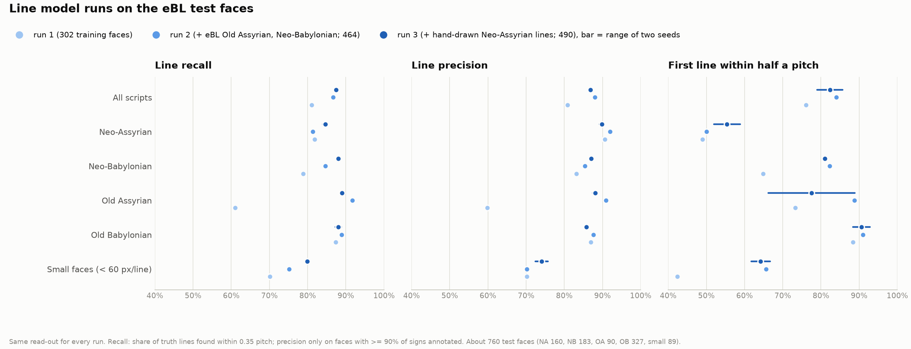
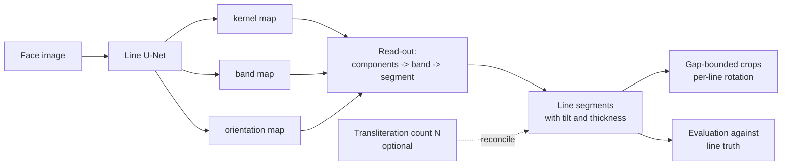
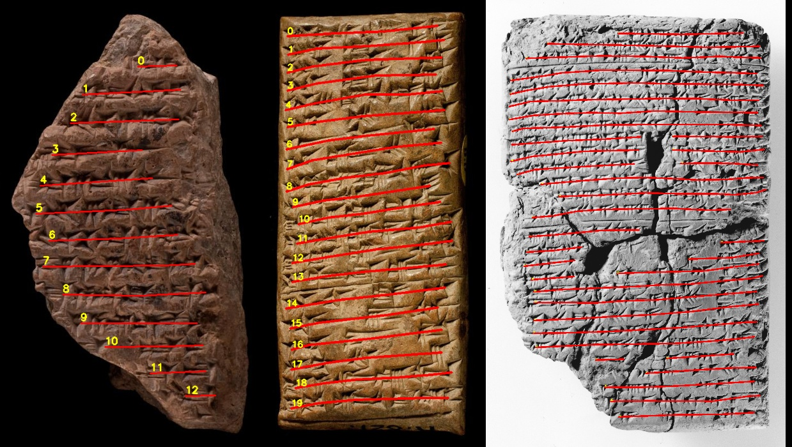
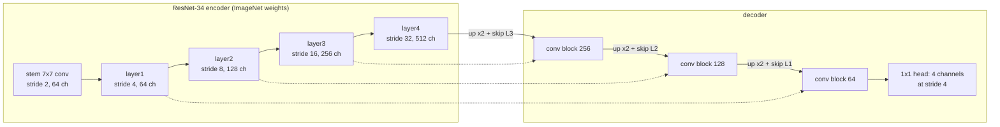
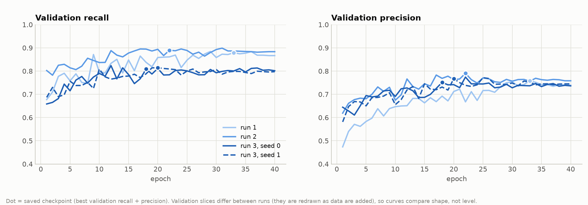
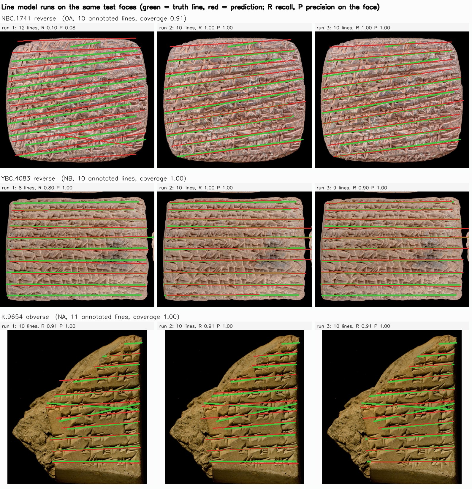
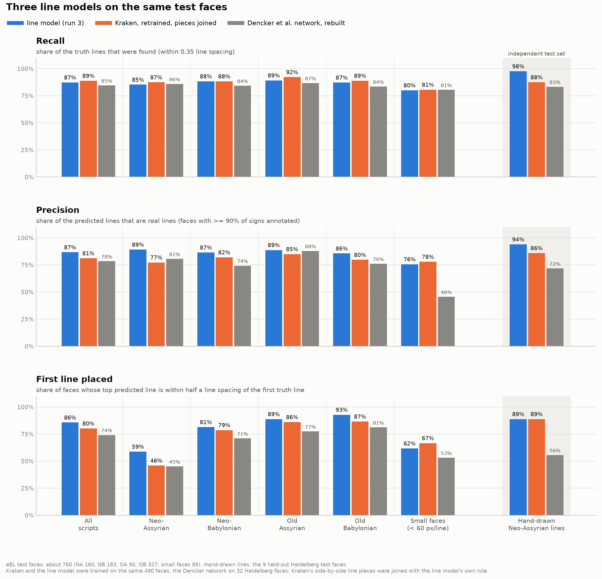
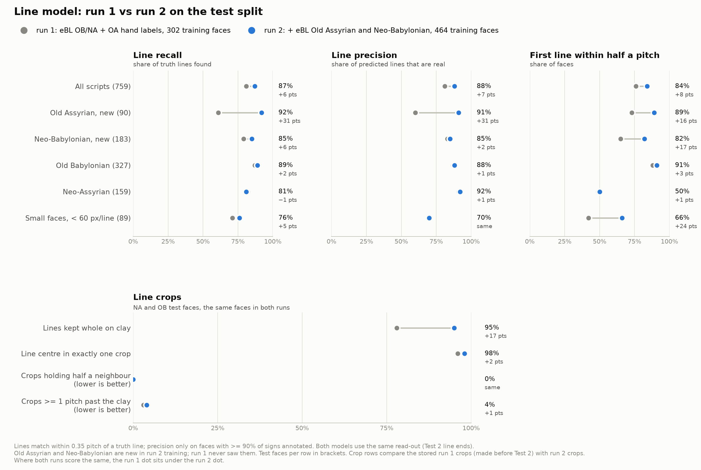
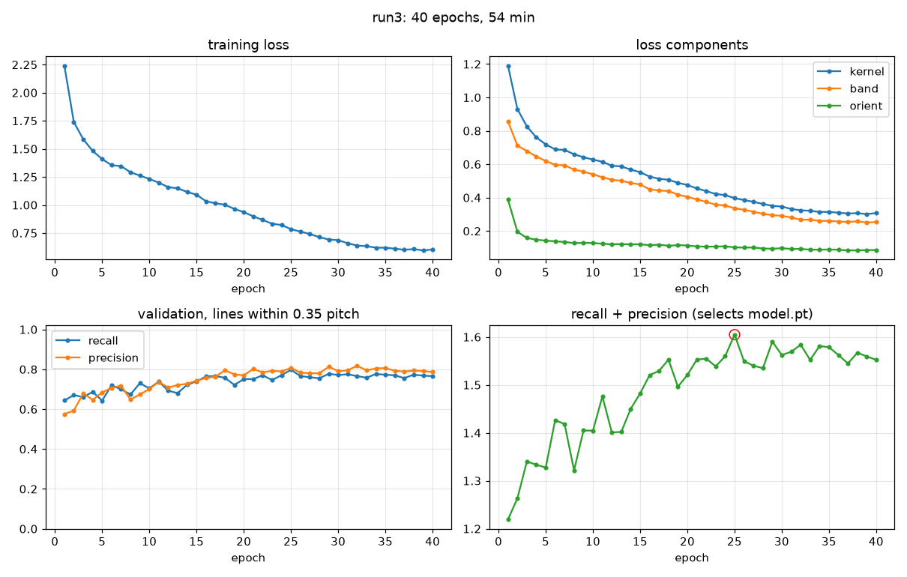

# The line model: a learned text-line finder for cuneiform tablet photographs

This report covers the line model built for the line-cropping pipeline (its Phase 7): the problem it solves, the
data and ground truth behind it, the model and how its output becomes line crops, how it is evaluated, and what it
achieves against earlier runs and against other line finders. It is written for readers who know OCR and object
detection; terms specific to the project are defined where they first appear. The work ran from late September to
mid-October 2026; the order of experiments is kept in Appendix A, and the main text is organised by topic. The rest of
the pipeline is described in `docs/line_cropping/pipeline_overview.md`, the published alternatives in
`related_work.md`, and the code is in `line_cropping/linemodel/`.

## Summary

- **What was built.** A U-Net with a ResNet-34 encoder that reads a photographed tablet face and predicts where its
  text lines are, as bands with a direction, without a transliteration or a sign detector. A read-out turns the
  bands into line segments, and the crop step cuts one image per line.
- **Data.** 490 training faces across four scripts: Old Babylonian (OB), Neo-Assyrian (NA), Neo-Babylonian (NB) and
  Old Assyrian (OA). Line truth comes from eBL sign boxes grouped by transliteration line, from hand-marked Old Assyrian
  lines, and from hand-drawn Neo-Assyrian lines published by Dencker et al. (2020).
- **Results on held-out test faces** (about 760 eBL faces; the current model, run 3):

  | | recall | precision | first line within half a pitch |
  |---|---|---|---|
  | all scripts | 0.87-0.88 | 0.87 | 79-86% |
  | Neo-Assyrian / Neo-Babylonian / Old Assyrian / Old Babylonian | 0.84-0.85 / 0.88 / 0.89 / 0.87-0.89 | 0.89-0.90 / 0.87-0.88 / 0.87-0.89 / 0.86 | 52-59% / 81% / 66-89% / 88-93% |
  | hand-drawn Neo-Assyrian lines (9 faces never trained on) | 0.96-0.98 | 0.93-0.94 | 89% |

  Ranges are the two training seeds. Recall is the share of truth lines found, precision the share of predicted lines
  that are real (section 5).
- **Progress over the three runs.** Adding eBL Old Assyrian and Neo-Babylonian data (run 2) lifted all-script recall
  from 0.81 to 0.87 and precision from 0.81 to 0.88, Old Assyrian from 0.61 to 0.92 recall. Adding hand-drawn
  Neo-Assyrian lines (run 3) raised Neo-Assyrian recall from 0.81 to 0.84-0.85 and small faces from 0.76 to 0.81, at a
  small cost on Old Assyrian and Old Babylonian; overall it ties with run 2.
- **Crops.** With the line ends set from where the predicted band fades, 95 percent of fully annotated lines sit
  whole in their crop (against 60 percent for the detector route), and no crop holds half of a neighbouring line.
- **Against other line finders.** The line model beats a rebuilt Dencker et al. line network on both test sets and
  Kraken's segmenter retrained on the same faces on precision, first-line placement and the hand-drawn lines; Kraken
  finds two lines more in a hundred on eBL. The detector route with the transliteration's line count still has the
  best eBL scores (0.91 / 0.91) but needs a transliteration (section 6.4).
- **Open problems.** Placing the first line of Neo-Assyrian fragments (52-59 percent), false lines on worn faces,
  seed-to-seed variation of several points on the smaller scripts, and line truth that is itself fitted from sign
  boxes (section 7).



*Figure 1. The three runs on the eBL test faces, per script: recall, precision and first-line placement. Run 3's bar
spans its two training seeds.*

## 1. Problem and approach

The pipeline's first line finder infers lines from detected signs: the eBL Deformable DETR detector [1] finds sign
boxes, the boxes are clustered by height into lines, and the transliteration's line count **N** reconciles the
result. On eBL photographs with a transliteration it reaches 0.91 line recall. Its two dependencies are exactly what a
new tablet lacks: without N, count agreement drops to 25 percent, and where the detector finds too few signs, as on
low-resolution photographs, the route fails. The line model predicts lines from the face image directly, so neither a
transliteration nor a sign detector is needed at line-finding time; both remain available as optional refinements.



The design was fixed before any code (section 14 of `docs/line_cropping/line_cropping_plan.md`): a face image at
1,024 pixels on the long side, three output maps painted from the existing line truth, a U-Net with a pretrained
ResNet-34 encoder, training on the tune half of the Phase 5 split only, and evaluation with the unchanged Phase 5
harness against the detector route on the same test faces.

## 2. Data and ground truth

### 2.1 Three kinds of line truth

A **face** is one inscribed side of a tablet (obverse, reverse, an edge), cut out of the museum's composite
photograph. A **truth line** is a text line's position on a face, stored as a centre line with a thickness. **Pitch**
is the median distance between consecutive lines on a face and is the unit for all tolerances.

| source | what an annotator drew | how a truth line is made | used for |
|---|---|---|---|
| eBL sign annotations (OB, NA, OA, NB) | a box around each sign, with the transliteration line it belongs to | least-squares straight segment through the centres of one line's boxes (`truth/ebl_ground_truth.py`) | training and the main test set |
| Old Assyrian Line Marker labels (CDLI photographs) | a mark at each line's height on 79 faces | horizontal segment across the face at that height, thickness 0.6 pitch | training |
| Heidelberg line annotations, Dencker et al. 2020 (NA) | each text line as a polyline from end to end, 618 lines on 50 faces | the polyline itself, as a chain of short segments | training (32 faces) and an independent test (9 faces) |

The eBL truth has two known limits. A line spans only the signs that were boxed, and annotation is partial (a median
of 86 percent of a face's lines). Only faces with **coverage**, the share of transliteration lines that have boxes, of
at least 0.9 are used, and precision is scored only on them. And a line is always straight, and occasionally wrong
where boxes of neighbouring lines were mislabelled (Figure 8, K.9654). The Heidelberg lines have neither limit, which
is why they serve as the independent check.



*Figure 2. Heidelberg line annotations (red, numbered) on three faces: every line is drawn end to end and follows its
slope; on the cracked tablet on the right a line is drawn as separate pieces either side of the crack.*

### 2.2 Training sets

Training uses only faces of the Phase 5 **tune** split; the **test** split is never trained on. New faces were added
to the split by tablet, so a tablet's obverse and reverse are always on the same side (`eval/extend_split.py`). A tenth
of the training tablets are held out as a validation slice that chooses the checkpoint.

| run | eBL OB | eBL NA | eBL OA | eBL NB | OA hand labels | Heidelberg NA | training / validation faces |
|---|---|---|---|---|---|---|---|
| run 1 | 205 | 16 | - | - | 81 | - | 302 / 38 |
| run 2 | 202 | 20 | 93 | 70 | 79 | - | 464 / 60 |
| run 3 | 208 | 21 | 86 | 68 | 81 | 26 | 490 / 66 |

Run 2's Old Assyrian and Neo-Babylonian faces come from 311 eBL tablets chosen from the eBL annotation export of
11 Sep 2026 (`data/ebl/annotations_11.09.2026/`) for having at least 50 sign boxes with a line position
(`ingest/download_ebl.py --scripts OA NB --annotations-dump`). The eBL sign data held no further usable Neo-Assyrian
tablets, which is why run 3 turned to the Heidelberg annotations (Appendix A.3, A.4).

### 2.3 Training targets

Five maps at one quarter of the input resolution, painted from the truth lines:

| channel | content | purpose |
|---|---|---|
| kernel | each line's band shrunk to 40 percent of its width | one connected region per line, so neighbours never merge |
| band | the line's band, width = min(truth thickness, 0.7 pitch) | the line's vertical extent for cropping |
| orientation, two channels | sin 2θ and cos 2θ of the line direction, inside the band | tilt and curvature without a global deskew |
| ignore | gaps between consecutive lines wider than 1.5 pitches, and one pitch beyond the first and last line of a block | pixels where an unannotated line may be carry no loss |

The band width is capped by the pitch because eBL sign boxes are as tall as the pitch itself; painted from the raw
thickness, adjacent bands merged into one mass. Hand-drawn polylines are painted segment by segment, with spacing and
ignore regions computed per line (`targets.polyline_segments`).


*Figure 3. Targets on HS.2027 reverse: green band, yellow kernel, red hatching where the loss is ignored above the
first and below the last annotated line.*


*Figure 4. The same targets on an Old Assyrian face, P358252 obverse, built from hand-marked line heights.*

## 3. Model and training



**Network.** A **ResNet-34** encoder (16 residual blocks in four stages, each halving resolution and doubling
channels), initialised from ImageNet, which gives edge and texture detectors from the start, important with a few
hundred training faces. A **U-Net** decoder upsamples back towards input resolution and at each step concatenates the
encoder's map of the same resolution through a **skip connection**, so wide context (which row is a line) and fine
position (where its edges are) are combined. The decoder stops at stride 4, enough for line positions and four times
cheaper than full resolution. The head is a 1 x 1 convolution to four channels: kernel, band, sin 2θ, cos 2θ.
24.4 million weights.

**Loss.** Binary cross-entropy plus Dice on the kernel and band maps, and an L1 error on the orientation channels
inside bands, weighted one half; ignore pixels are excluded. Dice measures region overlap as a whole and prevents the
"no line anywhere" solution that cross-entropy alone tolerates when lines are a small share of pixels.

**Training.** Random 768-pixel windows from the face resized to 1,024 pixels on its long side, centred near a line,
with scale augmentation between 0.5 and 2, rotation up to 4 degrees, brightness and contrast jitter, polarity
inversion for light-background photographs, greyscale and JPEG re-encoding; no horizontal flips, which would mirror
the script. AdamW with a one-cycle schedule, mixed precision, batch 6, 40 epochs (32 to 55 minutes on an RTX 4060).
After every epoch the model runs on the validation faces through the real read-out, and the checkpoint with the best
line recall plus precision is kept, so selection uses the measure the project cares about rather than the pixel loss.



*Figure 5. Validation recall and precision per epoch for every run; the dot marks the saved checkpoint. Validation
slices differ between runs, so the curves compare shape, not level. All runs level off after about 15 to 20 epochs.*

## 4. From maps to lines and crops

### 4.1 Read-out

The face goes through the network once. Kernel probabilities above 0.5 are split into connected components;
components under 12 pixels (at stride 4) are dropped. Every band pixel above 0.4 joins its nearest kernel component
within 1.5 kernel heights. A principal-component line through each component's band pixels gives the segment, and
twice the mean perpendicular spread its thickness. Segments more than 45 degrees off the face's median angle are
dropped (near-vertical false lines on worn faces). Segments that are side-by-side pieces of one line, at the same
height with barely overlapping horizontal ranges, are joined (`merge_fragments`; on run 1 this raised precision from
0.84 to 0.88 for one point of recall). Last, each line's ends are pushed outward while the band probability stays above
0.2 (at most three kernel heights per end) and pulled back off stretches that lie over the studio background
(Appendix A.2, Test 2).

Segments are written raw (`unet_segments/<face>.csv`) and in the pipeline's line format (`unet/<face>.csv`), so every
downstream tool and evaluator accepts them. An optional `--use-n` reconciles the line count with a transliteration as
the detector route does (method `unet_n`).


*Figure 6. Model output on YBC.5729 obverse: predicted band in green, kernel in lime, read-out segments in red.*

### 4.2 Crops

Each line becomes one image, cut from the face rotated so that its lines run horizontally (`crops/make_crops.py
--bounds segments`). A crop runs from the middle of the gap to the line above to the middle of the gap to the line
below, with half a pitch of margin beyond the line's ends. Options, each tested in Appendix A.2:

| option | effect | default |
|---|---|---|
| line ends from the fading band (`infer.py --end-thr 0.2 --clip-tablet 1`) | fewer lines cut short at the right end, fewer crops running into the background | on |
| `--rotate-per-line` | each line cut in its own frame, rotated by its own angle (within 20 degrees of the face's) | off |
| `--overlap 0.15` | neighbouring crops share 0.15 pitch of rows, never past the neighbour's band, so tall signs are not clipped | off (recommended) |
| `--trim-background` | crop ends trimmed back to the edge of the clay | off (for uses where any background is worse than a slightly cut line) |


*Figure 7. HS.2450 obverse cut in the face-wide deskewed frame (left) and each line in its own frame (right), at one
scale; the right-hand labels give each line's own angle.*

## 5. How it is evaluated

**Test sets.** (1) The eBL test split: about 760 faces with at least two truth lines, never trained on (NA 160,
NB 183, OA 90, OB 327); results are also given for **small faces**, those with fewer than 60 pixels between lines.
(2) The 9 Heidelberg test faces with hand-drawn lines (99 lines), never trained on by any run; every line on them is
drawn, so precision is valid on every face, and line ends can be checked.

**Line measures** (`eval/evaluate_lines.py`, `eval/evaluate_heidelberg.py`). A predicted line matches a truth line when
their centre heights differ by less than 0.35 pitch, one prediction per truth line. **Recall** is the share of truth
lines matched; **precision** the share of predicted lines matched, on faces with coverage of at least 0.9 only;
**first line** the share of faces whose top predicted line is within half a pitch of truth line 1; **count match** the
share of faces where the number of lines equals the transliteration's.

**Crop measures** (`eval/evaluate_crops.py`, `eval/crop_width.py`). **Kept whole on clay**: share of fully annotated
lines (at least five signs) whose part on the clay lies at least 95 percent inside their crop. **Past the clay**: how
far a crop runs beyond the tablet into the background. **Neighbour intrusion**: share of another line's band inside a
crop; half or more is the "half of the neighbouring line" failure.

**Variation.** Retraining with a different seed moves per-script recall or precision by up to three points and
first-line placement on the smaller scripts by up to twelve (Old Assyrian: 23). Differences smaller than that are not
treated as real.

## 6. Results

### 6.1 The three runs compared

| eBL test faces | run 1 | run 2 | run 3, seed 0 | run 3, seed 1 |
|---|---|---|---|---|
| all: recall / precision | 0.81 / 0.81 | 0.87 / 0.88 | 0.87 / 0.87 | 0.88 / 0.87 |
| all: first line within 0.5 pitch | 76% | 84% | 86% | 79% |
| Neo-Assyrian: recall / precision, first line | 0.82 / 0.91, 49% | 0.81 / 0.92, 50% | 0.85 / 0.89, 59% | 0.84 / 0.90, 52% |
| Neo-Babylonian: recall / precision, first line | 0.79 / 0.83, 65% | 0.85 / 0.85, 82% | 0.88 / 0.87, 81% | 0.88 / 0.88, 81% |
| Old Assyrian: recall / precision, first line | 0.61 / 0.60, 73% | 0.92 / 0.91, 89% | 0.89 / 0.89, 89% | 0.89 / 0.87, 66% |
| Old Babylonian: recall / precision, first line | 0.87 / 0.87, 88% | 0.89 / 0.88, 91% | 0.87 / 0.86, 93% | 0.89 / 0.86, 88% |
| small faces: recall / precision | 0.71 / 0.70 | 0.76 / 0.70 | 0.81 / 0.76 | 0.81 / 0.72 |
| Heidelberg test: recall / precision | | 0.95 / 0.90 | 0.98 / 0.94 | 0.96 / 0.93 |
| Heidelberg test: line count right, overshoot past the drawn ends | | 11%, 0.6 pitch | 56%, 0.5 | 44%, 0.5 |

All rows use the same read-out and the same test faces (run 1 was not scored on Heidelberg).



*Figure 8. Three test faces drawn at random, read by each run (green = truth line, red = prediction). NBC.1741 shows
the Old Assyrian jump from run 1 (recall 0.10) to runs 2 and 3 (1.00). K.9654 shows a flaw of the eBL truth: two green
truth lines cross where sign boxes of neighbouring lines were assigned to the wrong line; all three runs read the
face correctly and lose the point to the truth.*

- **Run 2 is the large step.** Old Assyrian goes from the worst script to one of the best: run 1's hand-labelled CDLI
  Old Assyrian faces did not carry over to eBL's Old Assyrian photographs; the eBL truth did. Neo-Babylonian gains six
  points of recall, and Old Babylonian, the script with most data, gains rather than losing.
- **Run 3 moves accuracy between scripts rather than adding to it.** It gains on Neo-Assyrian (recall 0.81 to
  0.84-0.85), Neo-Babylonian, small faces and the hand-drawn lines (count right 11 to 44-56 percent, lines stopping
  closer to their real ends), and loses about three points of Old Assyrian recall and two of Old Babylonian
  precision; overall it ties with run 2.
- **First-line placement on Neo-Assyrian stays the weakest result** (49 to 59 percent across runs): the eBL
  Neo-Assyrian test faces are mostly broken British Museum fragments whose first surviving line is often damaged.

### 6.2 Against hand-drawn lines

On the Heidelberg faces the model does better than against the eBL truth for the same script: run 2, which never saw a
Heidelberg face, finds 95 lines in 100 at 0.90 precision, against 0.81 / 0.92 on eBL Neo-Assyrian. The sets differ
(State Archives letters photographed for CDLI against mostly K. fragments), so this does not prove the eBL truth is at
fault, but it shows that the Neo-Assyrian weakness is not an inability to see Neo-Assyrian lines. Predicted lines
cover the whole drawn line on 91 to 94 percent of lines and are never short at either end; they run on past the drawn
ends by about half a pitch with run 3 (0.6 with run 2). The annotators stopped at about the centre of the first and
last sign, which accounts for roughly half a sign; the rest is the model carrying lines onto the edge of the clay.
Details in Appendix A.4.

### 6.3 Crop quality

| crops on the eBL test faces (NA and OB, the faces all crop sets cover) | detector route (`det_n`) | line model run 1 | run 1 + line ends from the band | line model run 2 |
|---|---|---|---|---|
| fully annotated lines kept whole on clay | 60% | 78% | 83% | **95%** |
| median cut at the right end | 0.38 pitch | 0.20 | 0.11 | 0.00 |
| crops at least 1 pitch past the clay | 2% | 3% | 1.5% | 4% |
| line centre in exactly one crop | 99% | 96% | 96% | 98% |
| crops holding half of a neighbouring line | | 0% | 0% | 0% |

The crops were first thought too wide; measured against fully annotated lines they were not (extra width median 1
percent). The real problems were the opposite, lines cut short at the right end, and a few crops running into the
background. Setting line ends from where the band fades fixed the first and halved the second (Appendix A.2, Tests 1
and 2). Run 2's lines reach further, so almost every line is now whole, at a little more overhang, which
`--trim-background` removes where it matters. Letting neighbouring crops share 0.15 pitch of rows more than doubles
the share of lines whose whole band lies inside one crop (4 to 10 percent; the measure counts residual slant as
height, so it stays low) without any crop taking half a neighbour (Test 4).

### 6.4 Compared with other line finders

| line finder (eBL test faces) | needs a transliteration | recall | precision | first line within 0.5 pitch | Heidelberg test recall / precision |
|---|---|---|---|---|---|
| detector route with the line count (`det_n`) | yes | 0.91 | 0.91 | 90% | |
| **line model, run 3** | no | 0.87-0.88 | 0.87 | 79-86% | 0.96-0.98 / 0.93-0.94 |
| Kraken segmenter, retrained on the same 490 faces, pieces joined | no | 0.89 | 0.81 | 80% | 0.88 / 0.86 |
| Dencker et al. line network, rebuilt and retrained | no | 0.85 | 0.78 | 74% | 0.83 / 0.72 |



*Figure 9. The line model, Kraken and the Dencker network on the same test faces, per script and on the hand-drawn
Heidelberg lines.*

Among models that need no transliteration, the line model has the best precision and first-line placement and the
best scores on the hand-drawn lines, and is about forty times faster than Kraken (0.17 against 6.8 seconds per face);
Kraken finds two more lines in a hundred on eBL. The detector route remains ahead on eBL when a transliteration is
available, at the cost of needing it and a sign detector that works on the photograph. The comparison, the side-by-side
examples and the literature search are in `related_work.md`.

## 7. Limitations and next steps

- **First line of Neo-Assyrian fragments** (52-59 percent). More intact Neo-Assyrian lines (run 3) did not fix it.
  Next: a per-face check of the top line against the tablet edge, or hand-labelled Neo-Assyrian fragments.
- **Worn faces.** Cracks and edge texture can be read as lines (Figure 10). The angle guard removes near-vertical ones;
  slanted ones remain (HS.2052 in `related_work.md`, Figure 2). A per-face confidence score would flag such faces.
- **Seed variation.** Several points on the smaller scripts, partly because the checkpoint is chosen on about 60
  validation faces. Next: average the predictions of several runs (run 2 is stronger on Old Assyrian and Old
  Babylonian, run 3 on Neo-Assyrian, Neo-Babylonian and small faces), which needs no training.
- **Read-out thresholds** (kernel 0.5, band 0.4, minimum area 12) were set by hand. A grid sweep on the validation
  faces, re-running only the read-out on stored maps, would tune them in minutes.
- **Truth fitted from sign boxes.** eBL lines are straight and occasionally wrong (Figure 8); the hand-drawn lines are
  the only truth without this limit and cover one script.


*Figure 10. HS.2050 obverse before the angle guard: near-vertical false segments on a worn face with a single
annotated line.*

## 8. Status and how to run

**Models.** `weights/linemodel/run2/` (used by the stored predictions and crops), `run3_full_s0/` and `run3_full_s1/`
(run 3); each holds `model.pt`, `history.csv`, `config.json` and `plots/`. **Stored outputs.**
`tablet_data/ebl_tablets/predictions/unet` and `line_crops_unet` are on run 2 (test split); `predictions/unet_n`,
`line_crops_unet_n`, `line_crops_unet_rot` and the Line Splitter app are still on run 1 (Appendix A.3). Earlier
versions are in `tablet_data/ebl_tablets/linemodel/archive/`. **Report figures** are regenerated with
`MPLBACKEND=Agg .venv/bin/python -m line_cropping.report.report_figures`.

```
python -m line_cropping.linemodel.targets --preview 12
python -m line_cropping.ingest.download_ebl --scripts OA NB --annotations-dump data/ebl/annotations_11.09.2026/annotations_11.09.2026.json
python -m line_cropping.truth.ebl_ground_truth && python -m line_cropping.faces.prepare_faces ebl && python -m line_cropping.eval.extend_split
MPLBACKEND=Agg .venv/bin/python -m line_cropping.linemodel.train --epochs 40 --heidelberg --out weights/linemodel/run3_full_s0
.venv/bin/python -m line_cropping.linemodel.infer --weights weights/linemodel/run3_full_s0/model.pt --faces tablet_data/ebl_tablets/faces/faces.csv --out tablet_data/ebl_tablets/predictions --split test [--use-n]
.venv/bin/python -m line_cropping.eval.evaluate_lines --faces tablet_data/ebl_tablets/faces/faces.csv --pred tablet_data/ebl_tablets/predictions
.venv/bin/python -m line_cropping.eval.evaluate_heidelberg --weights weights/linemodel/run3_full_s0/model.pt
.venv/bin/python -m line_cropping.crops.make_crops --faces tablet_data/ebl_tablets/faces/faces.csv --pred tablet_data/ebl_tablets/predictions --method unet --bounds segments --split test [--overlap 0.15] [--rotate-per-line] --out tablet_data/ebl_tablets/line_crops_unet
.venv/bin/python -m line_cropping.eval.evaluate_crops --faces tablet_data/ebl_tablets/faces/faces.csv --crops tablet_data/ebl_tablets/line_crops_unet/crops.csv --split test
.venv/bin/python -m line_cropping.report.export_tablets --zip     # 60 tablets with line crops and sign boxes, for other pipelines
```

## Appendix A. Experiment log

The experiments in the order they were run, with their full tables. Later sections supersede earlier numbers where
they differ (for example, run 1's first results below use the read-out of the time and only the NA and OB test faces
that existed then; section 6.1 scores every run with the same read-out on the full test set).

### A.1 Run 1: first results (29 Sep 2026)

Everything below is on the Phase 5 **test** split, which the model never saw. A line counts as found within 0.35 pitch of a truth centre; precision is reported only on faces with coverage of at least 0.9.

| method | recall | precision | first line within 0.5 pitch | count = N | crops: truth centre in exactly one crop | crops with an ATF label | ATF signs matched to a box / box confirmed by truth (OB) |
|---|---|---|---|---|---|---|---|
| line model, no transliteration (`unet`) | 0.85 | 0.88 | 81% | 29% | 97% | 20% | too few labelled lines |
| line model, count reconciled (`unet_n`) | 0.83 | 0.85 | 81% | 85% | 97% | 72% | 54% / 67% |
| detector route with count (`det_n`) | 0.91 | 0.91 | 90% | 85% | 99% | 73% | 53% / 66% |

By script, `unet` reaches 0.87 recall at 0.87 precision on Old Babylonian, three points behind the detector route, and 0.81 recall at 0.91 precision on Neo-Assyrian, where the first line is placed within half a pitch on only 45 percent of faces; those are the 16-face training script. Downstream the two routes are at parity: the crops are equally clean, and the transliteration-to-box alignment through the line model's crops matches the detector route's figures.


*Figure A1. The model's twelve lines (red) and the truth (green) on the original composite photograph of YBC.5729; no transliteration was used.*


*Figure A2. K.13419: the model finds twelve lines on a face whose eBL annotation covers one, which is why every score here is conditioned on coverage.*

**Files.** Per run: `weights/linemodel/<run>/{model.pt, last.pt, history.csv, config.json, plots/}`. Per inference: `tablet_data/ebl_tablets/predictions/{unet, unet_n}/<face>.csv`, `unet_segments/<face>.csv`, and rows in `faces_run.csv`; optional overlays in `unet_viz/`. Crops: `tablet_data/ebl_tablets/line_crops_unet*/` with `crops.csv` (rectangle, skew, per-line angle, ATF label). Whole-tablet overlays: `tablet_data/ebl_tablets/linemodel/prediction_overlays/`.

### A.2 Crop width and overlap tests (29 Sep - 3 Oct 2026)

Crops looked too wide by eye, so their horizontal fit is being examined one step at a time: first find what the
over-wide crops are, then change how line ends are set, then keep the resulting measures as standing metrics. Each
test below records the question, the method, the numbers and what they mean for the next step. The diagnostic is
`line_cropping/eval/crop_width.py`; its outputs are in `tablet_data/ebl_tablets/linemodel/crop_width/<test>/`.

**Measures.** For every truth line on a test face with annotation coverage of at least 0.9 whose centre falls inside
exactly one crop, the crop and the line are compared in the crop's frame. The line's true extent runs between its
outermost annotated sign centres, widened by half a sign on each side to reach the sign edges. **Inside** is the
share of that extent within the crop (1.0 means nothing is cut off); **excess** is the crop width outside the
extent, as a share of the line's width. Because annotators sometimes box only part of a line, both are also given
for **fully annotated lines**, those with at least five annotated signs. **Background overhang** needs no truth at
all: it is how far the crop runs past the edge of the clay into the studio background, in pitches.

#### Test 1: what are the over-wide crops? (29 Sep 2026)

Crops from the `unet` read-out on the test split (face-frame crops, `line_crops_unet`), 2,282 lines on 245 faces.

| measure | all lines | fully annotated lines (1,348) |
|---|---|---|
| true width inside the crop, median | 96% | 94% |
| lines keeping at least 95% of their width | 52% | 47% |
| extra width, median | 3% | 1% |
| extra width, 90th percentile | 65% | 16% |
| lines more than 50% too wide | 10% | 1% |

| background overhang, no truth needed | value |
|---|---|
| median | 0.33 pitch |
| 90th percentile | 0.75 pitch |
| lines overhanging by at least 1 pitch | 3% |

The worst tenth by extra width (229 lines, at least 65% too wide) was sorted into causes, first match wins:

| cause | lines | what it is |
|---|---|---|
| truth line barely annotated (two signs or fewer) | 116 | on inspection the crop covers the whole written line and the truth only the few signs that were boxed: the crop is right |
| runs into the background | 52 | the crop extends at least half a pitch past the clay: a real error |
| one-sided overhang | 27 | mostly partial annotation again, with some real overhang at broken edges |
| fragments merged | 23 | a line built by joining side-by-side pieces; usually right, occasionally two separate lines joined |
| wide on both sides | 11 | mixed |


*Figure A3. The two worst lines of each cause: crop in red, annotated extent of the line in green. K.1808 line 3 and
K.4063 line 4 have one annotated sign each on a fully written line, so the crop is right and the truth short.
BM.141781 line 18 runs off the tablet into the background, and YBC.4599 line 1 misses the left half of its line
along a crack: those are genuine errors.*

**What this means.** On fully annotated lines the crops are not too wide: extra width has a median of 1 percent and
exceeds half the line's width on only 1 percent of lines. Most of the apparent over-width came from comparing against
lines the annotators boxed only in part. Two genuine problems remain. The larger is the opposite of the original
concern: fewer than half of fully annotated lines keep 95 percent of their width, with the right end cut most often
(median cut 0.15 pitch against 0.03 on the left), so crops are more often slightly too narrow at one end. The smaller
is overhang into the background, at least one pitch on 3 percent of lines, part of which is simply the fixed half-pitch
margin added where a line meets the tablet edge. Step 2, setting line ends from where the predicted band actually fades
instead of the segment ends plus a fixed margin, therefore has to be judged on both counts: it should raise the share
of lines kept whole, especially at the right end, while trimming the background overhang, and not by narrowing crops
in general.

#### Test 2: line ends from the predicted band (2 Oct 2026)

**Question.** Can the crop ends be set from where the model's band actually fades, rather than from the segment's
ends plus a fixed half-pitch margin, so that fewer lines lose their right end without more crops running into the
background?

**Changes tried.** Three levers, all in the read-out or the crop step, none needing retraining:

- *Extend* (`infer.py --end-thr`): walk each end outward along the line while the mean band probability across the
  line's thickness stays above the threshold, up to three kernel heights per end. The segment's own ends come from
  the band pixels above 0.4 nearest its kernel, so a faint end of a line is often left out.
- *Clip* (`infer.py --clip-tablet 1`): pull each end back while it lies over the studio background (less than 30
  percent of the line's thickness is clay), using the same background polarity test as the face cutter.
- *Margin and trim* (`make_crops.py --margin`, `--trim-background`): the margin added beyond each end (0.5 pitch so
  far), and an option that, after adding it, trims each crop's left and right edges back to the edge of the clay.

**Measure, revised.** The first runs showed trimming apparently cutting many lines. Inspection showed a measurement
artefact: the truth extent is widened by half a sign beyond the outermost sign centres, and where writing runs onto
the tablet's rounded edge that widening lands on background (Figure A4, HS.2072 and YBC.5710). A crop that stops at
the clay was scored as cut. `crop_width.py` therefore also reports **kept whole on clay**: the share of fully
annotated lines whose part on clay lies at least 95 percent inside the crop. It is the headline measure from here on;
the old one is kept beside it.


*Figure A4. Lines that lost width after trimming to clay: crop before trimming in blue, after in red, annotated
extent in green. In HS.2072, YBC.7081, YBC.5710 and HS.2077 the green line runs past the clay, so part of the "cut"
is background that no crop should include. YBC.4603 line 3 is a genuine short read-out, not a trimming effect.*

**Method.** Sweep on the 292 tune-split faces with annotation coverage below 0.9, which the model never trained on
(612 fully annotated lines), then one run of the chosen settings on the test split. One bug surfaced on the way: the
first implementation refined ends before merging side-by-side fragments, so extended fragments overlapped and stayed
separate lines, and test precision fell from 0.88 to 0.86. Refinement now runs after the merge; the numbers below
are all from the corrected code.

| variant (tune faces) | extend | clip | margin | trim to clay | kept whole on clay | past clay >= 1 pitch | past clay, median |
|---|---|---|---|---|---|---|---|
| A, as before | - | - | 0.5 | - | 83% | 3.5% | 0.29 pitch |
| B | 0.2 | - | 0.5 | - | 88% | 5.9% | 0.36 |
| C | - | yes | 0.5 | - | 83% | 1.2% | 0.29 |
| **D, chosen** | 0.2 | yes | 0.5 | - | **88%** | **2.9%** | 0.36 |
| E | 0.2 | yes | 0.25 | - | 80% | 1.3% | 0.13 |
| F | 0.1 | yes | 0.25 | - | 85% | 1.4% | 0.17 |
| G | - | - | 0.25 | - | 72% | 1.4% | 0.07 |
| H, option | 0.2 | yes | 0.5 | yes | 82% | 0.1% | 0.00 |
| I | - | - | 0.5 | yes | 77% | 0.5% | 0.00 |

Extending alone (B) keeps five more lines in a hundred whole but doubles the large overhangs; clipping alone (C)
cuts those overhangs by two thirds and costs nothing; together (D) they keep the gain and the overhang stays at the
old level. Shrinking the margin (E, F, G) trades whole lines for overhang one for one, which is the general narrowing
Test 1 warned against. Trimming to clay (H, I) removes the overhang almost entirely, at six points of kept-whole
lines: on worn or dark faces the clay test misjudges the tablet edge and trims written clay.

**Test split** (245 faces, 1,179 fully annotated lines; the model never saw these faces):

| | before (Test 1 crops) | D: extend + clip | H: D + trim to clay |
|---|---|---|---|
| kept whole on clay | 78% | **83%** | 75% |
| kept whole, old measure | 45% | 51% | 31% |
| median cut, left / right end | 0.05 / 0.20 pitch | 0.02 / 0.11 | 0.23 / 0.31 |
| more than 50% too wide | 1.4% | 1.5% | 1.4% |
| past the clay by >= 1 pitch | 2.7% | **1.5%** | 0.2% |
| past the clay, median | 0.34 pitch | 0.39 | 0.00 |
| line recall / precision | 0.85 / 0.88 | 0.86 / 0.87 | (same lines as D) |

**What this means.** D does both things Step 2 had to do: five more lines in a hundred keep their full width, the
right-end cut nearly halves, and large overhangs into the background halve as well. It did not make crops narrower
in general; the median overhang grows slightly, because extended ends now reach the real end of the writing and the
half-pitch margin then sits beyond it. Line finding is essentially unchanged: one point of recall for one point of
precision, because extending one end of a tilted line moves its centre height, which is what line matching uses.
D is now the default in `infer.py` and in the Line Splitter app (`--end-thr 0.2 --clip-tablet 1`). H is kept as the
`make_crops.py --trim-background` option for uses where any background in a crop is worse than a slightly cut line.
The stored `predictions/unet` and `line_crops_unet*` were made before this change and are left as they are, so the
A.1 figures still describe them; rerunning inference regenerates them with the new ends.

#### Test 3: width as standing metrics (2 Oct 2026)

The width measures are now part of the regular evaluation instead of a one-off diagnostic. `crop_width.py` exposes
`measure()` (per-line rows and summary) and `headline()` (the numbers below); rerunning the refactored script on the
Test 1 crops reproduces its summary exactly.

- `evaluate_crops.py` prints a width line after its vertical metrics (`--split test` to restrict to the test faces,
  `--no-width` to skip it; it reads the face images, about 40 seconds on the test split).
- `report/compile_sample.py` adds a **Crop width** table to `samples/metrics/METRICS.md` for every crop set present,
  on the test split, and copies each summary to `metrics/crop_width_<set>.json`.
- `report/aggregate_metrics.py` records the same measures for the main crop set as `width_*` rows.

The headline measures are kept whole on clay, more than 50 percent too wide, the median cut at each end, and how far
crops run past the clay (median, and the share at one pitch or more). The current table, on the stored crop sets:

| crops (test faces, coverage >= 0.9) | lines (fully annotated) | kept whole on clay | > 50% too wide | median cut left / right | past clay, median | past clay >= 1 pitch |
|---|---|---|---|---|---|---|
| detector route (`det_n`), gap-bounded | 1,925 (1,206) | 60% | 1% | 0.20 / 0.38 pitch | 0.11 pitch | 2% |
| line model (`unet`), before Test 2 | 1,859 (1,179) | 78% | 1% | 0.05 / 0.20 | 0.34 | 3% |
| line model, per-line rotation | 1,823 (1,153) | 75% | 1% | 0.00 / 0.21 | 0.44 | 6% |
| line model, count reconciled (`unet_n`) | 1,859 (1,177) | 79% | 1% | 0.03 / 0.17 | 0.35 | 4% |
| line model with Test 2 ends (D) | 1,858 (1,179) | 83% | 2% | 0.02 / 0.11 | 0.39 | 1.5% |

The first row is new information: the detector route, whose crops end at its outermost sign boxes, keeps only 60
percent of lines whole, against 83 percent for the line model with the new ends. On horizontal fit the line model is
now clearly ahead, while it still trails the detector route on line recall and precision (A.1). Per-line
rotation overhangs more because it is measured in the face frame (see the measures above), which overstates width
for rotated crops.

#### Test 4: letting neighbouring crops overlap (3 Oct 2026)

**Question.** Each crop stops at the midpoint between its line's band and the next, so neighbouring crops share no
rows. Tall signs that reach into the gap, interlocking lines and slight residual slant are clipped at that boundary.
Can crops share a thin strip of rows without breaking the rule that no crop may hold half of a neighbouring line?

**Change.** `make_crops.py --overlap f` moves every boundary between two lines outward by f pitch in both crops (the
outer edges of the first and last line are unchanged). The move is capped at the near edge of the neighbour's
predicted band; `--overlap-into g` lets the crop reach a further g of that band's height, clamped below one half.
With g = 0 a crop takes in the gap and its own tall signs but none of the neighbour's band, so where two bands
already touch nothing moves. Works with segment, gap and midpoint bounds and with per-line rotation.

**New measure.** `evaluate_crops.py` now reports **neighbour intrusion**: for every crop, the largest share of
another line's truth band (a line whose centre lies outside the crop) that falls inside the crop's rows. At least 50
percent is the "half of the neighbouring line" failure and must stay at zero. It also gained `--max-cov`, so the
sweep can be scored on tune faces the model never trained on.

**Method.** Sweep on the 292 untrained tune faces (coverage below 0.9; 1,924 truth lines), crops from the Test 2
read-out, then one run of the chosen setting on the test split. The vertical measures to watch: the share of truth
lines whose whole band lies inside one crop (should rise), the share of line centres that fall inside two crops and
of crops holding two line centres (should stay low), and neighbour intrusion.

| overlap | into | band fully inside one crop | line centre in two crops | crops with >= 25% of a neighbour's band | half a neighbour |
|---|---|---|---|---|---|
| 0 | - | 9% | 0% | 10% | 0% |
| 0.05 | 0 | 10% | 1% | 13% | 0% |
| 0.1 | 0 | 12% | 1% | 17% | 0% |
| **0.15** | **0** | **13%** | **2%** | **18%** | **0%** |
| 0.2 | 0 | 14% | 2% | 18% | 0% |
| 0.05 | 0.25 | 11% | 1% | 15% | 0% |
| 0.1 | 0.25 | 14% | 3% | 21% | 0% |
| 0.15 | 0.25 | 20% | 4% | 27% | 0% |
| 0.2 | 0.25 | 26% | 6% | 31% | 0% |

Crops holding two line centres stayed at 2 percent everywhere except the largest setting (3 percent), no setting
took in half a neighbour, and horizontal fit did not move (88 percent of fully annotated lines kept whole on clay).

**Reading the sweep.** With the cap at the band edge (into 0) the gain levels off at 0.15 to 0.2 pitch: by then the
gap between the predicted bands is filled, and the bands nearly touch. Reaching into the neighbour's band (into
0.25) keeps raising containment, to 26 percent, but each step also puts more line centres into two crops, about one
for every three lines gained. Why a centre can land in a second crop without the cap being broken: the cap uses the
*predicted* band, and a truth line can sit a little off it. The setting chosen is the largest gain at which no more
than 2 percent of centres fall in two crops: overlap 0.15, into 0.

**Test split** (245 faces; the 0.1 / 0.25 column is a run made before the sweep and is shown for comparison only):

| | no overlap (Test 2 crops) | overlap 0.15, into 0 | overlap 0.1, into 0.25 |
|---|---|---|---|
| band fully inside one crop (faces with coverage >= 0.9) | 4% (5%) | **10% (12%)** | 11% (12%) |
| line centre in exactly one crop / in two | 96% / 0% | 95% / 1% | 95% / 2% |
| crops holding two line centres | 2% | 2% | 2% |
| neighbour intrusion: median, >= 25%, >= 50% | 4%, 11%, 0% | 11%, 25%, 0% | 12%, 27%, 0% |
| kept whole on clay (width) | 83% | 83% | 84% |
| median crop height | 113 px | 128 px | 132 px |

**What this means.** Overlap of 0.15 pitch, capped at the neighbour's band edge, more than doubles the share of lines
whose band sits whole in one crop, at the cost of one line in a hundred also having its centre in the next crop, and
never takes in half a neighbour. It matches the pre-sweep 0.1 / 0.25 setting on containment with half its
double-counted centres. Containment stays low in absolute terms because the evaluator takes each truth band's full
vertical span from both segment ends, so any slant left after deskewing makes the band taller than any horizontal
crop; per-line rotation or masked crops are the remedy for that, not more overlap. The default stays at no overlap,
so existing crop sets are reproducible; `--overlap 0.15` is the recommended setting for line-model crops, and
`--overlap-into 0.25` is there for material whose lines interlock, where some double-counted centres are acceptable.


### A.3 Run 2: Old Assyrian and Neo-Babylonian training data (3 Oct 2026)

**Why.** The first results named training data as the main lever, above all for scripts with few faces. The sign-snippet
metadata turned out to hold no new usable Neo-Assyrian or Old Babylonian tablets (every NA/OB tablet with line-labelled
snippets was already downloaded), but it and the eBL annotation export of 11 Sep 2026 (`annotations_11.09.2026.json`,
10,196 fragments, 236,000 boxes; identical to the API's boxes on the 200 downloaded tablets checked) list well-annotated
tablets in other scripts. Old Assyrian (OA) was the priority, because the CDLI Old Assyrian set has no automatic truth,
and Neo-Babylonian (NB), whose script is close to Neo-Assyrian.

**Data.** `download_ebl.py --scripts OA NB --annotations-dump annotations_11.09.2026/annotations_11.09.2026.json`
fetched the 311 tablets with at least 50 boxes carrying a line path (83 OA, 228 NB; the NB group includes tablets eBL
dates to the Persian period), reading the boxes from the export and only the photo and transliteration from the API.
The truth builder and face cutter then ran unchanged; every pre-existing row of their tables came out identical. Of
602 new faces, 377 are single-column with coverage of at least 0.9 (OA 202 from 81 tablets, median 208 px per line;
NB 175 from 96 tablets, 153 px per line). `eval/extend_split.py` appended them to the Phase 5 split without moving any
existing face, splitting by tablet so that a tablet's obverse and reverse share a side (OA 118 tune / 108 test faces,
NB 174 / 192). The NA and OB test faces are untouched, so run 1 and run 2 are directly comparable on them.

| training set | eBL OB | eBL NA | eBL OA | eBL NB | OA hand labels | total |
|---|---|---|---|---|---|---|
| run 1 (train / val) | 205 / 24 | 16 / 7 | - | - | 81 / 7 | 302 / 38 |
| run 2 (train / val) | 202 / 27 | 20 / 3 | 93 / 17 | 70 / 4 | 79 / 9 | 464 / 60 |

**Training.** Same settings as run 1 (40 epochs, batch 6, learning rate 3e-4, seed 0), 49 minutes. Validation
recall and precision level off from about epoch 17 while the training loss keeps falling; the selected checkpoint is
epoch 22 (validation recall 0.89, precision 0.79; the validation slice was redrawn over the larger set, so these are
not comparable with run 1's).


*Figure A5. run2: training loss and components, validation recall and precision per epoch, and the selection score
with the saved epoch circled.*

**Test split** (both models with the Test 2 read-out; 759 faces with at least two truth lines):

| script (faces) | run 1 recall / precision | run 2 recall / precision | first line within 0.5 pitch, run 1 → run 2 | count match, run 1 → run 2 |
|---|---|---|---|---|
| all (759) | 0.81 / 0.81 | **0.87 / 0.88** | 76% → 84% | 27% → 31% |
| OA, new (90) | 0.61 / 0.60 | **0.92 / 0.91** | 73% → 89% | 37% → 49% |
| NB, new (183) | 0.79 / 0.83 | **0.85 / 0.85** | 65% → 82% | 17% → 25% |
| OB (327) | 0.87 / 0.87 | 0.89 / 0.88 | 88% → 91% | 38% → 42% |
| NA (159) | 0.82 / 0.91 | 0.81 / 0.92 | 49% → 50% | 11% → 8% |
| fewer than 60 px per line (89) | 0.71 / 0.70 | 0.76 / 0.70 | 42% → 66% | 9% → 13% |



*Figure A6. Run 1 (gray) against run 2 (blue) on the test split: line recall, precision and first-line placement by
script, and the crop measures on the NA and OB test faces both runs cover. Each line runs from the run 1 value to the
run 2 value; the change is printed beside it.*

**What this means.**
- **Old Assyrian** goes from the worst script to one of the best: run 1 found three lines in five, run 2 more
  than nine in ten. Run 1's hand-labelled CDLI Old Assyrian faces did not carry over to eBL's Old Assyrian
  photographs; the eBL truth did.
- **Neo-Babylonian** gains six points of recall from 70 training faces, and first-line placement improves most of
  all (65 to 82 percent).
- **Old Babylonian**, the script with the most training data, did not get worse; it gained two points of recall.
  So the extra scripts help rather than compete.
- **Neo-Assyrian** is unchanged. Its training set barely changed (16 to 20 faces), and Neo-Babylonian, despite the
  related script, did not transfer. NA remains the weakest script, above all at placing the first line, where the
  model is within half a pitch on only half the faces.
- **Small faces** (under 60 px per line) gain on recall and first-line placement, but precision stays at 0.70.

Run 2 is better than run 1 on every script except NA, where it is equal, so it replaces run 1 as the line model.
The hand-labelled CDLI Old Assyrian faces cannot measure this gain: all of them are in training in both runs, so
they are not a hold-out. The A.1 figures and the stored `predictions/unet` and `line_crops_unet*` still
describe run 1.

**Moving the stored outputs to run 2**, one set at a time; run 1's versions are kept in
`tablet_data/ebl_tablets/linemodel/archive/`.

| stored set | status | check |
|---|---|---|
| `predictions/unet`, `unet_segments` (test split) | run 2, 3 Oct 2026; run 1 in `archive/run1_predictions/` | identical to the comparison above; on the same 486 NA and OB faces recall 0.853 → 0.865, precision 0.877 → 0.881 (the run 1 files predate the Test 2 read-out); 966 test faces now, against 666, because the OA and NB test faces are included |
| `line_crops_unet` (segment bounds, face frame, margin 0.5, test split) | run 2, 3 Oct 2026; run 1 in `archive/run1_line_crops_unet/` (rebuilding it from the archived run 1 predictions with these settings reproduces all 7,449 rectangles) | 10,137 crops from 963 faces. On the same NA and OB test faces: line centres in exactly one crop 96% → 98%, crops holding two line centres 2% → 2%, half a neighbour 0% → 0%; kept whole on clay 78% → **95%**, median cut at the right end 0.20 → 0.00 pitch; past the clay median 0.34 → 0.48 pitch, at least 1 pitch on 3% → 4%. Run 2's lines reach further, so the margin overhangs more (with run 1 and the Test 2 read-out the figures were 83% kept whole and 1.5% at 1 pitch or more). A third of the large overhangs come from three faces; on K.7853 reverse a diagonal broken edge makes any rectangle take in background, and K.3118 obverse is a face cut spanning obverse, edge and reverse, on which both runs fail (recall 0.00 and 0.12). `--trim-background` remains the remedy where overhang matters |
| `predictions/unet_n`, `line_crops_unet_n` | run 1 | |
| `line_crops_unet_rot` | run 1 | |
| Line Splitter app | run 1 | |

**Next.** Neo-Assyrian needs its own data. The NA tablets in the snippet metadata that have not been downloaded have
no line labels and a median of three boxes each, so that source is used up. The open options are lowering the training
coverage bar for NA only (`--min-cov 0.8` admits more NA faces at some label noise), building truth for NA tablets
from boxes without line paths by clustering them into lines (`lines/lines_from_boxes.py`), or hand-labelling NA faces
with the Line Marker page as was done for Old Assyrian.

### A.4 Independent check on hand-drawn Neo-Assyrian lines (10 Oct 2026)

**Why.** All line truth so far is built by us: eBL annotators boxed signs and recorded each sign's transliteration line,
and `ebl_ground_truth.py` fits a straight segment through each line's boxes, so a truth line spans only the signs that
were boxed and is always straight. The eBL sign dataset (Lewenstein et al. 2026, JOHD) has no line annotations of its
own; its export holds only sign boxes plus a few boxes around ruled lines (150) and around whole surfaces and columns.
Dencker et al. (2020) did draw text lines by hand: 618 lines on 50 faces of 36 Neo-Assyrian tablets from the State
Archives of Assyria, each line a polyline from end to end that follows the line's curve
(github.com/compvis/cuneiform-sign-detection-dataset, `annotations/line_annotations_{train,test}.csv`; downloaded to
`data/heidelberg/`). None of the 36 tablets is in our eBL set. The photographs are the Heidelberg images already in the
eBL OCR download; 9 faces (6 tablets) have none there and are skipped.

**Method.** `eval/evaluate_heidelberg.py` cuts each face out of its composite photograph, runs the model with the
standard read-out and scores it as `evaluate_lines.py` does (match within 0.35 pitch, one prediction per truth line,
in the frame of the truth lines' median angle). Line pieces split by a crack are merged first. Every line on these
faces is drawn, so precision is valid on every face. Because the drawn lines run end to end, it also measures how much
of each true line the matched prediction covers and how far it runs past each end. No training or tuning used these
faces.

| run 2 on hand-drawn lines | faces | lines | recall | precision | first line within 0.5 pitch | count match | line length covered: median / at least 95% | runs past the drawn ends, median left / right |
|---|---|---|---|---|---|---|---|---|
| all | 41 | 474 | 0.92 | 0.90 | 71% | 39% | 100% / 94% | 0.74 / 0.88 pitch |
| authors' test faces | 9 | 99 | 0.95 | 0.90 | 89% | 11% | 100% / 93% | 0.58 / 0.67 pitch |
| eBL Neo-Assyrian test faces, for comparison | 159 | | 0.81 | 0.92 | 50% | 8% | | |

**What this means.**
- **On Neo-Assyrian the model does better against hand-drawn lines than against our eBL truth:** recall 0.92 against
  0.81, first line 71 against 50 percent, at the same precision. The two sets are different tablets and photographs
  (Heidelberg: CDLI composites of State Archives letters; eBL: mostly British Museum K. fragments), so this does not
  prove the eBL truth is at fault, but it shows the model's Neo-Assyrian weakness is not simply an inability to see
  Neo-Assyrian lines.
- **Line ends: nothing is cut short.** Predicted lines cover the whole drawn line on 94 percent of lines, with no
  shortfall at either end, so the run 2 crops do not lose the ends of lines.
- **They run on by about 0.8 pitch at each end.** The annotators stopped at about the centre of the first and last
  sign, which accounts for roughly half a sign; the rest is real: the model's lines continue to the edge of the clay
  and onto rounded edges past the last sign. This matches the slightly larger background overhang of the run 2 crops.
- **The weak faces are dense or tiny:** VAT08803 obverse (36 lines, recall 0.61) and P335608 (37 tightly packed
  lines, 0.76), and small fragments with five or six lines where one miss costs 17 to 20 points.

**Next.** These 41 faces (32 from the authors' training set) are the first Neo-Assyrian truth not built by us. Adding
the 32 training faces to a run 3, with polylines rendered as chains of short segments and the 9 test faces held out,
would more than double Neo-Assyrian's 20 training faces. The face crops are already written to
`tablet_data/heidelberg/faces/`.

### A.5 Run 3: adding the hand-drawn Neo-Assyrian lines (10-11 Oct 2026)

**Data.** Run 2's data plus the 32 Heidelberg faces from the authors' train split (27 train, 5 validation in our
tablet-level slice); their 9 test faces stay out. Each hand-drawn polyline is painted as a chain of short segments
(`targets.polyline_segments`, thickness 0.6 pitch as for the Old Assyrian labels), with line spacing and ignore regions
computed per chain; all 513 existing training faces render identical targets to before. Note that `faces.csv` was
reduced on 7 Oct 2026 by 102 faces (99 Neo-Babylonian, 3 Old Babylonian) and kept that way, so run 3 also trains on 48
fewer Neo-Babylonian tune faces than run 2 did, and the test comparison below re-scores run 2 on the same reduced set
(705 faces; Neo-Babylonian 130 instead of 183). `train.py --heidelberg`, otherwise the same settings as run 2:
491 training and 54 validation faces, 54 minutes, checkpoint from epoch 25.



*Figure A7. run3: training loss, validation recall and precision, and the selection score with the saved epoch circled.*

| eBL test faces | run 2 recall / precision | run 3 recall / precision | first line within 0.5 pitch, run 2 → run 3 | count match, run 2 → run 3 |
|---|---|---|---|---|
| all (705) | 0.87 / 0.88 | 0.89 / 0.89 | 84% → 83% | 32% → 36% |
| Neo-Assyrian (159) | 0.81 / 0.92 | **0.85** / 0.90 | 50% → 51% | 8% → 11% |
| Neo-Babylonian (130) | 0.85 / 0.87 | 0.88 / 0.87 | 82% → 79% | 28% → 35% |
| Old Assyrian (90) | 0.92 / 0.91 | 0.90 / 0.91 | 89% → 81% | 49% → 48% |
| Old Babylonian (326) | 0.89 / 0.88 | 0.90 / 0.89 | 91% → 92% | 42% → 44% |
| fewer than 60 px per line (49) | 0.70 / 0.69 | **0.82 / 0.76** | 46% → 54% | 10% → 14% |

| Heidelberg test faces (9 faces, 99 hand-drawn lines, never trained on) | run 2 | run 3 |
|---|---|---|
| recall / precision | 0.95 / 0.90 | **0.98 / 0.94** |
| line count equals the drawn count | 11% | **67%** |
| first line within 0.5 pitch | 89% | 78% (one face of nine) |
| line length covered, at least 95% | 93% | 91% |
| runs past the drawn ends, median left / right | 0.58 / 0.67 pitch | 0.44 / 0.45 pitch |

**What this means.**
- **Neo-Assyrian recall rises four points on the eBL test faces** (0.81 to 0.85) for two points of precision, from 27
  training faces of a different collection; on the held-out Heidelberg faces both recall and precision rise and the
  line count is right on six faces in nine instead of one.
- **Placing the first Neo-Assyrian line did not improve** (50 to 51 percent on eBL). Whatever makes the top line hard
  on the eBL Neo-Assyrian fragments, mostly broken K. fragments whose first surviving line is often damaged, is not
  fixed by more Neo-Assyrian lines from intact letters.
- **Lines stop closer to the real ends**: the overshoot past the drawn ends falls by about a third, the hand-drawn
  truth being the first to show the model where a line actually stops.
- **Small faces improve most** (recall 0.70 to 0.82), probably because the Heidelberg faces are small CDLI images.
- **Old Assyrian first-line placement drops eight points** (six faces of 72) and Neo-Babylonian three; with one
  training run per configuration this is within what a different validation slice and fewer Neo-Babylonian faces
  could cause, so it needs a second run before it is read as a regression.

**Second seed.** Run 3 was repeated with `--seed 1`, which changes the starting weights, the training windows and the
validation slice, to see how much of the difference from run 2 is chance:

| eBL test faces | run 2 | run 3, seed 0 | run 3, seed 1 |
|---|---|---|---|
| all: recall / precision | 0.87 / 0.88 | 0.89 / 0.89 | 0.90 / 0.88 |
| Neo-Assyrian: recall / precision | 0.81 / 0.92 | 0.85 / 0.90 | 0.88 / 0.90 |
| Neo-Assyrian: first line within 0.5 pitch | 50% | 51% | 63% |
| Neo-Babylonian: recall / precision | 0.85 / 0.87 | 0.88 / 0.87 | 0.90 / 0.90 |
| Old Assyrian: recall / precision, first line | 0.92 / 0.91, 89% | 0.90 / 0.91, 81% | 0.91 / 0.87, 85% |
| Old Babylonian: recall / precision, first line | 0.89 / 0.88, 91% | 0.90 / 0.89, 92% | 0.91 / 0.87, 91% |
| fewer than 60 px per line: recall / precision | 0.70 / 0.69 | 0.82 / 0.76 | 0.83 / 0.83 |
| Heidelberg test: recall / precision, count match | 0.95 / 0.90, 11% | 0.98 / 0.94, 67% | 0.95 / 0.92, 33% |
| Heidelberg test: runs past the drawn ends | 0.58 / 0.67 pitch | 0.44 / 0.45 | 0.37 / 0.50 |

The two seeds differ by up to three points in per-script recall or precision and by up to twelve points in
first-line placement on the smaller groups (Neo-Assyrian 49 to 51 faces, Old Assyrian 71). Differences between run 2
and run 3 smaller than that are not reliable. What holds in both seeds: **Neo-Assyrian recall** rises (0.81 to 0.85
and 0.88), **overall recall** rises two to three points, **small faces** gain twelve to thirteen points of recall,
and **lines stop closer to their real ends**. The Old Assyrian first-line drop (89 to 81 percent) shrinks to four
points with seed 1 and is within the seed spread; precision on Old Assyrian and Old Babylonian is one to four points
lower with seed 1, also within it. Neo-Assyrian first-line placement remains the weak point (51 and 63 percent).

**Data caveat.** The reduction of `faces.csv` on 7 Oct 2026 was not a deliberate selection: row 47 (BM.31033__face)
ends in typed characters (`tablet_data/ bnjm.njm.`) and the 102 rows that followed it are missing, which is what
selecting a block of the file in an editor and typing over it produces. Run 3 (both seeds) therefore trained without 48
Neo-Babylonian tune faces, and all comparisons in this section use the reduced test set. On 10 Oct 2026 the file was
regenerated with `python -m line_cropping.faces.prepare_faces ebl` (damaged copy kept as
`faces.csv.damaged_2026-10-07`): 1,969 faces again, 106 restored (103 Neo-Babylonian, 3 Old Babylonian), and every
undamaged row of the damaged copy identical in the regenerated file. Runs 3 and 3 seed 1 above were trained before the
restore.

**Final comparison on the restored data (11 Oct 2026).** Both seeds were retrained on the restored face list
(`run3_full_s0`, `run3_full_s1`; checkpoints from epochs 18 and 20 of 40) and scored with run 2 on the full test set.
These figures supersede the two tables above, which used the damaged face list.

| eBL test faces (full set) | run 2 | run 3, seed 0 | run 3, seed 1 |
|---|---|---|---|
| all (760): recall / precision | 0.87 / 0.88 | 0.87 / 0.87 | 0.88 / 0.87 |
| all: first line within 0.5 pitch | 84% | 86% | 79% |
| Neo-Assyrian (160): recall / precision | 0.81 / 0.92 | 0.85 / 0.89 | 0.84 / 0.90 |
| Neo-Assyrian: first line within 0.5 pitch | 50% | 59% | 52% |
| Neo-Babylonian (183): recall / precision | 0.85 / 0.85 | 0.88 / 0.87 | 0.88 / 0.88 |
| Old Assyrian (90): recall / precision | 0.92 / 0.91 | 0.89 / 0.89 | 0.89 / 0.87 |
| Old Assyrian: first line within 0.5 pitch | 89% | 89% | 66% |
| Old Babylonian (327): recall / precision | 0.89 / 0.88 | 0.87 / 0.86 | 0.89 / 0.86 |
| fewer than 60 px per line (89): recall / precision | 0.76 / 0.70 | 0.81 / 0.76 | 0.81 / 0.72 |
| Heidelberg test (9 faces): recall / precision | 0.95 / 0.90 | 0.98 / 0.94 | 0.96 / 0.93 |
| Heidelberg test: count match, runs past the drawn ends | 11%, 0.58 / 0.67 pitch | 56%, 0.50 / 0.54 | 44%, 0.51 / 0.54 |

**What this means.**
- **Overall, run 3 ties with run 2** (recall 0.87 to 0.88, precision 0.87 against 0.88). The hand-drawn Neo-Assyrian
  lines move accuracy between scripts rather than adding to it.
- **Gains in both seeds:** Neo-Assyrian recall (0.81 to 0.85 and 0.84) and Neo-Babylonian recall and precision (three
  points each), small faces (recall 0.76 to 0.81), and on the held-out hand-drawn faces higher precision, a right line
  count far more often and line ends closer to the real ones.
- **Costs in both seeds:** Old Assyrian recall falls three points (0.92 to 0.89) and Old Babylonian precision two
  (0.88 to 0.86); Neo-Assyrian precision falls two to three points.
- **First-line placement is too noisy to call:** the two seeds differ by 7 points on Neo-Assyrian (59 and 52 percent)
  and by 23 points on Old Assyrian (89 and 66 percent). The checkpoint is chosen on a validation slice of about 54
  faces that changes with the seed, which adds to this spread.

Run 3 is the better model for Neo-Assyrian, Neo-Babylonian and small faces and run 2 for Old Assyrian and Old
Babylonian, with no overall winner. The stored outputs (A.3, "Moving the stored outputs") stay on run 2.

## Sources

1. Wentao Che et al., *Automated sign detection across the Electronic Babylonian Library*, 2026. https://arxiv.org/abs/2606.22608 (the detector the line model is compared against)
2. Olaf Ronneberger, Philipp Fischer, Thomas Brox, *U-Net: Convolutional Networks for Biomedical Image Segmentation*, MICCAI 2015. https://arxiv.org/abs/1505.04597
3. Kaiming He, Xiangyu Zhang, Shaoqing Ren, Jian Sun, *Deep Residual Learning for Image Recognition*, CVPR 2016. https://arxiv.org/abs/1512.03385
4. Wenhai Wang et al., *Shape Robust Text Detection with Progressive Scale Expansion Network* (PSENet), CVPR 2019, and Minghui Liao et al., *Real-time Scene Text Detection with Differentiable Binarization* (DBNet), AAAI 2020: the kernel-and-band recipe the targets follow. https://arxiv.org/abs/1903.12473, https://arxiv.org/abs/1911.08947
5. Rachel Mikulinsky et al., *ProtoSnap: Prototype Alignment for Cuneiform Signs*, ICLR 2025. https://arxiv.org/abs/2502.00129
