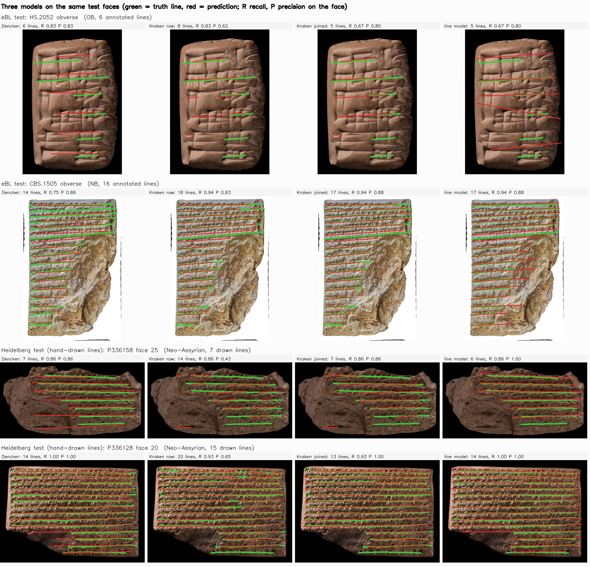

# Related work: other line finders compared with the line model

Which published or widely used models can find text lines on photographs of cuneiform tablets, and how do they
compare with our line model on the same test faces? This note reviews a supplied list of about 80 papers, datasets and
repositories (1998-2026) plus a wider web search, and reports two head-to-head comparisons: the line network of
Dencker et al. (2020), rebuilt and retrained, and Kraken's baseline segmenter, the most used trainable line segmenter in
the humanities, retrained on our training faces. The line model itself is described in `line_model.md`.

## Summary

- **Only one published model finds text lines in tablet photographs**: the line network of Dencker et al. (2020),
  trained on 410 hand-drawn Neo-Assyrian lines. Everything else detects signs or wedges (lines then have to be built
  by grouping, as our first pipeline does), works on 3D scans, or is not about segmentation (section 4).
- **General document segmenters can be retrained.** Kraken's segmenter fails on tablets out of the box (recall 0.03)
  but, retrained on our 490 training faces, becomes the strongest alternative.
- **On the eBL test faces** the line model and Kraken are close: Kraken finds two more lines in a hundred (recall 0.89
  against 0.87-0.88) and the line model has six to seven points more precision (0.87 against 0.81) and places the
  first line better (79-86 against 80 percent overall; 52-59 against 46 percent on Neo-Assyrian). **On the hand-drawn
  Neo-Assyrian lines** the line model is clearly ahead (0.96-0.98 / 0.93-0.94 against 0.88 / 0.86). The Dencker
  network trails both on precision.
- **Practicalities favour the line model:** about forty times faster than Kraken (0.17 against 6.8 seconds per face
  on the same GPU), no separate environment, and no extra step to join the side-by-side pieces into which Kraken splits
  a third of its lines.

## 1. Comparison at a glance

| line finder | trained on | eBL test (about 760 faces): recall / precision | first line within 0.5 pitch (all / Neo-Assyrian) | Heidelberg test, hand-drawn: recall / precision | seconds per face |
|---|---|---|---|---|---|
| **line model** (run 3, seeds 0 / 1) | our 490 faces | 0.87-0.88 / 0.87 | 79-86% / 52-59% | 0.96-0.98 / 0.93-0.94 | 0.17 |
| **Kraken**, retrained, line pieces joined | the same 490 faces | 0.89 / 0.81 | 80% / 46% | 0.88 / 0.86 | 6.8 |
| Kraken, retrained, raw output | the same 490 faces | 0.90 / 0.57 | 80% / 46% | 0.89 / 0.65 | 6.8 |
| Kraken, default model (no retraining) | manuscripts and print | | | 0.03 / 0.33 | |
| Dencker et al. line network, rebuilt | 32 Heidelberg faces (their recipe) | 0.85 / 0.78 | 74% / 45% | 0.83 / 0.72 | |
| detector route with the transliteration's line count (`det_n`), for reference | eBL sign boxes | 0.91 / 0.91 | 90% / | | |

*Figure 1. The line model (blue), Kraken retrained (orange) and the Dencker network (gray) on the same test faces,
per script and on the hand-drawn Heidelberg lines.*

*Figure 2. Four test faces drawn at random, each read by the three models (green = truth line, red = prediction; per
face recall R and precision P). "Kraken raw" shows its habit of returning one line as several side-by-side pieces (20
pieces for 15 lines on P336128), which "Kraken joined" merges with the line model's own rule. HS.2052 shows the line
model's typical error, two slanted false lines across a worn face; CBS.1505 shows all three handling a broken face,
the Dencker network missing the lowest lines.*

**Line model against Kraken, per script** (eBL test faces; positive = line model higher):

| | all | Neo-Assyrian | Neo-Babylonian | Old Assyrian | Old Babylonian | small faces | Heidelberg (hand-drawn) |
|---|---|---|---|---|---|---|---|
| recall | -0.02 | -0.02 | 0.00 | -0.03 | -0.02 | -0.01 | +0.10 |
| precision | +0.06 | +0.12 | +0.04 | +0.04 | +0.06 | -0.02 | +0.08 |
| first line within 0.5 pitch | +6 pts | +13 pts | +3 pts | +3 pts | +6 pts | -5 pts | 0 pts |

(run 3 seed 0 against Kraken with pieces joined.) Kraken trades precision for a little recall on every eBL script and
is slightly better on small faces' precision and first line (33 faces); the line model is ahead everywhere on the
hand-drawn lines and on Neo-Assyrian precision and first-line placement.

## 2. Head-to-head: Kraken's baseline segmenter retrained on our data (15 Oct 2026)

**Setup.** Kraken 7.1.1 (separate environment, `~/venvs/kraken`), its default segmenter (`blla.mlmodel`) fine-tuned with
`ketos segtrain` on exactly run 3 seed 0's faces (490 training, 66 validation: eBL, Old Assyrian hand labels and
Heidelberg), each truth line written as the line in PageXML (`line_cropping/baselines/kraken_seg.py export`). Augmentation
on, early stopping: 38 epochs at about 9 minutes, epoch 27 kept (Kraken's own validation line F1 0.37). Two Kraken 7.1.1
command-line bugs were worked around: the centre-line switch cannot be passed (it only changes how line polygons are
drawn, not which lines are learned), and class resizing crashes, avoided by naming our classes like the pretrained
model's. Kraken often returns one text line as several side-by-side pieces (42 of 138 predicted lines on the
Heidelberg test faces), which our scoring counts as false lines; the line model's read-out joins such pieces, so Kraken is
reported both raw and with the same join applied (`kraken_seg.py merge`, using `infer.merge_fragments`).

| Heidelberg test faces (9 faces, 99 hand-drawn lines) | recall | precision | first line within 0.5 pitch |
|---|---|---|---|
| Kraken default model, no retraining | 0.03 | 0.33 | 20% |
| Kraken retrained, raw | 0.89 | 0.65 | 89% |
| Kraken retrained, pieces joined | 0.88 | 0.86 | 89% |
| line model run 3, seeds 0 / 1 | 0.98 / 0.96 | 0.94 / 0.93 | 89% / 89% |

| eBL test faces (761) | all: recall / precision | Neo-Assyrian | Neo-Babylonian | Old Assyrian | Old Babylonian | fewer than 60 px per line | first line within 0.5 pitch (all / NA) | seconds per face |
|---|---|---|---|---|---|---|---|---|
| Kraken retrained, raw | 0.90 / 0.57 | 0.89 / 0.65 | 0.90 / 0.55 | 0.93 / 0.56 | 0.90 / 0.58 | 0.85 / 0.61 | 80% / 46% | 6.8 |
| Kraken retrained, pieces joined | 0.89 / 0.81 | 0.87 / 0.77 | 0.88 / 0.82 | 0.92 / 0.85 | 0.89 / 0.80 | 0.82 / 0.78 | 80% / 46% | |
| line model run 2 | 0.87 / 0.88 | 0.81 / 0.92 | 0.85 / 0.85 | 0.92 / 0.91 | 0.89 / 0.88 | 0.76 / 0.70 | 84% / 50% | 0.17 |
| line model run 3, seed 0 | 0.87 / 0.87 | 0.85 / 0.89 | 0.88 / 0.87 | 0.89 / 0.89 | 0.87 / 0.86 | 0.81 / 0.76 | 86% / 59% | 0.17 |

**What this means.**
- **Kraken's stock model does not work on tablet photographs** (recall 0.03): it is a manuscript and print model.
- **Retrained on the same faces, Kraken is the strongest baseline so far** and close to the line model on eBL: two
  points more recall (0.89 against 0.87), six to seven points less precision (0.81 against 0.87-0.88), once its line
  pieces are joined. Without the join its precision is 0.57.
- **The line model leads on the hand-drawn Neo-Assyrian lines** (0.96-0.98 / 0.93-0.94 against 0.88 / 0.86) and on
  placing the first line (86 against 80 percent on eBL; Neo-Assyrian 59 against 46 percent).
- **Kraken is slightly better on small faces' precision** (0.78 against 0.76) and finds a few more lines everywhere;
  its extra lines are mostly the cost of that recall.
- **The line model is about forty times faster** (0.17 against 6.8 seconds per face on the same GPU) and needs no
  separate environment.

## 3. Head-to-head: Dencker et al.'s line network against the line model (14 Oct 2026)

**Setup.** Their trained weights were unreachable, so `line_cropping/baselines/dencker_linenet.py` re-implements their
line network in current PyTorch and retrains it with their recipe: an AlexNet-style patch classifier (line or not, on
227-px grayscale patches) run fully convolutionally over a face, trained on the hand-drawn lines of the authors'
Heidelberg train faces (32 faces and 388 lines with photographs, against their 410), 101 epochs as in their notebook
(patch accuracy 0.83). Their post-processing is reproduced in simplified form: skeleton of the line map, Hough transform
restricted to near-horizontal angles, peaks thinned by non-maximum suppression, one straight line per peak. The two
read-out settings were tuned on the authors' train faces only. Two variants: **no count**, keeping every peak above a
threshold, which is the line model's setting; and **with count**, keeping as many lines as the transliteration has
(the drawn count for Heidelberg), which is their setting. Each face is rescaled so signs are about 128 px tall, as
their model expects; on eBL faces the scale comes from our truth line spacing, which gives the baseline the right
scale for free. Scoring is the line model's: `evaluate_heidelberg.py --segments` and `evaluate_lines.py`.

| Heidelberg test faces (9 faces, 99 hand-drawn lines) | recall | precision | first line within 0.5 pitch |
|---|---|---|---|
| Dencker line network, no count | 0.83 | 0.72 | 56% |
| Dencker line network, with count | 0.80 | 0.74 | 56% |
| line model run 2 (never saw Heidelberg) | 0.95 | 0.90 | 89% |
| line model run 3, seeds 0 / 1 (trained on the 32 Heidelberg train faces) | 0.98 / 0.96 | 0.94 / 0.93 | 89% / 89% |

| eBL test faces (about 755) | all: recall / precision | Neo-Assyrian | Neo-Babylonian | Old Assyrian | Old Babylonian | fewer than 60 px per line | first line within 0.5 pitch (all / NA) |
|---|---|---|---|---|---|---|---|
| Dencker, no count | 0.85 / 0.78 | 0.86 / 0.81 | 0.84 / 0.74 | 0.87 / 0.88 | 0.84 / 0.76 | 0.81 / 0.46 | 74% / 45% |
| Dencker, with transliteration count | 0.80 / 0.82 | 0.86 / 0.85 | 0.77 / 0.82 | 0.86 / 0.89 | 0.77 / 0.79 | 0.73 / 0.59 | 72% / 43% |
| line model run 2 | 0.87 / 0.88 | 0.81 / 0.92 | 0.85 / 0.85 | 0.92 / 0.91 | 0.89 / 0.88 | 0.76 / 0.70 | 84% / 50% |
| line model run 3, seed 0 | 0.87 / 0.87 | 0.85 / 0.89 | 0.88 / 0.87 | 0.89 / 0.89 | 0.87 / 0.86 | 0.81 / 0.76 | 86% / 59% |

**What this means.**
- **The line model is ahead on both test sets.** On the Heidelberg test faces, the Dencker network's home ground, the
  line model finds 12 to 18 more lines in a hundred at 16 to 22 points more precision, even run 2, which never saw a
  Heidelberg face. On the eBL test faces it leads on precision by 6 to 10 points at equal or better recall.
- **The Dencker network transfers surprisingly well in recall.** Trained on 32 Neo-Assyrian faces only, it finds 84
  to 87 percent of lines in every script without a count, and on eBL Neo-Assyrian matches run 3's recall (0.86 against
  0.85). It loses on precision: extra lines on small faces (precision 0.46 below 60 px per line) and on the Old and
  Neo-Babylonian faces.
- **The transliteration count does not help it on eBL:** keeping only as many lines as the transliteration has trades
  five points of recall for four of precision, because when the count is right the strongest Hough peaks are still
  not always the real lines.
- **Neither model places the first Neo-Assyrian line well** (Dencker 43 to 45 percent, the line model 50 to 59).

Caveats: a re-implementation retrained on 388 of their 410 lines, not their released model; a simplified version of
their post-processing (their line grouping also uses transliteration line lengths); straight lines only, by design;
and the scale handed to it from our truth.

## 4. Literature review

### 4.1 What the supplied list contains

Only one published model detects text lines in tablet photographs: the line segmentation network of **Dencker et al.
(2020)**, trained on Neo-Assyrian State Archives tablets. Everything else either detects signs or wedges (from which
lines must be built by grouping, as our first pipeline does), works on 3D scans, or is not about segmentation. The
newest large system, the eBL OCR pipeline (Che et al. 2026), groups detected signs into lines with a heuristic; that is
the route our first pipeline already uses and has already been compared (`det_n`, section 6.4 of `line_model.md`).

### 4.2 Models that could be compared directly

| work | what it finds | how | data and script | released | how it compares to ours |
|---|---|---|---|---|---|
| **Dencker, Klinkisch, Maul, Ommer 2020**, *Deep learning of cuneiform sign detection with weak supervision using transliteration alignment*, PLOS ONE 15(12): e0243039 | text lines (as a pre-step for sign detection) | a CNN labels each pixel as line or not; a straight-line Hough transform turns the map into lines | Neo-Assyrian (SAAo letters, CDLI photographs); trained on 410 hand-drawn lines | code: github.com/CompVis/cuneiform-sign-detection-code (`experiments/line_segmentation/`, Python 2.7, PyTorch 1.0, no licence stated); weights `lineNet_basic_vpub.pth` listed on cunei.iwr.uni-heidelberg.de, which did not respond on 14 Oct 2026 | Closest comparator: same idea as our band map, but one class and straight lines only, one script. Its line annotations are the Heidelberg set we now train and test on. No line detection accuracy is reported in the paper. |
| **Che, Garcés Arias, Niaz, Bender, Jiménez 2026**, *Automated sign detection across the Electronic Babylonian Library*, arXiv 2606.22608 | signs; lines by heuristic grouping of the signs | Deformable DETR sign detector (173 or 106 classes) + tablet-side extraction + heuristic line grouping | eBL, all periods; applied to 87,668 fragments | detector weights on Zenodo (17395154, used in our first pipeline) | This is our first pipeline's detector. Detector-plus-grouping is the `det_n` route in section 8 (eBL test recall 0.91, precision 0.91 with the transliteration's line count; the line model needs no transliteration). |

### 4.3 Sign or wedge detectors (lines would have to be built by grouping)

| work | detects | method | data | code / data |
|---|---|---|---|---|
| Cobanoglu, Sáenz, Khait, Jiménez 2024, *Sign detection for cuneiform tablets*, it – Information Technology (10.1515/itit-2024-0028) | signs | detection on 2D images | 315 fully annotated eBL tablets (52,102 signs) + four refined datasets, 88,536 signs | the dataset is our `data/ebl/ebl_detection_2024/` |
| Stötzner, Homburg, Mara 2023, *CNN based cuneiform sign detection learned from annotated 3D renderings and mapped photographs*, ICCVW (10.1109/ICCVW60793.2023.00183) | signs | RepPoints detector, annotations mapped between 3D renderings and photographs, illumination augmentation | HeiCuBeDa and MaiCuBeDa, about 500 tablets | datasets public (HeiCuBeDa: 10.11588/data/IE8CCN) |
| Williams et al. 2023/2025, *DeepScribe*, arXiv 2306.01268 / JOCCH | signs | RetinaNet + ResNet classifier; localisation mAP 0.78 | Persepolis Fortification Archive (Elamite, Achaemenid), 5,000+ images, 100,000 boxes | partly in our download (`deepscribe/`) |
| Poudel et al. 2026, *Zero-shot SAM2 segmentation and ViT recognition of Elamite cuneiform*, arXiv 2608.18544 | sign masks | SAM2-Large zero-shot + ViT-B/16 classifier | Persepolis tablets, 1,239 images | github.com/r11up/sam-guided-vit |
| Hamplová et al. 2024, *Cuneiform stroke recognition and vectorization in 2D images*, DHQ 18(1) | horizontal wedges | Faster R-CNN (Detecto) best: precision 74%, recall 91% | 8 Yale tablets, Old to Late Babylonian | github.com/adelajelinkova/cuneiform |
| Dencker et al. 2020 (above) | signs | SSD with MobileNet-v2, trained from transliteration alignment; 65.6 mAP | Neo-Assyrian | as above |

Our first pipeline already builds lines from a sign detector (the eBL Deformable DETR) and found it needs the
transliteration's line count to be reliable; any of these detectors would go through the same grouping and the same
limitation. SAM2 is the one general-purpose segmenter in the list and might be worth a zero-shot look, but it
segments signs, not lines.

### 4.4 Not applicable to line segmentation of photographs

- **3D scans and wedge extraction:** polynomial texture maps; 3D capture of tablets; unwrapping tablets (Anderson,
  Levoy); GigaMesh multi-scale integral invariants (Mara et al.); large-scale wedge extraction (Seiler, Mara, Bogacz
  2021); vectorisation of 3D characters; *Schriftmetrologie des Keils*; period classification of 3D tablets (Bogacz,
  Mara 2020); annotated 3D models (Homburg et al. 2022, JOAD); W3Dge 3D writing series (Zenodo 20608307); synthetic
  training data for 3D sign recognition (Bullenkamp et al., ICDAR 2026); X-ray tomography of AO 8295 (Hamburg
  14776).
- **Retrieval and spotting without segmentation:** segmentation-free word spotting (Rothacker et al. 2015);
  part-structured models (Bogacz, Howe, Mara 2016); query-by-expression retrieval (Rusakov et al. 2020); graph
  similarity and graph-based recognition (Kriege et al. 2018); generating signs with CycleGANs (Rusakov et al.
  2019). These avoid segmenting lines altogether.
- **Classification of single signs or tablets:** K-means and neural networks; intensity curves; ResNet-50 on Old
  Babylonian signs (Verwimp et al. 2025); fragmented-font CNN (Prasetiadi, Saputra 2024); style classification
  (Yugay et al. 2024); tablet dating (Chen et al. 2024); a handwritten character image set (Yamauchi et al., LREC
  2018).
- **Datasets without line geometry:** eBL transliterated tablets (Cobanoglu et al. 2023, JOHD 148: transliteration
  lines, no positions); CuneiML (Chen et al. 2023, JOHD 151: photographs, line art, face cut-outs, no line
  annotations); the eBL sign-crop dataset (Lewenstein et al. 2026, JOHD 503: sign boxes only); SumTablets (Unicode
  and transliterations).
- **Other topics:** Akkadian morphology (1998); assembling Hittite fragments (Tyndall 2012); fragment reconstruction
  (Lewis 2015 thesis); automated joining of fragments; Ithaca, Greek inscriptions (Nature 2022); OCR of printed
  transliterations (CuReD, 2024); Unicode TR56; recursive sign encoding (Stelzer 2024); iClassifier; Paleo Codage;
  surveys (Bogacz, Mara 2022; Homburg et al., CDLB 2023:4); ProtoSnap itself (arXiv 2502.00129).

### 4.5 Not checked

Blocked, unreachable or needing an account: the Heidelberg thesis (archiv.ub.uni-heidelberg.de 24537), the
Eurographics paper (diglib.eg.org), the Mara et al. papers on ResearchGate (*Automating transliteration from parallel
lines*, *From extraction to spotting*, *Automatable annotations*, *Clustering spatial n-grams*, *OCR Optical
Cuneiform Recognition*), the Iraqi and Başkent university theses and journal articles (iasj.net, uotechnology,
qu.edu.iq, dspace.baskent.edu.tr), the Fortunato/Di Ludovico and Feuerherm presentations, CDLB 2002:1, and
github.com/jerry13579/ocr (the repository and account return nothing). From their titles none promises a line
detector for photographs, but the 2017 *parallel lines* paper works on line images, and its line source could not be
confirmed.

### 4.6 Wider search (14 Oct 2026)

A web search beyond the supplied list, for cuneiform line detection and for general text-line segmenters that could
be retrained on our data.

**Cuneiform line finding found in addition:**
- **CDLI Cuneiform-OCR** (github.com/cdli-gh/Cuneiform-OCR, Google Summer of Code, last updated 2019): line detection
  with a pretrained HED edge detector, binarisation, skeletonisation, probabilistic Hough and clustering. Shown only
  qualitatively on one tablet; no training data or scores.
- **Line grouping from sign detections:** DeepScribe groups detected Elamite signs into lines with sequential RANSAC;
  the eBL pipeline (arXiv 2606.22608) with DBSCAN. Both are variants of our first pipeline's route.
- **YOLOv8 sign detectors** (Iraq Museum Assyrian tablets, about 800 to 2,000 photographs, mAP50 0.82; arXiv
  2407.06133 on tablet classification): small-scale sign detection, no line output.
- **Classical processing for Old Babylonian tablets** (multi-layered visualisations for OCR training, 2024):
  histogram equalisation, morphology and Hough transform to find sign boundaries.

**General historical-document line segmenters that could be retrained on our faces:**
- **Kraken baseline segmenter (BLLA)** (kraken.re): a maintained, installable segmenter that predicts baselines with
  start and end maps and is trained from PageXML; our truth (eBL segments, Heidelberg polylines, Old Assyrian labels)
  converts directly to baselines. Its default model is trained on manuscripts and printed pages and is reported to
  struggle with non-Latin scripts without retraining.
- **Doc-UFCN** (Teklia): small fully convolutional line detector chosen in a recent comparison for training on few
  images; best mAP (0.76) there against dhSegment and ARU-Net.
- **dhSegment** (ResNet encoder-decoder) and **ARU-Net** (attention residual U-Net, the line detector in Transkribus):
  the standard baselines in that comparison; ARU-Net tends to merge close lines.
- **Mask R-CNN** for text lines (Journal of Imaging 2024): instance segmentation that avoids the post-processing step,
  reported ahead of U-Net variants on pixel metrics.

**Inscriptions on stone** (EpiSAM, arXiv 2606.28859; patch-based Attention U-Net binarisation): character-level
segmentation or binarisation, no line models.

None of these has been applied to cuneiform tablets with a published line score. Kraken's segmenter, the most widely
used trainable line segmenter in the humanities, has since been retrained on our faces and compared (head-to-head
above).

## 5. What this means for the line model

- There is no published multi-script line detector for tablet photographs to benchmark against. The line model
  (four scripts, no transliteration needed) is already broader than anything in this list.
- Two baselines have been run against it on the same test sets: Dencker et al.'s line network, which it beats on
  both, and Kraken's segmenter retrained on the same faces, which comes close on eBL (two points more recall, six to
  seven less precision once its line pieces are joined) but trails on the hand-drawn Neo-Assyrian lines, on first-line
  placement and on speed.
- For sign-based routes, the comparison has already been made with the strongest detector available (eBL's), so
  adding other sign detectors would mostly repeat that result.
